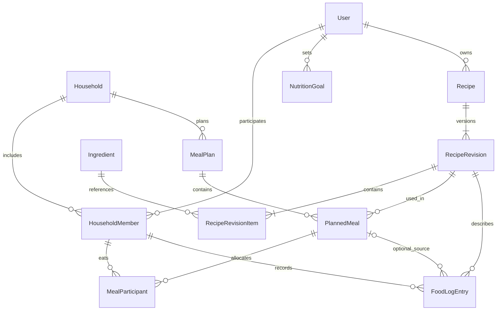

# Backend трекера питания

Создан: 1 ноября 2026 года. Обновлён: 3 ноября 2026 года.

Документ описывает целевую архитектуру backend, модель данных, связи, расчёты и API. Приложение, зависимости и миграции пока не созданы. Деплой в документ не входит.

Основа — исходное ТЗ «Дневник питания — продуктовая архитектура и ТЗ», обсуждение проекта и [архитектура frontend](../frontend/README.md). Уточнения модели относительно исходного ТЗ перечислены в разделе 3: они нужны для согласованной реализации, а не являются дословным переносом документа.

## 1. Задачи и этапы

Backend обслуживает веб-приложение на React и будущий мобильный клиент через один REST API. Он отвечает за права доступа, хранение данных, историю изменений рецептов и достоверные расчёты питания.

### Первая версия

- Пользователь и личный контекст семьи из одного участника.
- Справочник продуктов с КБЖУ.
- Создание, просмотр, редактирование и архивирование рецептов.
- План питания на конкретные даты, приёмы пищи и порции.
- Плановое КБЖУ по участнику и дню.
- Фактический дневник питания и история.
- Цели КБЖУ с периодом действия.
- API-контракты для frontend и его моков MSW.

Модель `HouseholdMember` и участников блюда закладываем сразу. Приглашения, роли совместного редактирования и семейный интерфейс развиваем следующим этапом.

### Следующие этапы

1. Семейное планирование и шаблоны недель.
2. Потребность в ингредиентах, ручные остатки и офлайн-закупка.
3. Магазины, товары, цены и сравнение стратегий покупки.
4. Подтверждаемый ввод по фото, прогнозирование, интеграции магазинов.

Исходное ТЗ включает покупки и цены уже в MVP. Для первой реализации границы сужены до базового трекера, как описано в frontend README. Будущие сущности ниже — проектирование расширений, не список таблиц, которые необходимо немедленно создать.

## 2. Технологии

### Явно выбранный стек

| Задача | Технология | Назначение |
|---|---|---|
| Язык | Python | Бизнес-логика, расчёты и интеграции |
| API | FastAPI | HTTP-маршруты, зависимости, валидация и OpenAPI |
| База данных | PostgreSQL | Связанные данные, ограничения целостности и транзакции |

### Согласованные инструменты

Весь набор ниже подтверждён пользователем 3 ноября 2026 года и дополняет Python + FastAPI + PostgreSQL.

| Задача | Инструмент | Для чего |
|---|---|---|
| Схемы API | Pydantic | Входные и выходные DTO, типы и ограничения |
| ORM и SQL | SQLAlchemy | Таблицы, запросы, связи и транзакции |
| Драйвер PostgreSQL | psycopg с async-поддержкой | Соединения с PostgreSQL через SQLAlchemy |
| Миграции | Alembic | Версионирование схемы базы |
| Запуск ASGI-приложения | Uvicorn | Локальный запуск FastAPI |
| Настройки | pydantic-settings | Типизированная конфигурация окружения |
| Окружение и зависимости | uv | Управление Python-окружением и lock-файлом |
| Форматирование и lint | Ruff | Единый стиль и поиск ошибок |
| Модульные тесты | pytest | Проверка Python-кода и бизнес-правил |
| Тестирование HTTP API | HTTPX + pytest/AnyIO | Запросы к приложению в тестовом процессе |

Vitest остаётся инструментом frontend. Для Python используем pytest, для тестирования HTTP API — HTTPX с pytest/AnyIO. Сквозные тесты с браузером не пишем; тесты серверного API с тестовой PostgreSQL относятся к интеграционным.

Для маршрутов с вводом-выводом используем `async def`, SQLAlchemy `AsyncSession` и psycopg с async-поддержкой. Одна сессия относится к одному запросу/сценарию; не используем её одновременно в нескольких задачах. Блокирующие операции и тяжёлые вычисления не выполняем непосредственно в event loop. Расчёты первой версии остаются обычными чистыми Python-функциями.

Точные совместимые версии фиксируем при инициализации проекта. Этот документ не привязывает проект к конкретным номерам релизов.

## 3. Что уточняем в исходной архитектуре

| Исходное ТЗ | Принятая модель / техническое уточнение | Причина |
|---|---|---|
| `Household → User[]` | Связь через `HouseholdMember`, не более одной активной семьи у пользователя | Выход и переход в другую семью сохраняют личные данные |
| План ссылается на изменяемый `Recipe` | Версии рецепта; автоматическое обновление сегодняшних несъеденных и последующих записей | История сохраняется, будущий план следует изменениям рецепта |
| `RecipeItem` | `RecipeRevisionItem` | Состав принадлежит конкретной версии |
| `MealPlanMeal` | `PlannedMeal` | Явно обозначает запланированную запись |
| Постоянная таблица `MealPlanDay` | В первой версии группировка по `PlannedMeal.date` в DTO | У дня пока нет собственного состояния |
| `dayOfWeek` | Календарная дата | Поддержка истории и будущих недель |
| `portionShare` | `servings` относительно `yieldServings` рецепта | Однозначное масштабирование количества |
| `repeatDays` | Отдельные записи на выбранные даты | Независимое редактирование; партия готовки — отдельный процесс |
| `MealPlan` — истина обо всём питании | `MealPlan` — план; `FoodLogEntry` — факт | Запланированное и съеденное могут отличаться |
| Сессия закупки только со статусами | Сессия хранит снимок позиций и количеств | План может измениться во время покупки |
| `StoreOffer` сразу связан с ингредиентом | При развитии интеграций добавляется `StoreProduct` | Товар магазина и абстрактный ингредиент не одно и то же |

`MealPlanDay` можно добавить позже, когда у дня появятся заметки или другие самостоятельные данные. Отсутствие отдельной таблицы не мешает отдавать frontend массив дней, в том числе пустых.

### Согласованные продуктовые правила

Решения подтверждены пользователем 3 ноября 2026 года:

1. У пользователя не более одной активной семьи. Можно выйти и присоединиться к другой, сохранив аккаунт, собственные рецепты, цели и личную историю питания.
2. Редактирование рецепта автоматически обновляет сегодняшние ещё не съеденные блюда и последующие дни во всех затронутых планах. Прошлые записи и записи, по которым уже есть факт съеденного, сохраняют старую версию. Количество порций участников остаётся прежним, даже если изменился выход рецепта.
3. В плане используем порции. Факт питания можно записать порциями или граммами готового блюда; для граммов нужен известный вес готового рецепта.
4. Сначала копируем блюдо на выбранные даты. Позже добавляем объединение нескольких записей в одну готовку, общий выход и число необходимых приготовлений.
5. План и факт разделены. Поддерживаем изменение фактически съеденного количества, пропуск и незапланированную еду. Перенос плана не меняет дневник.
6. Закупка хранит снимок списка. При изменении плана показываем уведомление; обновление сессии выполняется только явным действием пользователя.

## 4. Архитектура приложения

Модульный монолит: одно FastAPI-приложение и одна PostgreSQL. Модули разделены по предметным областям и взаимодействуют через прикладные сервисы и явно передаваемые данные.

```text
React / будущий мобильный клиент
              ↓ HTTP / JSON
        FastAPI routes
              ↓
      Прикладные сервисы
         ↙          ↘
Чистые расчёты    SQLAlchemy
                      ↓
                 PostgreSQL
```

FSD используется на frontend. На backend применяем предметные модули с разделением HTTP, сценариев, расчётов и доступа к данным.

### Модули

| Модуль | Ответственность |
|---|---|
| `auth` | Идентификация, вход, выход и текущий пользователь |
| `users` | Профиль и настройки пользователя |
| `households` | Семья, членство и роли |
| `ingredients` | Каталог продуктов и пищевые данные |
| `recipes` | Рецепты, версии и состав |
| `meal_planning` | Недельные планы, записи и участники |
| `food_diary` | Фактически съеденное и история |
| `nutrition` | Чистые расчёты, цели и суточные итоги |
| `dashboard` | Сбор данных экрана за ограниченный период |
| `pantry` — позже | Остатки и движения запасов |
| `shopping` — позже | Потребность и процесс закупки |
| `store_integrations` — позже | Каталог магазинов, предложения и адаптеры |
| `photo_recognition` — позже | Черновики результатов распознавания |

### Структура каталогов

```text
backend/
  src/
    food_tracker/
      main.py                 # Создание приложения и подключение routers
      core/
        config.py             # Конфигурация
        errors.py             # Общие ошибки и HTTP-преобразование
        security.py           # Технические примитивы авторизации
      db/
        base.py               # SQLAlchemy metadata и базовые соглашения
        session.py            # Engine и фабрика сессий
      modules/
        auth/
        users/
        households/
        ingredients/
        recipes/
          router.py           # HTTP и зависимости
          schemas.py          # Pydantic DTO
          models.py           # SQLAlchemy-модели
          service.py          # Сценарии и границы транзакций
          queries.py          # Запросы к данным при необходимости
        meal_planning/
        food_diary/
        nutrition/
          calculators.py      # Функции без HTTP и БД
        dashboard/
  migrations/                 # Alembic
  tests/
    unit/
    integration/
  pyproject.toml
  uv.lock
  README.md
```

Это целевая структура, не требование создавать все файлы заранее. Простому модулю не обязательно иметь отдельный `queries.py`. Общий repository-класс на все таблицы не вводим.

### Правила слоёв

- Router разбирает HTTP-запрос, получает текущего пользователя и вызывает сервис.
- Pydantic проверяет структуру и ограничения отдельных полей.
- Service проверяет доступ, бизнес-инварианты и управляет транзакцией.
- SQLAlchemy-модели описывают хранение, но не служат публичными DTO.
- Сложные запросы выносятся в `queries.py`, без скрытых `commit` внутри вспомогательных функций.
- Калькуляторы принимают значения и возвращают значения; они не открывают соединения и не вызывают API.
- Один модуль не импортирует router другого. Общие сценарии собираются прикладным сервисом.
- Внешние вызовы не держат открытой транзакцию PostgreSQL.

## 5. Общие соглашения данных

### Идентификаторы и именование

- Первичные ключи — UUID; принадлежность данных всё равно проверяется отдельно.
- Python-код и таблицы используют `snake_case`; JSON API — `camelCase`.
- Преобразование имён задаётся в DTO, а не выполняется компонентами frontend.
- У изменяемых объектов есть `created_at`, `updated_at`; у архивируемых — соответствующий статус/дата.
- В API поле `id` остаётся стабильным при изменении пользовательского названия.

### Даты и время

- Даты плана — PostgreSQL `date`, JSON `YYYY-MM-DD`.
- Моменты событий — `timestamptz`, API передаёт ISO 8601 с часовым смещением.
- Часовой пояс — отдельный IANA-идентификатор, например `Europe/Moscow`.
- Неделя плана начинается с понедельника в календаре семьи и содержит семь дат.
- Слово «текущий» определяется по часовому поясу и дате, а не отдельным глобальным флагом активного плана.

### Количества и пищевые значения

- В Python используем `Decimal`, в PostgreSQL — `numeric` с согласованной точностью.
- Количества положительные, КБЖУ неотрицательные; `NaN` и бесконечности недопустимы.
- Ингредиенты первой версии измеряются в граммах съедобной части.
- Отображаемые значения округляем после расчёта, не на каждом промежуточном шаге.
- Для JSON предлагается единый формат десятичных значений строками, например `"70.5"`. Это относится к граммам, порциям и КБЖУ. Формат явно описываем в Pydantic/OpenAPI и адаптерах frontend; не полагаемся на случайные настройки сериализации.
- Деньги будущего модуля закупок — целое количество минимальных денежных единиц и код валюты.

Примеры API ниже используют этот предлагаемый формат Decimal. Его нужно закрепить до реализации генерации клиента и моков.

## 6. Схема основных связей



`Recipe` не принадлежит плану: один рецепт используется много раз. `MealParticipant` относится к конкретной записи плана: в другой день у того же рецепта могут быть другие участники и порции. Запись дневника может ссылаться на план, но её фактическое количество и пищевой снимок существуют независимо.

## 7. Пользователь, семья и цели

### User

Аккаунт человека.

Основные поля: `id`, `email`, `display_name`, `timezone`, `password_hash` при парольном входе, даты создания и изменения.

Связи: исторические членства `HouseholdMember`, не более одного активного членства, собственные рецепты и периоды целей `NutritionGoal`.

Email нормализуется по принятому правилу и имеет уникальное ограничение. Пароль и его hash никогда не входят в публичный DTO.

### Household

Общий контекст планирования.

Основные поля: `id`, `name`, `timezone`, `created_by_user_id`, даты создания и изменения. Бюджет добавляется вместе с покупками.

Связи: участники, недельные планы; позже — кладовая и закупки. При регистрации можно создавать личную семью из одного участника, чтобы не поддерживать отдельную модель одиночного планирования.

### HouseholdMember

Связь пользователя с семьёй.

Основные поля: `id`, `household_id`, `user_id`, `role`, `status`, `joined_at`, `left_at`.

Предлагаемые роли: `owner`, `editor`, `viewer`. В первой версии достаточно владельца. Пара `(household_id, user_id)` уникальна; возвращение человека реактивирует членство. Уход из семьи не удаляет исторические ссылки.

Правило одной активной семьи закрепляем частичным уникальным индексом по `user_id` для активного статуса. Присоединение при уже активном членстве требует выхода/перехода, а не создания второго активного членства. Во время перехода допускается отсутствие активной семьи.

Выход завершает активное членство. Собственные рецепты, цели и личные записи дневника остаются доступны пользователю, в том числе записи, связанные с прежним членством. Для чтения собственной истории не требуется активное членство в старой семье; доступ к общему плану прежней семьи и чужим данным этим не предоставляется. Данные общей семьи автоматически в новую семью не копируются.

В модели первой версии каждый участник имеет аккаунт. Профили детей или других людей без аккаунта потребуют отдельного уточнения модели, а не создания фиктивных пользователей.

### NutritionGoal

Целевые КБЖУ пользователя на период.

Поля: `id`, `user_id`, `effective_from`, `effective_to` — исключительная верхняя граница либо `null`, `calories`, `protein_grams`, `fat_grams`, `carbs_grams`.

Для одного пользователя периоды не пересекаются. Изменение цели создаёт новый период, сохраняя прежнюю цель для истории. Сравнение фактического КБЖУ выполняется с целью на дату записи.

Если цели ещё нет, API возвращает отсутствие цели, а не нулевые нормы. Приложение не рассчитывает персональные медицинские рекомендации в первой версии.

## 8. Продукты и рецепты

### Ingredient

Продукт справочника с пищевыми значениями на 100 г.

Основные поля:

- `id`, `name`, `category`;
- `state`: состояние продукта, например сырой/приготовленный, когда это применимо;
- `calories_per_100g`, `protein_per_100g`, `fat_per_100g`, `carbs_per_100g`;
- `source`, `source_external_id`, `source_updated_at` — происхождение данных;
- `status` для скрытия неактуальных записей без потери ссылок.

Сухой рис и приготовленный рис — разные записи. Совпадение названий не делает продукты взаимозаменяемыми. Источник и разрешённое использование данных справочника нужно определить до его наполнения.

В первой версии пользователь выбирает продукт из подготовленного каталога. Пользовательские продукты, штрихкоды и фасованные брендовые товары — отдельное расширение.

### Recipe

Постоянная идентичность рецепта и правила доступа.

Поля: `id`, `owner_user_id`, `visibility`, `shared_household_id` при семейной видимости, `current_revision_id`, `archived_at`, даты создания и изменения.

Предлагаемая видимость:

- `private` — доступ владельцу, используется в первой версии;
- `household` — доступ указанной семье, следующий этап;
- `public` — доступный каталог, отдельное последующее решение.

Нельзя добавить недоступный рецепт в план, доступный другим участникам, и тем самым раскрыть его состав. Для семейного плана рецепт должен иметь соответствующие права доступа. Модель сохранения исторического доступа при изменении видимости требует отдельного правила перед запуском sharing.

### RecipeRevision

Неизменяемая версия рецепта.

Поля: `id`, `recipe_id`, `number`, `title`, `instructions`, `yield_servings`, необязательный `cooked_weight_grams`, `source_type`, `created_by_user_id`, `created_at`.

Пара `(recipe_id, number)` уникальна. Ссылка `current_revision_id` должна указывать на версию того же рецепта. Создание рецепта, первой версии и её состава выполняется одной транзакцией.

Редактирование создаёт новую версию и меняет указатель текущей версии. Старые версии не перезаписываются. Будущие записи плана обновляются автоматически по правилам ниже; записи дневника сохраняют версию и значения на момент еды.

### Автоматическое обновление расписания после редактирования рецепта

При сохранении новой версии находим записи этого рецепта во всех затронутых календарных планах, включая будущие недели. Дату «сегодня» определяем по часовому поясу семьи каждого плана на момент операции.

- Даты до сегодняшней не обновляются, даже если факт съеденного не был записан.
- Сегодняшние и последующие даты обновляются, если запись не удалена и по ней ещё нет ни одной записи `FoodLogEntry`.
- Если хотя бы один участник уже отметил общее блюдо как съеденное, версия всей этой записи плана сохраняется. Остальные участники при этой записи используют прежний рецепт.
- Уже существующие записи дневника, их фактические порции, граммы и КБЖУ не меняются.
- У обновляемого блюда сохраняются дата, тип приёма пищи, участники, их включённость и количество порций. Обновляются ссылка на версию, состав и производные расчёты.
- Количество порций сохраняется численно: если человек планировал 1 порцию, она остаётся 1 порцией новой версии, даже при изменении выхода рецепта с 2 до 4 порций. КБЖУ новой порции может измениться.
- Revision каждого затронутого плана увеличивается. Плановые итоги и будущая потребность пересчитываются по новой версии; начатые сессии покупки сохраняют свой снимок.

Это автоматическое правило сохранения рецепта; отдельное подтверждение обновления будущего меню не требуется. Ответ API содержит ID и новые revision изменённых планов для обновления клиентского кеша. При совместном использовании рецепта проверки доступа и сценарий распространения изменений выполняются сервером, без доверия присланному клиентом списку планов.

Итоговое КБЖУ версии можно сохранить как вычисленный результат для чтения. Его источник — зафиксированный состав; независимое ручное редактирование итогов не допускается.

### RecipeRevisionItem

Строка состава версии.

Поля: `id`, `recipe_revision_id`, `ingredient_id`, `quantity_grams`, `position` и пищевой снимок продукта на момент создания версии.

Снимок содержит название, состояние, КБЖУ на 100 г и происхождение использованных данных. Значения выбирает сервер из справочника, а не принимает на веру от клиента.

Это важно: одной ссылки на версию рецепта недостаточно, если её ингредиенты продолжают читать изменяемые пищевые значения из справочника. Исторические расчёты используют снимки.

Одинаковый ингредиент может встречаться в нескольких строках рецепта, например для основы и соуса. При расчёте потребности его количества агрегируются.

### Выход готового блюда

`yield_servings` обязателен и больше нуля. `cooked_weight_grams` необязателен и, если задан, тоже больше нуля.

Состав задаёт входные граммовки. Масса после приготовления может отличаться. Без веса готового блюда показываем КБЖУ на порцию; запись готового блюда в граммах требует этого веса. Учёт потерь пищевых веществ при приготовлении в первую версию не входит.

Архивирование рецепта скрывает его из обычного выбора, но сохраняет версии для уже существующих записей.

## 9. План питания

### MealPlan

Недельный план семьи.

Поля: `id`, `household_id`, `starts_on`, `revision`, даты создания и изменения.

Пара `(household_id, starts_on)` уникальна. В первой версии у семьи один календарный план на неделю, при этом прошлые и будущие недели сохраняются.

Несколько именованных шаблонов в будущем не конкурируют за этот ключ: они хранятся отдельно и копируются в календарный план.

`revision` увеличивается при любом изменении содержимого плана и используется для защиты от потери параллельных правок.

### PlannedMeal

Конкретное блюдо в расписании; соответствует `MealPlanMeal` исходного ТЗ.

Поля: `id`, `meal_plan_id`, `household_id`, `date`, `meal_type`, `recipe_revision_id`, `scope`, `position`, `created_by_member_id`, `deleted_at`.

- Дата принадлежит неделе плана; это проверяется сервисом.
- `meal_type`: `breakfast`, `lunch`, `dinner`, `snack`.
- В одном приёме пищи разрешено несколько записей.
- Ссылка ведёт на конкретную версию рецепта.
- Ссылка автоматически переключается при редактировании рецепта только по правилам раздела 8; прошедшая или уже съеденная запись сохраняет прежнюю версию.
- Удаление из расписания логическое: запись перестаёт участвовать в плановых расчётах, но ссылки дневника сохраняются.

`scope` определяет вид участия, а не приватность: `personal` — один включённый участник, `shared` — один или несколько. Общий план может показывать личное блюдо другим участникам. Видимость личного дневника задаётся отдельно.

### MealParticipant

Количество еды для конкретного участника конкретной записи плана.

Поля: `id`, `planned_meal_id`, `household_id`, `household_member_id`, `included`, `servings`, необязательный `skipped_at`.

Пара `(planned_meal_id, household_member_id)` уникальна. Участник принадлежит той же семье, что и план. `servings` — положительное количество порций относительно выхода рецепта; исключённая строка не участвует в расчёте, но может сохранить прежнее значение для восстановления.

Если участник исключил себя, количества остальных не меняются. Запись без включённых участников допускается как черновик и даёт нулевую потребность; frontend явно показывает этот статус.

`skipped_at` — личная отметка «Пропустил», а не изменение запланированных порций. Она не создаёт съеденные калории и не меняет `included` или `servings`. Факт «Съел» определяется связанной записью дневника; одновременно считать одно участие пропущенным и съеденным нельзя. При записи факта отметка пропуска снимается в той же транзакции. Это поле описывает отметку выполнения плана, а пищевые значения факта остаются в `FoodLogEntry`.

Переход к `personal` требует ровно одного включённого участника. Смена scope и списка участников выполняется атомарно.

### Повторение и перенос

Копирование на несколько дат создаёт отдельные `PlannedMeal` и строки участников. Даты, порции и участие у копий редактируются независимо. При изменении общего рецепта подходящие сегодняшние и последующие копии автоматически получают новую версию по правилам раздела 8. Факты съеденного и отметки пропуска не копируются.

Перенос в другую неделю затрагивает исходный и целевой планы в одной транзакции. Для них проверяются обе revision; при блокировках соблюдается стабильный порядок по ID. Перенос не меняет уже созданные записи дневника.

Приготовление общей партии на несколько дней позже описывается `CookingBatch` и распределениями этой партии. Пользователь сможет объединить несколько записей расписания в одну готовку; система рассчитает общий выход, ингредиенты и количество приготовлений. В первой версии остаётся только копирование. Поле `repeatDays` не заменяет модель партии.

## 10. Фактический дневник

### FoodLogEntry

Факт съеденного конкретным участником.

Поля: `id`, `household_member_id`, `planned_meal_id` — необязательно, `recipe_revision_id`, `consumed_at`, `local_date`, `timezone`, `meal_type`, `input_unit`, `input_quantity`, `consumed_servings`, `nutrition_snapshot`, `revision`, даты создания и изменения.

- Нажатие «Съел» создаёт запись с фактическим количеством; оно может отличаться от планового.
- Запись можно создать напрямую из рецепта, без расписания.
- `input_unit` — `servings` или `g`; `input_quantity` сохраняет введённое пользователем количество. `consumed_servings` рассчитывается сервером для унифицированных вычислений, не является вторым независимо редактируемым количеством.
- При вводе граммов нужен `cooked_weight_grams` зафиксированной версии рецепта. Без него предлагается ввод порциями, а недостоверный перевод не выполняется.
- `local_date` вычисляет сервер из `consumed_at` и выбранного часового пояса; клиент не задаёт противоречащую дату.
- Исторический день не перемещается автоматически после изменения часового пояса профиля.
- Снимок фиксирует название блюда, количество и рассчитанные КБЖУ.
- Изменение плана не меняет запись дневника.
- Исправление количества в дневнике выполняется явно, проверяет revision и обновляет снимок по той же версии рецепта.
- Пропуск блюда отмечается отдельно и не создаёт `FoodLogEntry` с нулевым количеством. Незапланированная еда создаёт обычную запись без `planned_meal_id`.

Пользователь сохраняет доступ к собственному дневнику после выхода из семьи. Без фильтра по семье API может вернуть его личную историю за период по всем историческим членствам; фильтр выбирает контекст, но не требует активного членства для чтения своих записей.

Для отметки из плана в первой версии допускается одна запись дневника на пару `(planned_meal_id, household_member_id)` с непустым `planned_meal_id`; это закрепляется частичным уникальным индексом. Повторное нажатие возвращает существующую запись, а изменение количества выполняется через её PATCH. Дополнительный незапланированный приём создаётся отдельно.

Позже можно добавить прямую запись отдельного продукта или оценку по фото. Для этого вводится явный тип источника и соответствующий снимок, без обязательного создания рецепта для каждого яблока.

### Два независимых итога дня

```text
Плановое КБЖУ = сумма PlannedMeal × порции участника
Фактическое КБЖУ = сумма снимков FoodLogEntry за local_date
```

Они не заменяют друг друга. Суточные итоги рассчитываются по одному человеку; суммарное питание всей семьи не выдаётся за индивидуальный результат.

## 11. Правила расчёта

### КБЖУ рецепта

Для каждого пищевого показателя:

```text
Показатель строки = quantity_grams / 100 × показатель продукта на 100 г
Показатель рецепта = сумма показателей строк
Показатель порции = показатель рецепта / yield_servings
```

Калории считаем по указанному значению справочника, не заменяя его автоматически формулой из белков, жиров и углеводов.

### Масштабирование плана

```text
total_servings = сумма servings включённых участников
scale = total_servings / recipe_revision.yield_servings
required_grams[ingredient] += recipe_item.quantity_grams × scale

КБЖУ участника = КБЖУ рецепта × servings участника / yield_servings
```

Пример: рецепт на две порции содержит 400 г курицы и 200 г риса. Участники планируют 1 и 1,5 порции. Масштаб равен `2.5 / 2 = 1.25`, значит потребность — 500 г курицы и 250 г риса. При отказе второго участника остаётся одна порция: 200 г курицы и 100 г риса.

### Добавление готового блюда в граммах

Если задан `cooked_weight_grams`:

```text
consumed_servings = consumed_grams / cooked_weight_grams × yield_servings
КБЖУ съеденного = КБЖУ рецепта × consumed_grams / cooked_weight_grams
```

Без веса готового блюда сервер возвращает ошибку проверки такого ввода. Переводы «штука → граммы» и «миллилитр → граммы» позже задаются для конкретного продукта, а не общим коэффициентом.

## 12. REST API первой версии

Все бизнес-маршруты имеют префикс `/api/v1`. Точный контракт реализуется Pydantic-схемами и публикуется в OpenAPI. Таблицы ниже — проект маршрутов, а не уже существующий сервер.

### Профиль и контекст

| Метод | Маршрут | Назначение |
|---|---|---|
| GET | `/users/me` | Текущий пользователь |
| PATCH | `/users/me` | Профиль и часовой пояс |
| GET | `/households` | Доступные пользователю семьи |
| GET | `/households/{householdId}` | Семья и доступные сведения об участниках |
| PATCH | `/households/{householdId}` | Название и настройки при наличии прав |
| GET | `/users/me/nutrition-goals` | Периоды целей |
| POST | `/users/me/nutrition-goals` | Установить цель с сохранением истории |

Маршруты входа и выхода добавляются вместе с выбранным механизмом авторизации; он не фиксируется как окончательно согласованный в этом документе.

### Справочник и рецепты

| Метод | Маршрут | Назначение |
|---|---|---|
| GET | `/ingredients?query=...&cursor=...&limit=...` | Поиск продуктов |
| GET | `/ingredients/{ingredientId}` | Продукт и источник КБЖУ |
| GET | `/recipes?query=...&cursor=...&limit=...` | Доступные рецепты |
| POST | `/recipes` | Создать рецепт с первой версией |
| GET | `/recipes/{recipeId}` | Текущая версия карточки |
| GET | `/recipes/{recipeId}/revisions/{revisionId}` | Конкретная доступная версия |
| PATCH | `/recipes/{recipeId}` | Создать новую версию и автоматически обновить подходящие записи плана |
| DELETE | `/recipes/{recipeId}` | Архивировать рецепт |

В PATCH отсутствующие поля сохраняются. Переданный массив `items` заменяет состав целиком; пустой состав запрещён. Передаётся ожидаемый номер текущей версии, чтобы не перезаписать параллельную правку.

Пример тела создания рецепта; UUID приведены как иллюстрация формата:

```json
{
  "title": "Курица с рисом",
  "yieldServings": "2",
  "items": [
    {
      "ingredientId": "11111111-1111-4111-8111-111111111111",
      "quantityGrams": "400"
    },
    {
      "ingredientId": "22222222-2222-4222-8222-222222222222",
      "quantityGrams": "200"
    }
  ]
}
```

КБЖУ и пищевые снимки в тело не включаются: их формирует сервер.

### План и дневник

| Метод | Маршрут | Назначение |
|---|---|---|
| GET | `/households/{householdId}/meal-plans?startsOn=...` | План выбранной недели |
| POST | `/households/{householdId}/meal-plans` | Создать пустой план на неделю |
| POST | `/meal-plans/{planId}/meals` | Добавить блюдо |
| PATCH | `/meal-plans/{planId}/meals/{mealId}` | Порции, дата внутри недели, версия рецепта или scope |
| DELETE | `/meal-plans/{planId}/meals/{mealId}` | Убрать из расписания |
| POST | `/meal-plans/{planId}/meals/{mealId}/copy` | Скопировать на выбранные даты |
| POST | `/meal-plans/{planId}/meals/{mealId}/move` | Перенести в другой план |
| PUT | `/meal-plans/{planId}/meals/{mealId}/participants/{memberId}` | Создать/изменить участие одного человека |
| PUT | `/meal-plans/{planId}/meals/{mealId}/my-skip` | Отметить свой пропуск без изменения плановых порций |
| DELETE | `/meal-plans/{planId}/meals/{mealId}/my-skip` | Снять свою отметку пропуска |
| GET | `/food-log?householdId=...&from=...&to=...` | Собственное фактическое питание за период |
| POST | `/food-log` | Записать съеденное с привязкой к плану или без неё |
| PATCH | `/food-log/{entryId}` | Исправить фактическое количество или время |
| DELETE | `/food-log/{entryId}` | Удалить ошибочную запись факта |

Участники в PATCH, если массив передан, заменяются целиком. Для изменения одного участника используется отдельный PUT; это устраняет неоднозначность исходного примера с частичным массивом.

В POST/PATCH дневника фактическое количество задаётся как `amount: { "unit": "servings", "value": "0.5" }` либо `amount: { "unit": "g", "value": "250" }`. Сервер сохраняет исходную единицу и вычисляет порции и КБЖУ по выбранной версии. Передать собственный итог КБЖУ вместо серверного расчёта нельзя.

Для изменяющих план запросов предлагаем `If-Match: "plan-12"`, где 12 — известная клиенту revision. Успешный ответ содержит новую revision. Для переноса дополнительно передаётся ожидаемая revision целевого плана. Отсутствие обязательного предусловия — `428`, устаревшая revision — `412` с кодом `PLAN_REVISION_CONFLICT`.

### Данные экрана

```text
GET /api/v1/households/{householdId}/dashboard?from=...&to=...
```

Ответ содержит семью, участников, записи плана, дневные плановые итоги и фактические итоги текущего пользователя с его целями. Период ограничиваем, например 31 днём, а не выдаём всю историю. Диапазон для этого API задаём полуоткрытым: `from` включительно, `to` исключительно.

Каталог продуктов и рецептов загружается отдельным поиском. Цены и запросы к магазинам не входят в критический путь открытия расписания.

При сборке ответа несколькими SQL-запросами нужен согласованный снимок данных: используем подходящий единый запрос или короткую read-only транзакцию с repeatable read. Возвращаем revision прочитанного плана.

## 13. Контракты, ошибки и frontend

- FastAPI публикует OpenAPI через `/openapi.json`; Swagger UI для разработки доступен через `/docs`.
- Для каждого маршрута описаны запрос, ответ и ожидаемые ошибки.
- Типы для TypeScript и RTK Query генерируются из OpenAPI; Python ORM-модели не разделяются с клиентом.
- Pydantic проверяет запросы backend; Zod проверяет пользовательский ввод frontend. Их назначение различается.
- Для неизвестных полей изменяющих DTO рекомендуем запрет вместо молчаливого игнорирования.
- Даты, Decimal и имена полей имеют один согласованный формат во всех ответах.
- У списков есть ограничение размера, стабильная сортировка и пагинация. Для cursor-сортировки используем уникальный дополнительный ключ, например `id`.

Предлагаемый единый формат ошибки:

```json
{
  "code": "PLAN_REVISION_CONFLICT",
  "message": "План изменён другим запросом",
  "details": { "currentRevision": 13 },
  "requestId": "request-identifier"
}
```

Ошибки FastAPI/Pydantic преобразуем в общий формат с массивом ошибок полей, который frontend сможет отобразить в React Hook Form. Не включаем в публичные ошибки внутренние SQL-запросы и секретные значения.

Базовые статусы: `401` — нет авторизации, `403` — нет права, `404` — ресурс недоступен/не найден по принятой политике, `409` — конфликт состояния или idempotency key, `412` — нарушено предусловие версии, `422` — неверные данные, `428` — отсутствует обязательная версия.

MSW утверждён для development frontend. Его обработчики имитируют API FastAPI по тому же контракту: успешные ответы, пустые списки, задержки и ошибки. MSW не является реализацией backend и не заменяет проверку реального API.

## 14. Транзакции и параллельные изменения

### Изменение плана

1. Проверить пользователя и доступ к семье.
2. Начать транзакцию сценария.
3. Атомарно обновить `MealPlan` с условием по ID и ожидаемой revision, увеличив её на один.
4. Если строка не обновлена, определить отсутствие ресурса/конфликт и отменить транзакцию.
5. Проверить и изменить запись блюда и участников.
6. Подтвердить транзакцию; только после этого сообщить об успехе.

Если бизнес-проверка на шаге 5 не пройдена, увеличение revision тоже откатывается. Сравнение версии в Python до независимого UPDATE не обеспечивает нужной защиты.

Другие атомарные операции: создание рецепта и версии, переключение текущей версии и обновление подходящих записей планов, изменение scope с участниками, запись факта и её снимка, изменение периода целей, переход между семьями.

При создании версии рецепта проверяем и меняем указатель текущей версии условным обновлением или блокировкой строки Recipe. Номер версии не назначается незащищённым `max(number) + 1`.

Сохранение новой версии и автоматическое переключение записей плана выполняем одной транзакцией. Блокируем затрагиваемые планы в стабильном порядке, проверяем наличие факта съеденного перед изменением, увеличиваем их revision и возвращаем результат после commit. Создание факта из плана согласуется с той же блокировкой: параллельное нажатие «Съел» не должно приводить к обновлению уже съеденной записи. До внедрения этого механизма нельзя считать проверку одного `FoodLogEntry` вне транзакции достаточной.

### Повторная отправка

Для создания записей с риском дублей предлагаем `Idempotency-Key`. Сервер сохраняет владельца ключа, операцию, hash нормализованного тела и результат в той же транзакции, что и изменение.

Повтор того же запроса возвращает прежний результат. Тот же ключ с другим телом даёт конфликт. Уникальное ограничение защищает и от одновременных повторов. Срок хранения ключей задаётся отдельной настройкой.

Для отметки «Съел» дополнительно действует уникальность записи на участника и блюдо плана. Для закупок завершение по идентификатору сессии должно само быть идемпотентным.

## 15. Ограничения базы и чтение данных

- Внешние ключи на пользователей, семьи, планы и версии рецептов.
- Составные внешние ключи там, где нужно закрепить принадлежность одной семье, например у участников блюда.
- Уникальность членства, недели плана, номера версии и участника блюда.
- Не более одного активного членства на пользователя: частичный уникальный индекс по `user_id`.
- Положительные количества и выход рецепта; допустимые значения состояний.
- Непересечение периодов NutritionGoal: ограничение диапазона в PostgreSQL либо сериализованная по пользователю транзакционная проверка.
- Исторические версии, членства и использованные записи не удаляются каскадно вместе с карточкой.

CHECK-ограничения не используются для проверки произвольных данных других таблиц. Например, принадлежность даты неделе проверяется сервисом в транзакции, а принадлежность одной семье при необходимости закрепляется составными ключами.

Начальные индексы: членство по пользователю, план по семье и началу недели, блюда по плану/дате/позиции, версии по рецепту и номеру, строки состава по версии, дневник по участнику и локальной дате.

Связанные данные загружаем явно, без N+1 и неожиданной lazy-загрузки при сериализации async-моделей. Поиск небольшого справочника можно начать с простого SQL-поиска; полнотекстовый поиск или `pg_trgm` добавлять по реальной потребности.

Alembic-миграции просматриваются перед применением. При запуске приложения не изменяем схему автоматически через создание таблиц из моделей. Тестовые данные и справочник наполняются отдельной повторяемой командой.

## 16. Авторизация и доступ

Окончательный механизм авторизации ещё не выбран. Рабочий вариант для первого веб-клиента — серверная сессия с непрозрачным случайным идентификатором, хранением сессий в PostgreSQL и cookie с `HttpOnly`, подходящим `SameSite` и `Secure` при HTTPS. Для cookie-запросов предусматриваем CSRF-защиту.

Если выбираем парольный вход, используем готовое хеширование, например Argon2 через поддерживаемую библиотеку; собственную криптографию не пишем. Проверку доступа отделяем от способа доставки учётных данных, чтобы мобильный клиент позже мог использовать согласованный token-механизм без переписывания бизнес-сервисов.

Правила доступа:

- Любой запрос работает от аутентифицированного пользователя.
- Переданный `householdId`, `memberId` или `recipeId` не является доказательством доступа.
- Членство и роль проверяются при каждом сценарии с семейными данными.
- В первой версии пользователь редактирует собственные фактические записи и цели.
- Выход из семьи не лишает доступа к собственной истории питания, целям и собственным рецептам; активное членство требуется для операций с её общим планом.
- Семейный доступ к плану не даёт автоматически доступ к чужому личному дневнику.
- Личные рецепты видит владелец; sharing появляется с отдельными правилами.
- Не фиксируем ID тестового пользователя в бизнес-логике. Локальный seed и подмена зависимости авторизации в тестах — отдельные механизмы.

## 17. Потребность, кладовая и покупки — следующие этапы

### Производные расчёты

```text
Выбранные даты MealPlan
  → версии рецептов × порции включённых участников
  → потребность в ингредиентах
  → учёт доступных запасов
  → количество к покупке
  → подбор товаров и упаковок
  → оценка стоимости
```

`MealPlan` остаётся источником плановых количеств. Список потребности не становится вторым независимо редактируемым меню. Кешировать расчёты допустимо, если известны версии входных данных.

Потребность без магазинов считается отдельно от упаковок и цен. При изменении плана следующий запрос даёт новый результат; отдельный фоновый пересчёт всех производных слоёв для первой версии не требуется.

### PantryItem и PantryMovement

`PantryItem`: `id`, `household_id`, `ingredient_id`, `quantity_grams`. На первом этапе расширения — ручной агрегированный остаток; пара семьи и ингредиента уникальна.

`PantryMovement`: поступление, расход, ручная корректировка или списание. Поля: ссылка на остаток, изменение количества, причина, время, источник операции. Когда вводим движения, остаток меняется только вместе с записью движения в одной транзакции.

Простая оценка `to_buy = max(0, required - available)` корректна только для согласованного состояния запасов. Система должна учитывать уже использованные/зарезервированные запасы и незавершённые закупки. Первый вариант можно ограничить одной активной закупкой на семью; параллельные сессии потребуют резервирования или другого явного механизма.

Нажатие «Съел» не списывает автоматически сырые ингредиенты: блюдо могло быть приготовлено заранее. Точный расход и остатки готовой еды потребуют процесса приготовления, например `CookingBatch`.

### ShoppingSession

Снимок потребности и состояние процесса покупки.

Поля: `id`, `household_id`, `meal_plan_id`, `source_plan_revision`, выбранные даты, `mode`, `strategy_type`, `status`, создатель и время начала/завершения.

Режимы: `offline`, `deeplink`, `mcp`. Первый реализуемый режим — offline. Предлагаемые статусы: `draft`, `in_progress`, `completed`, `cancelled`.

Начало сессии фиксирует позиции и количества в согласованном снимке плана и запасов. Изменение плана во время покупки не меняет сессию незаметно: показываем устаревание и предлагаем пересобрать её явно.

Это согласованное поведение: при несовпадении revision показываем уведомление «План изменился — обновить список?». Пока пользователь не подтвердил обновление, позиции, количества и отметки покупки не меняются. Автоматическое обновление меню после правки рецепта тоже делает снимок закупки устаревшим. Подтверждённое обновление не должно молча стирать уже купленные количества; интерфейс показывает разницу и сохраняет факт покупки.

### ShoppingSessionItem

Поля: собственный `id`, `shopping_session_id`, `ingredient_id`, снимок названия, требуемое количество, планируемое к покупке количество, фактически купленное количество, отметка покупки; товар, упаковки и цена — при наличии интеграции.

Позиции обновляются по собственному ID, а не по `ingredientId`: один ингредиент может покупаться разными товарами и в разных магазинах. Чекбокс сам по себе не заменяет фактическое количество.

### ShoppingStoreLeg

Часть сессии, относящаяся к одному магазину: `id`, `shopping_session_id`, `store_id`, статус, ссылка перехода и внешний идентификатор при наличии. Позиция с выбранным магазином ссылается на соответствующую часть сессии.

### Завершение

В одной транзакции проверяем состояние, фиксируем результат, создаём движения прихода по фактически купленным количествам и отмечаем сессию завершённой. Уникальность источника движения не позволяет прибавить одну покупку дважды. Повторный `complete` возвращает сохранённый результат.

Недокупленные позиции остаются явно незакрытыми в результате завершённой сессии и могут перейти в новую закупку. Повторное завершение не добавляет их в запасы.

Проект будущих маршрутов:

```text
GET   /api/v1/meal-plans/{planId}/ingredient-requirements?from=...&to=...
GET   /api/v1/meal-plans/{planId}/grocery-preview?from=...&to=...
GET   /api/v1/meal-plans/{planId}/cost-preview?from=...&to=...
POST  /api/v1/shopping-sessions
GET   /api/v1/shopping-sessions/{sessionId}
PATCH /api/v1/shopping-sessions/{sessionId}/items/{itemId}
POST  /api/v1/shopping-sessions/{sessionId}/complete
```

## 18. Магазины, цены и интеграции — следующие этапы

```text
Ingredient ← StoreProduct ← StoreOffer → Store

MealPlan → расчёт → ShoppingSession
                      ├── ShoppingSessionItem[]
                      └── ShoppingStoreLeg[] → Store
```

- `Store` — магазин/провайдер, региональные условия и правила доставки.
- `StoreProduct` — конкретный товар/SKU с названием, характеристиками и массой упаковки. Соответствие `Ingredient` может отсутствовать до проверки.
- `StoreOffer` — предложение товара в магазине: цена, валюта, наличие, регион и время актуальности.
- Сопоставление товара ингредиенту учитывает состояние, состав, единицы и допустимые замены. Оно не строится только по совпадению названия.

Для одинаковых упаковок количество можно оценить как `ceil(to_buy_grams / pack_weight_grams)`. Для весовых товаров, кратности и нескольких размеров упаковок нужны отдельные правила. Расчёт не выдаётся как точный заказ, если часть условий неизвестна.

`single_store` учитывает покрытие списка, упаковки, доставку и минимальную сумму. `smart_split` учитывает те же условия и ограничение числа магазинов. Выбор самой дешёвой позиции по отдельности не гарантирует минимум общей стоимости; начальную эвристику описываем честно.

Ответ цены содержит время актуальности, неизвестные позиции и признак полноты. Недоступность внешнего магазина не блокирует чтение рецептов и плана.

API и MCP скрываются за адаптерами. Режим доступен, только если адаптер действительно существует и настроен; наличие интеграции конкретного магазина не предполагается заранее. При недоступности возвращается `ADAPTER_UNAVAILABLE`, клиент предлагает доступный режим. Автоматически оформлять покупку вместо пользователя нельзя.

Webhooks проверяются по правилам провайдера и обрабатываются идемпотентно. Факт перехода по deeplink не считается оплатой.

## 19. Шаблоны, фото и прогнозирование — следующие этапы

- `MealPlanTemplate` хранит именованную неделю без календарных дат. Применение создаёт обычные записи плана на выбранную неделю; последующее изменение шаблона не меняет уже созданный план.
- `CookingBatch` описывает приготовленную партию и её распределение между днями. Вводится вместе с правилами остатков готовой еды.
- Несколько записей питания можно будет объединить в одну большую готовку. Планирование готовки покажет количество сеансов приготовления, их даты, суммарные порции и ингредиенты; назначения порций на дни остаются отдельными записями питания. Для объединения разных версий рецепта потребуется явное приведение к одному составу, а не простая сумма названий блюд.
- Распознавание фото создаёт черновик состава/количеств с происхождением оценки. Пользователь подтверждает его перед созданием рецепта или записи дневника.
- Фотография тарелки не обязана превращаться в точный рецепт. Допускается подтверждённая оценка фактической записи.
- Прогнозирование использует историю факта, планов и запасов. Детерминированный расчёт списка из готового плана — отдельная функция, не прогноз.
- Тяжёлую обработку, если она появится, можно вынести в фоновые задания. Система очередей и дополнительное хранилище пока не выбираются.

ИИ не управляет напрямую таблицами, правами или оформлением заказов. Результат внешнего сервиса проходит те же прикладные проверки, что и ручной ввод.

## 20. Проверка реализации

### Модульные тесты

- КБЖУ состава и масштабирование рецепта.
- Разные порции участников и исключение участника.
- Преобразование готовых граммов в порции.
- Разделение планового и фактического питания.
- Правила периодов целей и календарных дат.

### Интеграционные тесты

На отдельной PostgreSQL с применёнными миграциями, без подмены её поведения SQLite:

- создание рецепта, версии и состава одной транзакцией;
- неизменность старых значений после редактирования рецепта и справочника;
- автоматическое обновление сегодняшних несъеденных и последующих блюд во всех затронутых неделях с сохранением числа порций;
- сохранение версии общей записи, если хотя бы один участник уже отметил её съеденной;
- корректное изменение КБЖУ при смене выхода рецепта без изменения количества запланированных порций;
- единственное активное членство и доступ к личной истории после перехода в другую семью;
- ввод факта в граммах только при известном готовом весе, отметка пропуска и незапланированная еда;
- невозможность доступа к данным другой семьи;
- откат неполного изменения;
- конфликт двух запросов с одной revision;
- повторная запись факта без дубля;
- ограничения связей и периодов;
- согласованный JSON, ошибки и OpenAPI;
- позже — однократное пополнение запасов при повторном завершении закупки;
- позже — уведомление об устаревшем снимке закупки и обновление только после подтверждения.

Внешние сервисы в тестах подменяются. Реальный браузер и полные E2E-тесты не добавляются.

## 21. Порядок реализации и готовность первой версии

1. Уточнить формат API Decimal и зафиксировать совместимые версии согласованных инструментов.
2. Инициализировать FastAPI, конфигурацию, соединение с PostgreSQL и миграции.
3. Выбрать и реализовать авторизацию; создать личную семью и членство.
4. Добавить источник/seed продуктов, поиск и API-контракты.
5. Реализовать рецепты и неизменяемые версии с расчётами.
6. Реализовать недельные планы, порции, копирование и защиту от конфликтов.
7. Реализовать дневник, цели и суточные итоги.
8. Подключить реальный API к frontend после разработки с MSW.

Первая версия готова, когда пользователь может создать рецепт, добавить его на конкретную дату, изменить порции, отметить фактически съеденное порциями или граммами при известном готовом весе, пропустить блюдо, добавить незапланированную еду и получить отдельные плановые и фактические итоги. Редактирование рецепта автоматически обновляет сегодняшнее несъеденное и будущие записи, сохраняет количество порций и не меняет прошлое или уже записанный факт. Повтор запроса не создаёт дубликаты, чужие данные недоступны, миграции и релевантные тесты проходят.

## 22. Документация технологий

- [FastAPI: структура приложения](https://fastapi.tiangolo.com/tutorial/bigger-applications/)
- [FastAPI: OpenAPI и возможности](https://fastapi.tiangolo.com/features/)
- [FastAPI: async и concurrency](https://fastapi.tiangolo.com/async/)
- [Pydantic](https://docs.pydantic.dev/latest/)
- [Pydantic Settings](https://docs.pydantic.dev/latest/concepts/pydantic_settings/)
- [SQLAlchemy: AsyncSession](https://docs.sqlalchemy.org/en/20/orm/extensions/asyncio.html)
- [SQLAlchemy: psycopg](https://docs.sqlalchemy.org/en/20/dialects/postgresql.html#module-sqlalchemy.dialects.postgresql.psycopg)
- [Alembic](https://alembic.sqlalchemy.org/en/latest/)
- [Uvicorn](https://uvicorn.dev/)
- [PostgreSQL: ограничения](https://www.postgresql.org/docs/current/ddl-constraints.html)
- [PostgreSQL: изоляция транзакций](https://www.postgresql.org/docs/current/transaction-iso.html)
- [uv](https://docs.astral.sh/uv/)
- [Ruff](https://docs.astral.sh/ruff/)
- [pytest](https://docs.pytest.org/en/stable/)
- [FastAPI: тесты через HTTPX](https://fastapi.tiangolo.com/advanced/async-tests/)
