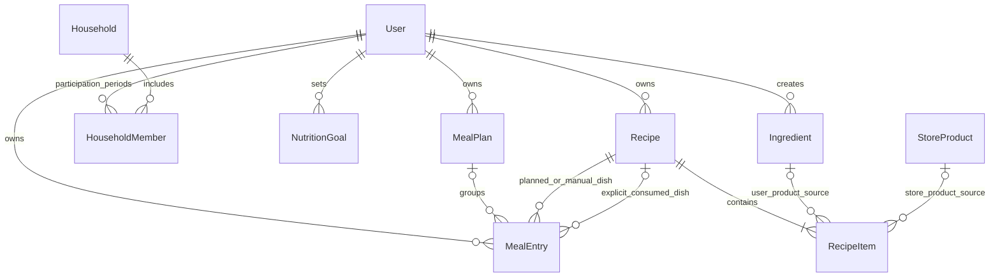

# Backend трекера питания

Создан: 1 ноября 2026 года. Обновлён: 7 ноября 2026 года.

Документ описывает целевую архитектуру, сущности, расчёты и API. Приложение, зависимости и миграции пока не созданы. Деплой в документ не входит.

Основа — исходное ТЗ «Дневник питания — продуктовая архитектура и ТЗ», последующие решения пользователя и [архитектура frontend](../frontend/README.md). Актуальная модель: личные планы, объединение в семейное расписание, неизменяемые блюда без версий, продукты пользователей и магазинов, три способа учёта съеденного.

## 1. Задачи и этапы

Backend обслуживает React-приложение и будущий мобильный клиент через один REST API. Он хранит данные, проверяет доступ и рассчитывает питание.

### Первая версия

- Аккаунт: email + пароль, подтверждение почты кодом до первого входа, восстановление пароля и JWT access/refresh-токены.
- Собственное расписание и единственная роль `USER`. Семьи и дополнительные роли в MVP не создаются.
- Продукты с КБЖУ, создаваемые пользователями; тот же сценарий для администратора с отдельной меткой происхождения — будущий этап.
- Личные продукты при создании и последующая публикация автором для всех пользователей.
- Раздельные сущности пользовательского продукта и конкретного товара магазина.
- Неизменяемые блюда с зафиксированными составом и КБЖУ; изменение сохраняется новым блюдом без версий.
- Быстрое добавление продукта через блюдо из одного ингредиента.
- Личный недельный план, даты, время, порции и порядок блюд.
- Автоматический учёт после запланированного времени, явное подтверждение и ручной ввод/корректировка факта с разными отметками.
- Сохранение явно записанного факта при переносе или изменении расписания.
- Перенос, пропуск, корректировка съеденного количества и незапланированная еда.
- Плановые и фактические итоги, цели КБЖУ с редактируемой историей.
- OpenAPI-контракты для frontend и его моков MSW.

Семью, периоды членства и семейную историю питания описываем как задел. Таблицы, API и логику семейного режима, включая приглашения, объединённый экран и права совместного редактирования, реализуем отдельным этапом. Для одиночного режима создавать семью из одного человека не требуется.

### Следующие этапы

1. Семейное расписание как объединение личных планов.
2. Шаблоны недель, потребность в ингредиентах и офлайн-закупка.
3. Кладовая, товары магазинов, цены и стратегии покупки.
4. Объединение записей питания в одну готовку.
5. Подтверждаемый ввод по фото, прогнозирование и интеграции магазинов.

Будущие сущности описаны для понимания расширений. Они не требуют создания всех таблиц в первой реализации. В MVP основа каталога — продукты пользователей с ролью `USER`; административный кабинет, загрузка полных каталогов магазинов, сопоставление и цены относятся к следующим этапам.

Упрощённую модель приготовления сохраняем: состав и готовый выход задаются явно, коэффициенты потерь и преобразований не вводятся. Сложные сценарии смены часовых поясов откладываются; базовые моменты времени и сохранённый часовой пояс остаются.

## 2. Согласованный стек

| Задача | Технология | Назначение |
|---|---|---|
| Язык | Python | Бизнес-логика и интеграции |
| API | FastAPI | HTTP-маршруты, зависимости и OpenAPI |
| База | PostgreSQL | Связанные данные, ограничения и транзакции |
| Схемы API | Pydantic | Входные и выходные DTO, типы и проверки |
| ORM и SQL | SQLAlchemy | Таблицы, связи, запросы и транзакции |
| Драйвер базы | psycopg с async-поддержкой | Соединения с PostgreSQL через SQLAlchemy |
| Миграции | Alembic | Версионирование структуры базы |
| Запуск приложения | Uvicorn | ASGI-сервер для FastAPI |
| Настройки | pydantic-settings | Типизированная конфигурация окружения |
| Окружение и зависимости | uv | Python-окружение и lock-файл |
| Форматирование и lint | Ruff | Стиль и статические проверки |
| Модульные тесты | pytest | Проверка Python-кода и расчётов |
| Тестирование HTTP API | HTTPX + pytest/AnyIO | Интеграционные тесты в процессе приложения |

Для ввода-вывода используем `async def`, SQLAlchemy `AsyncSession` и асинхронный драйвер. Одна сессия относится к одному запросу/сценарию; не разделяем её между параллельными задачами. Расчёты остаются чистыми Python-функциями. Блокирующие вызовы и тяжёлые вычисления не выполняются непосредственно в event loop.

Vitest используется во frontend. Сквозные тесты с браузером не пишем. Совместимые версии инструментов фиксируем при инициализации в lock-файле.

## 3. Ключевые продуктовые решения

1. **Расписание принадлежит человеку.** Выход и вступление в семью сохраняют его планы, блюда, цели и дневник.
2. **Семья объединяет личные расписания.** Записи не копируются при присоединении; активная семья — не более одной. Каждый возврат создаёт новый период членства с сохранением предыдущих.
3. **Сохранённое блюдо неизменяемо.** Recipe — самостоятельное блюдо с собственным ID и составом. Изменение или создание на основе сохраняет новое блюдо. Номеров версий, текущей версии и переключателя версий нет.
4. **КБЖУ фиксируется в составе блюда.** Исправление продукта пользователем или администратором не пересчитывает старые блюда, планы и историю. MealEntry ссылается на блюдо; полный состав в каждую запись не копируется.
5. **MealEntry объединяет два происхождения записи.** `scheduled` имеет план, `manual` добавляется как незапланированная еда. Способ учёта съеденного хранится/вычисляется отдельно от kind.
6. **Три отметки питания.** «Учтено автоматически», «Подтверждено пользователем», «Введено или скорректировано пользователем». Подтверждение и изменение количества сохраняются отдельно, чтобы не терять оба обстоятельства.
7. **Автоматический учёт — предположение.** После наступления времени непропущенное блюдо учитывается без обязательного действия. Перенос в будущее убирает только автоматический вклад до нового времени.
8. **Явный факт отделён от плана.** Подтверждение/ввод сохраняет фактическое время, количество и блюдо. Перенос, смена плановых порций или блюда и пропуск в расписании сами по себе не изменяют этот факт.
9. **Количество — порции или готовые граммы.** План использует порции. Граммы съеденного допустимы при известном готовом весе; для быстрого добавления одного продукта готовый вес определяется автоматически.
10. **Пользовательский каталог — основа MVP.** Продукт создаёт пользователь; будущий административный кабинет сможет использовать тот же сценарий. Метка создателя, видимость и связь с магазинным товаром — разные свойства. При создании продукт личный; автор может опубликовать его для всех.
11. **Цели имеют редактируемые периоды.** Исправление нормы или границ прошлого периода меняет сравнение с целью, а не съеденное.
12. **Копирование и готовка различаются.** Копирование создаёт записи на даты; объединение в общую готовку появляется позже.
13. **Закупка сохраняет снимок списка.** Изменения источников вызывают уведомление; обновление начатой закупки выполняется явно.

## 4. Архитектура приложения

Модульный монолит: одно FastAPI-приложение и одна PostgreSQL.

```text
React / будущий мобильный клиент
             ↓ HTTP / JSON
        FastAPI routes
             ↓
      Прикладные сервисы
        ↙           ↘
Чистые расчёты     SQLAlchemy → psycopg → PostgreSQL
```

FSD применяется во frontend. Backend организуется по предметным модулям.

| Модуль | Ответственность |
|---|---|
| `auth` | Регистрация, коды почты, восстановление пароля, JWT access/refresh, вход, выход и текущий пользователь |
| `users` | Профиль, часовой пояс и настройки расписания |
| `households` — позже | Семья, членство, доступ и объединённое представление |
| `ingredients` | Продукты пользователей/администраторов, публикация, исходные пищевые данные и отдельные товары магазинов |
| `recipes` | Неизменяемые блюда, создание на основе и зафиксированный состав |
| `meal_planning` | Личные недели, группировка и операции над планами |
| `meal_entries` | Единая MealEntry: оба типа, подтверждение, фактическое питание, перенос, копирование и пропуск |
| `food_diary` | Производное представление MealEntry и суточные итоги, без отдельной таблицы ручного дневника |
| `nutrition` | Цели, расчёты и суточные итоги |
| `dashboard` | Сбор данных экрана за ограниченный период |
| `pantry` — позже | Остатки и движения запасов |
| `shopping` — позже | Потребность и сессии покупки |
| `cooking` — позже | Объединение записей в готовку и партии |
| `store_integrations` — позже | Магазины, предложения и адаптеры |
| `photo_recognition` — позже | Черновики распознавания |

```text
backend/
  src/
    food_tracker/
      main.py
      core/
        config.py
        errors.py
        security.py
        clock.py              # Источник времени для расчётов и тестов
      db/
        base.py
        session.py
      modules/
        auth/
        users/
        households/
        ingredients/
        recipes/
          router.py           # HTTP и зависимости
          schemas.py          # Pydantic DTO
          models.py           # SQLAlchemy-модели
          service.py          # Сценарии и транзакции
          queries.py          # Сложные запросы при необходимости
        meal_planning/
        meal_entries/
        food_diary/
        nutrition/
          calculators.py
        dashboard/
  migrations/
  tests/
    unit/
    integration/
  pyproject.toml
  uv.lock
  README.md
```

Это целевая структура: пустые файлы и будущие модули заранее не создаём.

- Router разбирает запрос и вызывает сервис.
- Pydantic проверяет форму данных; сервис — доступ и бизнес-правила.
- Сервис задаёт границу транзакции. Вспомогательные функции не делают скрытый `commit`.
- ORM-модели не являются публичными DTO.
- Калькуляторы получают значения, включая `now`, и возвращают результат без HTTP и БД.
- Межмодульный сценарий собирается сервисом; router другого модуля не импортируется.
- Внешние запросы не держат открытой транзакцию базы.

## 5. Соглашения данных и времени

- Первичные ключи — UUID. Знание ID не заменяет проверку доступа.
- Python и таблицы используют `snake_case`, JSON — `camelCase`; преобразование задаётся в DTO.
- Моменты времени — PostgreSQL `timestamptz`, JSON ISO 8601 с часовым смещением.
- Календарные даты — `date`, JSON `YYYY-MM-DD`. Часовой пояс — IANA-идентификатор, например `Europe/Moscow`.
- MealPlan сохраняет часовой пояс календаря недели. Изменение профиля не сдвигает уже запланированные моменты автоматически.
- `scheduled_at` — конкретный запланированный момент. `consumed_at` — явно записанное фактическое время. Сложные сценарии смены поясов и календарные неоднозначности не расширяем в отдельный скоуп MVP; сохраняем базовое представление времени и часового пояса.
- Типы приёмов могут иметь настройки времени по умолчанию. При создании записи это время превращается в сохранённый `scheduled_at`; изменение настройки не переносит существующие записи.
- Одно серверное значение `now` используется для всего ответа, чтобы статусы и итоги были согласованы.

Количества и пищевые показатели: Python `Decimal`, PostgreSQL `numeric`. Количества положительные, КБЖУ неотрицательные; `NaN` и бесконечности запрещены. Округление — при выводе, а не на каждом шаге расчёта.

Для JSON пока предлагается передавать Decimal строками, например `"1.5"`. Формат нужно закрепить до генерации клиента и моков. Примеры ниже используют строки. Это оставшееся техническое соглашение, а не изменение выбранных библиотек.

Ингредиенты первой версии измеряются в граммах съедобной части. Деньги будущих покупок — целое количество минимальных денежных единиц и код валюты.

## 6. Основные связи



Recipe — неизменяемое блюдо; RecipeItem — строка его состава со снимком пищевых данных. Строка имеет ровно один источник: Ingredient или StoreProduct. Это две сущности продуктов, а не две обязательные копии одного товара.

MealEntry принадлежит User. Запись `scheduled` входит в личный MealPlan; `manual` недельного контейнера не требует. План ссылается на Recipe, а при явном вводе факта отдельно сохраняется ссылка на съеденное блюдо. Эти ссылки могут совпадать; копии состава при этом не создаются.

Семейное расписание объединяет доступные `scheduled` текущих участников. Семейная история использует все периоды участия и правила видимости. MealParticipant не нужен: человек и количество определяются личной записью.

## 7. Пользователь и семья

### User

Аккаунт и владелец личных данных.

Поля MVP: `id`, `email`, `password_hash`, `email_verified_at` (до подтверждения — `null`), `role` с единственным значением `USER`, `display_name`, `timezone`, настройки времени приёмов пищи, даты создания и изменения. Пароль хранится как хеш Argon2id. До подтверждения почты access/refresh-токены и доступ к личному кабинету не выдаются.

Связи: личные планы, все MealEntry, цели, собственные рецепты и исторические членства. Email нормализуется по принятому правилу и уникален. Секретные поля не входят в DTO.

### Household

Группа для совместного просмотра и закупок.

Поля: `id`, `name`, `timezone`, `created_by_user_id`, `revision`, даты создания и изменения. Бюджет появляется вместе с покупками.

Семья не владеет личными планами. Её revision отражает изменения состава/настроек, важные для объединённого представления и снимков закупки.

### HouseholdMember

Одна запись — один непрерывный период участия человека в семье. Сущность относится к будущему семейному этапу.

Поля: `id`, `household_id`, `user_id`, `role`, `joined_at`, необязательное `left_at`, даты создания и изменения.

- Период задаётся как `[joined_at, left_at)`: момент вступления включён, выхода исключён; `left_at = null` означает продолжающееся участие.
- Отдельный `status` не храним: активность определяется по `left_at`. Приглашение ещё не является членством и позже получит отдельную сущность.
- Пара `(household_id, user_id)` не уникальна. Выход заполняет `left_at`; возвращение создаёт новую запись с новым ID и `joined_at`, не открывая старую повторно.
- `left_at`, если задан, строго позже `joined_at`. Периоды одного пользователя не пересекаются, в том числе между разными семьями; соседние периоды могут иметь общую границу.
- Не более одного незакрытого периода на пользователя — частичный уникальный индекс по `user_id` при `left_at IS NULL`. Отсутствие семьи является нормальным состоянием.

Например, вступление 1 ноября, выход 3 ноября и возвращение 7 ноября сохраняются двумя строками: `[1 ноября, 3 ноября)` и `[7 ноября, null)`. Даты создания/изменения строки не заменяют даты участия.

Выход закрывает членство, не переносит и не удаляет планы. Вступление даёт семейному представлению доступ к личным записям в рамках правил совместного просмотра. Изменять чужое расписание можно только при предусмотренных правах, а не вследствие одного членства.

В MVP существует только роль аккаунта `USER`; семейные роли и проверки по ним не реализуются. Роли будущего членства определим при запуске семейного режима вместе с приглашениями и объёмом доступной истории. Собственная история доступна пользователю независимо от членств. Периоды сохраняют вступления и выходы, но не являются полным аудитом: историю смены ролей, инициаторов действий и исправлений при необходимости добавляем отдельным журналом событий.

### Семейная история питания — будущий этап

Семейный дневник должен показывать, кто, когда, какое блюдо и сколько съел во время участия в семье, включая уже вышедших участников. Выход сам по себе не удаляет из семейной истории ранее совместно доступное питание; повторное вступление не открывает питание за перерыв между периодами.

Источником остаётся личная MealEntry: `user_id` определяет человека, ссылка на неизменяемое Recipe — состав блюда, время и количество — питание. Для отнесения к семье используем попадание времени учёта (`scheduled_at` только у автоматически учтённой записи, `consumed_at` у подтверждённой, введённой или скорректированной) в период HouseholdMember. Дата создания записи и текущая семья пользователя для этого не подходят. Учитываются только записи с вкладом в дневник по правилам раздела 11.

Для MVP новые семейные поля на MealEntry и копии записей не нужны. На семейном этапе история выбирается по всем периодам участия в нужной семье, а не только по её текущему составу. Исправления фактической еды пересчитывают семейную историю, как и личную. Перенос автоматической записи через границу участия может изменить её отнесение к семье; перенос плана с явным фактом не меняет его consumed_at и семейную принадлежность. Это редактируемый дневник, а не неизменяемый снимок или аудит.

Отнесение еды к периоду не даёт права на чтение. До запуска семейного режима закрепляем, кому доступна история бывших участников и прошлые периоды до вступления самого читателя. Частные `manual` не становятся общими автоматически: для их включения потребуется явное правило совместного доступа. При этом сохраняется требование семейной истории ранее доступного питания; доработка схемы доступа относится к семейному этапу.

### Объединение расписаний

Сервер получает активных участников, выбирает доступные личные записи за период и возвращает их с владельцем каждой позиции. Личные планы не копируются при вступлении и не пересоздаются при выходе.

Действие «Добавить нам обоим» создаёт отдельные записи с индивидуальными порциями в личных планах. Одинаковые дата и рецепт не означают одну готовку. Связанные изменения общих приёмов и объединение в партии — отдельные операции будущего семейного режима.

## 8. Цели NutritionGoal

Целевая норма КБЖУ пользователя на интервал дат.

Поля: `id`, `user_id`, `effective_from`, `effective_to` — исключительная верхняя граница либо `null`, `calories`, `protein_grams`, `fat_grams`, `carbs_grams`, `revision`, даты изменения.

- Пользователь создаёт, исправляет и удаляет ошибочно созданные периоды, в том числе в прошлом.
- Можно менять значения цели и границы дат. Периоды одного пользователя не пересекаются.
- Изменение общей границы соседних периодов выполняется одной транзакцией; интерфейс явно показывает изменяемые интервалы.
- При конфликтующем изменении API сообщает о пересечении, а не молча меняет произвольные периоды.
- Если для даты нет цели, возвращаем отсутствие цели, а не нулевую норму.
- Редактирование прошлой цели пересчитывает сравнение за затронутые даты, но не меняет съеденное количество и КБЖУ.

```text
Соответствие норме = учтённое питание относительно цели на эту дату
Следование расписанию = учтённое питание относительно запланированного
```

Редактирование расписания не создаёт новую цель автоматически. «Период» — интервал действия значения, а не отдельная обязательная программа питания.

## 9. Продукты и неизменяемые блюда

### Две сущности продуктов

| Сущность | Назначение | Происхождение |
|---|---|---|
| Ingredient | Продукт, созданный человеком: общий ингредиент или описанный брендовый продукт | Пользователь; администратор использует тот же сценарий |
| StoreProduct | Конкретная позиция каталога магазина с его идентификатором | Данные реального магазина, введённые или загруженные с указанием источника |

Метка «создан администратором» описывает автора карточки Ingredient. Она сама по себе не превращает карточку в StoreProduct, не подтверждает наличие товара в магазине и не означает отдельную проверку качества.

### Ingredient: продукт пользователя или администратора

Поля: `id`, `created_by_user_id`, `created_by_type` (`user` или `administrator` на момент создания), `name`, необязательные бренд и штрихкод, `category`, `state`, КБЖУ на 100 г, сведения об источнике, `visibility` (`private` или `public`), `status`, даты создания и изменения.

- Основу каталога MVP составляют пользовательские продукты. Пользователь и администратор создают одну сущность одним прикладным сценарием; различается метка происхождения, которую определяет сервер по типу кабинета. Клиент не назначает себе метку администратора.
- Новый продукт виден только автору (`private`), в том числе при административном типе кабинета. Автор может позднее изменить видимость на `public`; тогда продукт доступен всем пользователям в общем поиске и выборе.
- Публикация не создаёт второй продукт и не меняет его ID, автора или метку происхождения. Пользовательский продукт после публикации остаётся пользовательским. Обязательное одобрение администратором для публикации в MVP не вводится.
- Поиск объединяет собственные личные карточки и публичные карточки с различимой меткой «создан пользователем» / «создан администратором». Чужие личные продукты в поиск не попадают.
- Автор может исправлять свои данные и менять видимость. Если публичную карточку сделать личной или архивировать, она исчезает из нового выбора других пользователей; уже сохранённые блюда и дневники сохраняют снимки состава. Это не открывает чужую личную исходную карточку.
- Сырой и приготовленный продукт различаются. Бренд, разновидность и штрихкод заполняются, если известны; слово «макароны» не считается доказательством выбора конкретного бренда.
- Изменение КБЖУ влияет на последующее создание блюд. Существующие Recipe и MealEntry не пересчитываются. Происхождение и изменения карточки должны быть прослеживаемыми.

На будущем административном этапе интерфейс использует ту же форму создания продукта. Работа с каталогом включает проверку пищевых данных и источника, исправление карточек в пределах предоставленных возможностей, поиск дублей и архивирование. В MVP административный интерфейс и полномочия не создаются. Механизмы и источники массового импорта определяются позже.

### StoreProduct: конкретный продукт магазина

Поля: `id`, магазин/источник и его внешний ID товара, название, бренд, разновидность, штрихкод/GTIN при наличии, масса или объём упаковки и единица, КБЖУ и источник значений, время обновления, статус. Пара «магазин + внешний ID» идентифицирует позицию источника. Цена и наличие относятся к будущему StoreOffer.

Ingredient и StoreProduct не отождествляются по одному названию. Пользовательская карточка может описывать обобщённый продукт или тот же брендовый товар, но связь с магазинной позицией требует сопоставления. Подтверждённые связи сохраняются; неопределённые совпадения не используются как точная идентичность. Таблицы сопоставления и автоматические адаптеры добавляются на магазинном этапе.

Для будущего подбора различаем «только этот товар», «предпочитаю бренд» и «подойдёт аналог». Сам факт использования общего ингредиента не задаёт бренд. ИИ может предложить соответствие по названию и характеристикам, но не восстанавливает отсутствующее предпочтение и не выдаёт аналог за идентичный товар. Эти стратегии не входят в MVP.

### Recipe: неизменяемое блюдо без версий

Поля: `id`, `owner_user_id`, `title`, `instructions`, `yield_servings`, необязательный `cooked_weight_grams`, `kind` (`regular` или `single_product`), необязательный `source_recipe_id`, `visibility`, `shared_household_id` при семейном доступе, `archived_at`, `created_at`.

Сохранённые название, состав, количества, выход и пищевые значения блюда неизменяемы. Создание на основе или изменение черновика сохранённого блюда создаёт новый Recipe с новым ID. Отдельных RecipeRevision, номера/указателя текущей версии и переключателя версий нет. Служебные настройки видимости и архивирования могут изменяться без изменения пищевого содержания.

`source_recipe_id`, если используется, показывает происхождение копии, не задавая наследование, цепочку версий или автоматическую синхронизацию. Новое блюдо по умолчанию личное, даже если создано на основе доступного семейного. Создание копии никому не заменяет исходное блюдо.

В первой версии используются собственные блюда. Семейный доступ и публичный каталог блюд добавляются отдельно; публикация продукта Ingredient не публикует блюда его автора. Архивирование убирает блюдо из обычного выбора и сохраняет существующие ссылки. Уже использованное блюдо доступно через собственную запись питания, не открывая другие личные блюда автора.

`yield_servings` и заданный `cooked_weight_grams` положительны. Вес готового блюда может отличаться от суммы входных граммовок. В MVP используем явно заданные значения без коэффициентов потерь приготовления.

### RecipeItem: состав и снимок пищевых данных

Поля: `id`, `recipe_id`, ровно один из `ingredient_id` / `store_product_id`, `quantity_grams`, `position`, зафиксированные название, состояние, бренд при наличии, КБЖУ на 100 г и происхождение использованных данных.

Сервер проверяет доступность источника и сохраняет его пищевые данные при создании блюда. Каждая строка положительна, пустой состав запрещён. Один продукт может встречаться в нескольких строках. Итоги вычисляются из снимков строк и не редактируются независимо.

Исторические расчёты не читают текущее КБЖУ из исходного продукта. Исправление карточки пользователем или администратором, публикация, скрытие либо новая изменённая копия блюда не меняют старый состав. Полные снимки в каждый приём пищи не копируются.

Пример: «Овсянка с бананом» содержит хлопья 70 г и банан 100 г. Замена банана яблоком создаёт отдельное блюдо «Овсянка с яблоком»; старые планы и съеденное продолжают ссылаться на первое. Замена блюда в конкретной записи выполняется явно; изменение плановой ссылки не меняет отдельно сохранённую фактическую.

### Быстрое добавление продукта — MVP

Сценарий: выбрать доступный продукт → ввести количество в граммах и время → сохранить еду. Редактор многокомпонентного блюда, ручное название и настройка выхода пользователю не требуются.

Сервер создаёт или переиспользует неизменяемое Recipe с `kind=single_product`: одна строка на 100 г выбранного продукта, выход 1 техническая порция, готовый вес 100 г. Например, 150 г йогурта дают 1.5 технической порции; пользователь продолжает видеть граммы. Это пересчёт без преобразования продукта при приготовлении.

Переиспользование допустимо только в доступном контексте и при совпадении продукта и сохранённого снимка его пищевых данных. После исправления КБЖУ нельзя переиспользовать старое блюдо лишь по ID продукта. Старое съеденное остаётся на прежнем снимке. Создание простого блюда и MealEntry не должно оставлять частично сохранённую операцию.

Для незапланированной еды создаётся manual с явным фактом. Для будущей еды можно добавить то же простое блюдо в scheduled. Одиночные продукты отделяем фильтром от обычных рецептов, чтобы они не засоряли каталог блюд. Продукт пользователя допускается и без связи с магазином; точное сравнение цен для него появится после сопоставления.

## 10. Личный план и единая запись питания

### MealPlan

Контейнер личного расписания на неделю. Поля: `id`, `user_id`, `starts_on`, `timezone`, необязательное `title`, `revision`, даты создания и изменения.

Пара `(user_id, starts_on)` уникальна. Неделя начинается в понедельник и содержит семь календарных дат в сохранённом часовом поясе. План нужен для операций над неделей и защиты от параллельных правок. Его владелец — User.

### MealEntry: происхождение записи и независимый факт

Одна строка представляет одно блюдо одного человека. `kind=scheduled` означает наличие расписания, `kind=manual` — незапланированную запись. Kind не определяет способ подтверждения: scheduled тоже может быть явно подтверждена или скорректирована.

Общие поля: `id`, `user_id`, `kind`, `recipe_id`, `meal_type` (`breakfast`, `lunch`, `dinner`, `snack`), `position`, `revision`, `deleted_at`, даты создания и изменения. Recipe — неизменяемое блюдо. Revision строки защищает от конкурентных правок и не является версией блюда.

| Поле | scheduled | manual |
|---|---|---|
| `meal_plan_id` | Обязательный личный недельный план | Отсутствует |
| `scheduled_at`, `timezone` | Время плана и пояс MealPlan | Времени плана нет |
| `servings` | Положительные плановые порции | Отсутствуют |
| `recipe_id` | Блюдо по плану | Выбранное съеденное блюдо |
| `skipped_at` | Пропуск в расписании либо null | Отсутствует |
| `consumed_at`, `consumed_timezone` | Только при явном подтверждении или вводе факта | Обязательное фактическое время и его пояс |
| `consumed_recipe_id` | Ссылка на съеденное блюдо при явном факте | То же блюдо, что recipe_id |
| `amount_unit`, `amount_quantity` | Зафиксированное фактическое количество при явном факте | Обязательное фактическое количество |
| `confirmed_at` | Время действия «Подтвердить», если оно выполнялось | Необязательно, если затем выполнялось подтверждение |
| `consumption_recorded_at` | Время первого явного сохранения факта | Обязательно |
| `consumption_edited_at` | Время последнего явного ввода/исправления факта, если выполнялось | Заполняется при вводе и последующих исправлениях |

Это описание данных и инвариантов предметной модели. `confirmed_at` и служебные даты — моменты действий; они не заменяют фактическое `consumed_at`. Фактический пояс сохраняется отдельно, чтобы перенос плана не менял дату уже съеденного.

### Количество и подтверждение

- Без явного факта scheduled после времени использует плановые servings и recipe_id. Это только автоматическое предположение.
- Действие «Подтвердить» сохраняет фактическое время, ссылку на съеденное блюдо и количество одним действием. По умолчанию берётся количество плана; оно фиксируется отдельно и больше не следует за изменениями servings.
- Для наступившего автоматического приёма по умолчанию предлагается его scheduled_at. Для действия «Уже съел» до планового времени предлагается текущий момент. Пользователь может исправить время; consumed_at не может быть будущим.
- Явный ввод/корректировка съеденного сохраняет полный факт в той же MealEntry. При первой корректировке автоматического приёма фактическое время по умолчанию берётся из наступившего scheduled_at; последующие корректировки не сбрасывают уже сохранённое время.
- `amount_unit` — servings или g. Количество положительно, единица и значение задаются вместе; граммы требуют готового веса именно consumed_recipe_id. В автоматическом режиме расчёт использует готовые данные планового блюда.
- Правка только планового времени, порций, названия группы или выбор блюда для будущего плана не подтверждает употребление и не создаёт факта. Предварительная правка порций будущей еды остаётся правкой плана.
- Изменение плана после явного факта не меняет consumed_at, consumed_timezone, consumed_recipe_id и amount. Фактическое блюдо меняется только при явном исправлении съеденного. Два указателя ссылаются на неизменяемые блюда без копирования состава.
- Полный отказ от ещё не подтверждённой плановой еды отмечается пропуском. Если фактическая запись ошибочна, пользователь явно сбрасывает её или удаляет запись; нулевое количество вместо этого не вводится.

### Копирование, перенос, пропуск и исправление

Копирование в расписание создаёт новую scheduled с выбранным плановым блюдом, порциями и новыми датами. Явный факт, подтверждение, корректировки и пропуск не копируются. При копировании manual пользователь задаёт плановые порции; новое расписание не наследует статус съеденного.

Перенос scheduled меняет только план. При переходе в другую неделю запись перемещается в целевой личный MealPlan одной транзакцией; ID и kind сохраняются, проверяются revision записи и обоих планов. Без явного факта перенос в будущее убирает автоматический вклад. При наличии факта съеденное остаётся на consumed_at, даже если план оказался в другой неделе.

Пропуск исключает автоматический вклад, но не удаляет явно введённый факт. Календарь может показывать пропущенный план, а дневник — уже записанное питание с собственным временем. Снятие пропуска возвращает автоматический вклад только при отсутствии явного факта и наступившем времени.

Снятие только отметки подтверждения сохраняет введённые/скорректированные данные, если они были. Если факт был создан одним подтверждением без ручного ввода/корректировок, его отмена означает полный сброс явного факта, а не сохранение блока без способа учёта. Полный явный сброс факта scheduled очищает его время, блюдо, количество и отметки: далее снова действуют расписание и пропуск. Интерфейс показывает результат сброса: для наступившего непропущенного плана питание снова будет учтено автоматически. У manual сброс до автоматического режима невозможен, поскольку плана нет; ошибочную manual исправляют или удаляют.

Удаление всей MealEntry исключает и план, и её факт. Это отдельное явное действие, не побочный эффект переноса либо архивирования блюда.

### Целостность и группировка

User хранится непосредственно на MealEntry. Для scheduled владелец совпадает с владельцем MealPlan; составной внешний ключ `(meal_plan_id, user_id)` может закрепить это правило. Плановый пояс согласован с планом, а плановая локальная дата входит в его неделю. Дата явного факта может отличаться и от планового дня, и от недели контейнера.

Автоматическая scheduled не имеет заполненного блока явного факта. Явный факт содержит согласованный набор: consumed_at, consumed_timezone, consumed_recipe_id, положительный amount и consumption_recorded_at. Хотя бы одна из отметок confirmed_at / consumption_edited_at показывает явное действие. Manual всегда имеет такой блок и отметку ручного ввода; поля плана отсутствуют.

Pydantic и ограничения PostgreSQL проверяют обязательные комбинации. Тип записи не меняется из-за подтверждения или переноса. В одном дне и типе приёма пищи может быть несколько блюд; пустые дни формируются при чтении, без обязательной MealPlanDay.

Пример: суп запланирован во вторник на 13:00, 1.5 порции. Пользователь подтверждает 1.5 порции в 12:30. Дневник учитывает это блюдо в 12:30. Перенос плана на 18:00 и смена плановых порций не переписывают уже съеденные 1.5 порции.

## 11. Дневник и три способа учёта питания

Дневник — вычисляемое представление MealEntry обоих типов. Отдельной копии записи для подтверждения или корректировки не создаём. Для каждой записи есть не более одного вклада в съеденное.

### Способ учёта и состояние плана

| Отметка в дневнике | Условие | Откуда время, блюдо и количество |
|---|---|---|
| Учтено автоматически | scheduled без явного факта, время наступило, пропуска нет | scheduled_at, recipe_id и servings |
| Подтверждено пользователем | Явный факт подтверждён, ввода/корректировки факта не было | Сохранённые consumed_at, consumed_recipe_id и amount |
| Введено или скорректировано пользователем | Есть ручной ввод либо исправление фактического питания | Сохранённые consumed_at, consumed_recipe_id и amount |

При одновременных подтверждении и корректировке основная отметка — «Введено или скорректировано пользователем»; подтверждение сохраняется как дополнительное обстоятельство. Повторное подтверждение не стирает сведения о корректировке. Для manual основная отметка всегда о ручном вводе.

До планового времени без явного факта вклад отсутствует и способ учёта съеденного не назначен. «Запланировано», «время наступило» и «пропущено» описывают план, а не степень подтверждения. Удалённая запись исключена из дневника. Автоматическая отметка не является доказательством фактического употребления; интерфейс и будущая аналитика сохраняют это различие.

### Правило расчёта

```text
Для каждой MealEntry:
  если deleted_at задан:
    вклад = 0
  иначе если есть явный факт:
    вклад = КБЖУ consumed_recipe_id для amount на consumed_at
    способ = ручной ввод/корректировка, если они были, иначе подтверждение
  иначе если kind == scheduled и skipped_at отсутствует и scheduled_at <= now:
    вклад = КБЖУ recipe_id для servings на scheduled_at
    способ = автоматический
  иначе:
    вклад = 0

Итого съедено = сумма вкладов на даты учёта за нужный период
```

Явный факт имеет приоритет над автоматическим вкладом и пропуском плана. Он не складывается с плановым количеством второй раз. consumed_at проверяется при записи и не может быть будущим. День определяется временем и сохранённым поясом соответствующего источника. Плановый итог отдельно включает исходные servings неудалённых scheduled; manual в него не входит.

| Сценарий | Результат |
|---|---|
| В 14:00 scheduled на 13:00 без явных действий | Учтено автоматически |
| Автоматическую запись перенесли на 18:00 | Вклад исчезает до 18:00 |
| В 12:30 пользователь подтвердил еду по плану на 13:00 | Вклад в 12:30, подтверждение пользователем |
| Подтверждённый обед затем перенесли на 18:00 или другой день | Факт остаётся на прежнем consumed_at |
| Пользователь исправил съеденное на 0.5 порции | Одна запись с новым количеством и отметкой корректировки |
| Скорректированную запись затем подтвердили | Сохраняются корректировка и подтверждение, вклад один |
| Пропуск без явного факта | Вклад отсутствует |
| Пропуск плана с явным фактом | Факт сохраняется; ошибку исправляют явно |
| Изменили плановые порции/блюдо при существующем факте | Фактические количество и блюдо сохраняются |
| Быстро добавили продукт в дневник | manual через простое блюдо, отметка ручного ввода |

Наступление времени не создаёт и не изменяет строки, поэтому автоматический учёт работает при закрытом приложении без фонового задания. Подтверждение и ввод факта сохраняются явным действием.

### Время, обновление и выборка

Один now используется для всего расчёта. nextStatusChangeAt учитывает только будущие непропущенные scheduled без явного факта; для явно съеденного повторного автоматического начисления нет. Frontend обновляет данные при наступлении границы, возврате на экран и восстановлении соединения.

Расписание выбирается по scheduled_at. Дневник выбирается по consumed_at для любого явного факта и по scheduled_at только для автоматического. Нельзя ограничивать дневник ID плана или его неделей: подтверждённый факт остаётся на своей дате после переноса плана. При изменениях обновляются затронутые плановые и фактические даты.

Сервер пакетно загружает нужные блюда и состав без запроса на каждую карточку. Семейное расписание объединяет доступные scheduled текущих участников; семейная история использует период членства на дату учёта. Частные manual не становятся общими автоматически.

## 12. Расчёты КБЖУ

```text
Показатель строки = quantity_grams / 100 × показатель продукта на 100 г
Показатель блюда = сумма показателей строк
Показатель порции = показатель блюда / yield_servings
Плановый показатель записи = показатель порции × servings
```

Для корректировки готовыми граммами:

```text
Учтённые порции = consumed_grams / cooked_weight_grams × yield_servings
Учтённое КБЖУ = КБЖУ блюда × consumed_grams / cooked_weight_grams
```

Калории берём из зафиксированного значения, не заменяя автоматически формулой по БЖУ. Итоги считаются отдельно для человека; семейная сумма не выдаётся за индивидуальный результат.

Пример: блюдо на две порции содержит 400 г курицы и 200 г риса. Личные записи на 1 и 1.5 порции дают потребность 500 г курицы и 250 г риса. Для закупки агрегируем количество по источнику продукта и сохранённому составу блюда. Не объединяем пользовательские и магазинные позиции как один точный товар без подтверждённого сопоставления; разные ограничения по бренду/заменам сохраняются.

Плановый итог использует исходные порции расписания. Итог дневника — явный факт при его наличии, иначе наступившее время и пропуск, а также незапланированную еду. Для явного факта используется его неизменяемое блюдо, для автоматического — плановое. Исправление NutritionGoal меняет сравнение с нормой, а не эти количества.

## 13. Проект REST API

Бизнес-маршруты имеют префикс `/api/v1`. Это проект контракта; сервер ещё не реализован.

### Профиль, семья и цели

| Метод | Маршрут | Назначение |
|---|---|---|
| GET / PATCH | `/users/me` | Профиль, часовой пояс, настройки времени |
| GET | `/households/current` | Текущая семья или её отсутствие |
| POST | `/households` | Создать семью |
| POST | `/households/{householdId}/leave` | Выйти с сохранением личных данных |
| GET | `/users/me/nutrition-goals` | История целей |
| POST | `/users/me/nutrition-goals` | Создать период |
| PATCH | `/users/me/nutrition-goals/{goalId}` | Изменить значения/даты, включая прошлые |
| DELETE | `/users/me/nutrition-goals/{goalId}` | Удалить ошибочный период |
| POST | `/users/me/nutrition-goals/change-boundary` | Изменить общую границу соседних периодов |

Семейные маршруты в этом разделе относятся к будущему этапу и в MVP не реализуются. Маршруты регистрации, входа и восстановления пароля определены в разделе 17; приглашения проектируются на семейном этапе.

### Справочник и рецепты

| Метод | Маршрут | Назначение |
|---|---|---|
| GET | `/ingredients?query=...&cursor=...&limit=...` | Поиск продуктов |
| GET | `/ingredients/{ingredientId}` | Продукт и источник данных |
| GET / POST | `/recipes` | Поиск / создание рецептов |
| GET | `/recipes/{recipeId}` | Карточка и текущая версия |
| GET | `/recipes/{recipeId}/revisions` | Список доступных версий |
| GET | `/recipes/{recipeId}/revisions/{revisionId}` | Конкретная версия |
| PATCH | `/recipes/{recipeId}` | Создать новую версию без изменения расписания |
| DELETE | `/recipes/{recipeId}` | Архивировать карточку, сохранив версии |

В PATCH отсутствующие поля сохраняются; переданный `items` заменяет состав целиком. Пустой состав запрещён. Передаётся ожидаемый номер текущей версии для защиты от параллельных правок.

```json
{
  "title": "Курица с рисом",
  "yieldServings": "2",
  "items": [
    { "ingredientId": "11111111-1111-4111-8111-111111111111", "quantityGrams": "400" },
    { "ingredientId": "22222222-2222-4222-8222-222222222222", "quantityGrams": "200" }
  ]
}
```

Пищевые значения и расчётные итоги формирует сервер.

### Личный план и записи питания

| Метод | Маршрут | Назначение |
|---|---|---|
| GET | `/users/me/meal-plans?startsOn=...` | Личная неделя с запланированными MealEntry |
| POST | `/users/me/meal-plans` | Создать недельный контейнер |
| GET / POST | `/meal-entries` | Список личных записей / создание scheduled или manual |
| GET / PATCH / DELETE | `/meal-entries/{entryId}` | Чтение, исправление или удаление записи |
| POST | `/meal-entries/{entryId}/copy` | Копировать в расписание на выбранные даты |
| POST | `/meal-entries/{entryId}/move` | Перенести scheduled между неделями |
| PUT / DELETE | `/meal-entries/{entryId}/skip` | Поставить / снять пропуск scheduled |
| PUT / DELETE | `/meal-entries/{entryId}/consumption` | Задать / сбросить корректировку количества scheduled |
| GET | `/users/me/diary?from=...&to=...` | Вычисляемый дневник по MealEntry обоих типов |

Список принимает from/to, необязательные kind и mealPlanId. Владелец определяется по авторизации, а не доверенному userId из тела. Создание проверяется схемой по kind: scheduled требует план, время и servings; manual — consumedAt и amount. Количество manual меняется через PATCH; корректировка scheduled — через consumption.

Amount: `{ "unit": "servings", "value": "0.5" }` либо `{ "unit": "g", "value": "250" }`. Граммы требуют готового веса выбранной версии.

Дневник и расписание используют один entryId. DTO содержит kind, выбранную версию, время, исходное и учтённое количество, вычисленный статус и КБЖУ. Отдельной сущности или API для ручных записей дневника нет.

### Данные экранов

```text
GET /api/v1/users/me/dashboard?from=...&to=...
GET /api/v1/households/{householdId}/schedule?from=...&to=...
```

Личный dashboard содержит планы, MealEntry, вычисленные статусы, дневник и цели. Семейный schedule объединяет доступные записи с владельцами; доступ к чужому частному дневнику из этого не следует.

Диапазоны ограничены, например 31 днём; `from` включительно, `to` исключительно. Семейный часовой пояс задаёт представление общего календаря, не переписывая сохранённые моменты и личные планы.

## 14. Контракты и кеширование

Для каждой ручки соблюдаем порядок [«прото → backend → frontend»](../README.md#порядок-разработки). Сначала согласовываем метод, маршрут, параметры, схемы запроса/ответа и ошибки, фиксируем их в Pydantic/OpenAPI; только затем реализуем бизнес-логику. Для получения спецификации достаточно описания маршрута и схем, полная реализация backend на этом шаге не требуется. После реализации и проверки ручки её подключает frontend. Детали остальных ручек уточняем в следующих циклах.

- Pydantic/OpenAPI описывает запросы, ответы и ошибки; схема — `/openapi.json`, интерфейс разработки — `/docs`.
- TypeScript-контракты и RTK Query endpoint генерируются из OpenAPI; ORM-модели во frontend не импортируются.
- Zod проверяет ввод; backend независимо проверяет данные и права.
- Формат дат, Decimal, ошибок и названий полей согласован для API.
- У списков есть ограничение размера, стабильная сортировка и пагинация.
- MSW используется для тестов и отдельных состояний frontend по согласованному контракту; основной интерфейс подключается к готовой ручке backend.

Изменение рецепта инвалидирует карточку и список версий, но не переписывает расписание. Все сохранённые записи читают закреплённую версию. Только явная замена версии в записи меняет её расчёт.

Изменение времени, порций, пропуска или корректировки инвалидирует личный план, дневник и итоги затронутых дат; на семейном этапе — общее представление. Перенос между датами обновляет оба дня.

Даже без мутации время меняет автоматический учёт. Кеш дневника нельзя считать свежим бессрочно: используем `serverTime`, `nextStatusChangeAt` и обновление при возвращении. Если дневник кешируется на сервере, учитываем revision всех затронутых MealEntry и целей. Manual может не иметь MealPlan, поэтому одной revision недельного контейнера недостаточно.

```json
{
  "code": "PLAN_REVISION_CONFLICT",
  "message": "План изменён другим запросом",
  "details": { "currentRevision": 13 },
  "requestId": "request-identifier"
}
```

Ошибки полей Pydantic преобразуются в общий формат для React Hook Form. Статусы: `401` — нет авторизации, `403/404` — нет доступа/ресурса по принятой политике, `409` — конфликт состояния, `412` — несовпадение версии, `422` — неверные значения, `428` — отсутствует обязательное предусловие версии.

## 15. Транзакции и защита от повторов

- Recipe и снимки всех строк RecipeItem создаются одной транзакцией.
- Создание на основе сохраняет самостоятельное неизменяемое блюдо без обновления оригинала и обхода планов.
- Создание простого блюда и записи при быстром добавлении атомарно; повтор не создаёт дополнительного съеденного.
- Подтверждение/ввод факта атомарно фиксирует время, блюдо, количество и отметки. Изменение плана не переписывает этот блок.
- Продукты пользователей и администраторов создаются одним сценарием с серверной меткой происхождения. Публикация меняет видимость той же карточки, не создавая новую сущность.
- Изменение MealEntry проверяет и увеличивает её revision. У scheduled в той же транзакции проверяется и увеличивается revision MealPlan; manual защищается своей revision. При ошибке операция откатывается.
- Перенос между неделями проверяет обе revision и обновляет оба плана; блокировки берутся в стабильном порядке.
- Изменение целей выполняется с проверкой пересечений и защитой от одновременных правок.
- Вступление/выход не переносит личные данные; изменение членства и revision семьи атомарно.

Для MealEntry предлагаем `If-Match: "entry-12"`. Для операций scheduled передаётся также ожидаемая revision исходного плана, а при переносе — целевого. Создание scheduled использует revision контейнера, поскольку у новой строки её ещё нет. Устаревшая версия возвращает `412`, отсутствие обязательной — `428`. Изменения строки и контейнеров атомарны.

Для создания объектов предлагаем `Idempotency-Key`: владелец, операция, hash тела и результат сохраняются вместе с изменением. Повтор возвращает тот же результат; тот же ключ с другим телом даёт конфликт. От наступления времени idempotency-записи не создаются: автоматический факт вычисляется при чтении.

## 16. Ограничения и работа с базой

- Внешние ключи на владельцев, планы, неизменяемые блюда и источники продуктов. У MealEntry с планом владелец совпадает с владельцем контейнера.
- Уникальность `(user_id, starts_on)`; для магазинных позиций — источника/магазина и его внешнего ID товара.
- На семейном этапе: один незакрытый период членства на пользователя (`left_at IS NULL`), проверка `left_at > joined_at` и отсутствие пересечений периодов пользователя. Пара `(household_id, user_id)` может повторяться; проверка пересечений защищается ограничением базы либо сериализацией изменений по пользователю.
- У RecipeItem ровно один источник: Ingredient или StoreProduct. Снимок состава обязателен и не изменяется после сохранения блюда.
- CHECK по kind: scheduled имеет план, scheduled_at и servings; manual не имеет плановых полей и skipped_at, но всегда имеет полный явный факт.
- Блок явного факта заполнен согласованно: фактические время, пояс, блюдо, amount и дата сохранения; подтверждение и корректировка отражают соответствующие действия. Автоматическая scheduled этого блока не имеет.
- Положительные порции, граммы и выход; amount задаётся согласованной парой unit/value. Граммы проверяются относительно фактически выбранного блюда.
- Ingredient имеет автора, метку типа создателя на момент создания и независимую видимость private/public. При создании видимость private; публикация не меняет происхождение.
- Название, бренд или непроверенный штрихкод пользовательской карточки не объявляются уникальным ключом реального магазинного товара.
- Непересекающиеся цели обеспечиваются диапазонным ограничением PostgreSQL либо сериализованной проверкой по пользователю.
- Использованные блюда и их снимки не удаляются каскадно при архивировании или скрытии исходного продукта.
- У scheduled локальная дата принадлежит неделе её плана; manual не требует контейнера. Межтабличные правила проверяет сервис, а не CHECK с обращением к другим таблицам.

Индексы: планы по пользователю/неделе; MealEntry по пользователю и scheduled_at / consumed_at, scheduled по плану/времени/позиции; блюда по владельцу, состав по блюду; продукты по автору/видимости и поисковым полям; магазинные позиции по источнику/внешнему ID; членство по пользователю/семье. Индекс consumed_at учитывает явный факт обоих kind, а не только manual.

Связанные блюда загружаются пакетно без N+1 и неожиданной lazy-загрузки. Поиск продуктов сначала выполняется средствами PostgreSQL; отдельный поисковый сервис заранее не выбирается.

Alembic-миграции просматриваются перед применением. Схема не изменяется автоматически при запуске из ORM-моделей. Seed справочника и тестовых данных выполняется отдельной повторяемой командой.

## 17. Авторизация и доступ

### Согласованная схема MVP

- Вход по email и паролю. Почта обязательно подтверждается одноразовым кодом при регистрации, до выдачи токенов и входа в личный кабинет.
- При последующих обычных входах код не требуется. Для восстановления пароля отправляется отдельный код на подтверждённый email.
- Используем подписанные JWT двух назначений: короткоживущий access-токен и обновляемый refresh-токен.
- Единственная роль аккаунта — `USER`. Семьи, членство и семейные роли в MVP не реализуются. Упоминания административного кабинета и происхождения продуктов от администратора в других разделах — задел на будущий этап; в MVP все создаваемые через приложение продукты имеют пользовательское происхождение, административных прав нет.

### Регистрация, вход и восстановление

Регистрация: email + пароль → неподтверждённый аккаунт и отправка кода → ввод кода → установка `email_verified_at` → выдача токенов и вход в личный кабинет. Подтверждение привязано к конкретной попытке регистрации через случайный `challengeId`; одного знания email недостаточно. Повторная регистрация не заменяет пароль существующего аккаунта.

Обычный вход: email + пароль → проверка пароля и подтверждения почты → выдача новой пары токенов. Неподтверждённому пользователю после правильного пароля предлагается завершить подтверждение; токены до этого не выдаются.

Восстановление: email → отправка нового кода, если есть подтверждённый аккаунт → ввод кода и нового пароля → атомарная смена хеша и отзыв всех сеансов пользователя → обычный вход с новым паролем. Код регистрации не подходит для восстановления и наоборот. После сброса автоматический вход не выполняется; на почту отправляется уведомление об изменении.

Пароли хешируются Argon2id через готовую библиотеку; параметры и политика длины фиксируются при реализации. Пароли, коды и токены не записываются в логи и не возвращаются в профиле.

### Коды из почты

Стартовые технические настройки, изменяемые конфигурацией: код из 6 цифр, срок действия 10 минут, не более 5 неверных попыток на challenge, повторная отправка не чаще раза в 60 секунд. Генератор — криптографически стойкий; проверка, учёт попыток и погашение защищены от конкурентных запросов.

`EmailChallenge` хранит `id`, `user_id`, назначение (`verify_email` или `reset_password`), проверочный отпечаток кода, срок действия, число попыток, время отправки и погашения. Для короткого кода используем HMAC с отдельным серверным секретом и привязкой к challenge/пользователю/назначению: обычный быстрый хеш шестизначного кода легко перебрать при утечке базы.

Успешный код одноразовый. Повторная отправка делает предыдущий код недействительным. Дополнительно ограничиваем запросы и суммарные попытки по аккаунту и IP, чтобы переотправка не обходила защиту от перебора. Неподтверждённые аккаунты и истёкшие challenges имеют политику очистки. Публичные ответы на запрос восстановления и отправку кодов не раскрывают наличие аккаунта; учитываем различия времени ответа.

Письма отправляются через заменяемый адаптер почтового сервиса. Провайдер выбирается при реализации; в тестах используется подмена. Не держим транзакцию PostgreSQL открытой во время отправки; предусмотрены повторная отправка и обработка временной недоступности почты.

### JWT и жизненный цикл токенов

Стартовые сроки, изменяемые конфигурацией: access — 15 минут, refresh-сеанс — 30 дней с момента входа. Ротация refresh не продлевает абсолютный срок сеанса.

- Access передаётся в `Authorization: Bearer <token>`. В браузере хранится только в памяти, без `localStorage`, `sessionStorage` и сохранения Redux в постоянное хранилище.
- Refresh в вебе передаётся cookie `HttpOnly; Secure; SameSite=Lax`, без `Domain`, с `Path=/api/v1/auth` и сроком не больше оставшегося срока refresh. В JSON для браузера refresh не возвращается.
- JWT содержат минимальные claims: `sub` (ID пользователя), `sid` (ID сеанса), `jti`, `iat`, `exp`, `iss`, `aud` и `token_type` (`access`/`refresh`). Access также содержит `role=USER`. Пароль, код и дневник в payload не входят; подпись не скрывает содержимое JWT.
- Используем готовую JWT-библиотеку. Сервер явно задаёт разрешённый алгоритм и проверяет подпись, issuer, audience, срок и назначение токена. Refresh не принимается вместо access. Ключи и правила проверки access/refresh разделены; секреты хранятся в конфигурации окружения.
- `AuthSession` хранит пользователя, время создания/истечения и `revoked_at`. `RefreshToken` хранит `jti`, связь с сеансом, хеш токена, срок, время использования и ссылку на замену. Исходные refresh-токены в базе не сохраняются.
- Каждый refresh атомарно погашает старый токен и выдаёт новую пару. История использованных refresh сохраняется до истечения сеанса: повторное предъявление использованного токена отзывает весь его сеанс. Конкурентные обновления не могут оба успешно использовать один токен.
- Защищённый запрос проверяет access JWT, подтверждённого пользователя и активность `sid` в базе. Поэтому выход, отзыв сеанса и сброс пароля сразу закрывают доступ и по ранее выданным access. JWT не отменяет серверный учёт отзыва.
- Выход отзывает текущий сеанс и удаляет refresh-cookie с теми же Path/атрибутами. Сброс пароля отзывает все сеансы и погашает остальные challenges восстановления.

Веб и API предпочтительно доступны через один origin с маршрутизацией `/api`. Cookie-запросы auth, включая login, refresh и logout, защищаются от CSRF: проверка разрешённого Origin и CSRF-токен. `SameSite` дополняет эту защиту. При отдельном origin разрешаются только явно заданные адреса и credentials; `*` не используется.

Мобильный клиент в будущем использует тот же JWT access и серверные проверки. Хранение refresh в защищённом хранилище ОС и его транспорт определяются на мобильном этапе; браузерная HttpOnly-cookie в JavaScript не раскрывается.

### Маршруты auth

Префикс — `/api/v1`. Методы ниже — POST с JSON, кроме refresh-cookie и CSRF-заголовка. DTO фиксируются в OpenAPI при реализации. Получение CSRF-токена — отдельный публичный GET `/auth/csrf`; клиент хранит его в памяти.

| Маршрут | Назначение |
|---|---|
| `/auth/register` | Принять email/пароль, начать регистрацию и отправить код; вернуть `challengeId` без access/refresh |
| `/auth/verify-email` | Проверить challenge/код, подтвердить почту и выдать токены |
| `/auth/verification/resend` | Переотправить код регистрации с учётом ограничений |
| `/auth/login` | Войти по email/паролю; при неподтверждённой почте после проверки пароля вернуть `email_verification_required` и challenge |
| `/auth/refresh` | Принять refresh-cookie, выполнить ротацию и вернуть новый access |
| `/auth/logout` | Отозвать текущий сеанс и удалить cookie; истёкший access не мешает выходу по refresh |
| `/auth/password/forgot` | Запросить код восстановления; вернуть одинаковый публичный ответ с `challengeId` независимо от существования аккаунта |
| `/auth/password/reset` | Принять challenge/код/новый пароль, сбросить пароль и отозвать все сеансы |

Ответ с токенами содержит access, `tokenType=Bearer` и срок действия; refresh устанавливается только через Set-Cookie. Используется `Cache-Control: no-store`. Текущий пользователь читается через GET `/api/v1/users/me`.

### Доступ к данным

- Роль `USER` не даёт доступа к чужим личным данным. Планы, цели, MealEntry и приватные блюда доступны владельцу; фильтрация выполняется на сервере. Собственные и опубликованные продукты читаются по правилам видимости каталога.
- Пользователь определяется по проверенному access и сеансу. Переданный в теле/URL `userId` не считается доказательством доступа.
- Семейные права и административные возможности добавляются отдельными этапами. В MVP нет назначения дополнительных ролей и доступа к чужому дневнику.
- Регистрация, подтверждение, восстановление и публичные технические маршруты имеют отдельные правила; бизнес-операции требуют подтверждённого пользователя с ролью `USER`.
- Тестовый пользователь не зашивается в бизнес-код; в тестах подменяется зависимость авторизации.

## 18. Потребность и закупки — следующие этапы

```text
Выбранные личные записи участников на даты
  → неизменяемые блюда × плановые порции
  → агрегированная потребность в ингредиентах
  → учёт доступных запасов
  → количество к покупке
  → товары, упаковки и цена
```

Закупка использует только MealEntry с kind=scheduled. Manual в потребность не входит. Прошлое питание не превращается автоматически в будущую потребность. Запрос явно выбирает период и участников; пропущенные и удалённые записи исключаются из актуальной закупки. Корректировки съеденного относятся к дневнику, плановые порции — к потребности.

### PantryItem и PantryMovement

PantryItem хранит остаток ингредиента в контексте пользователя или семьи. PantryMovement фиксирует приход, расход, корректировку или списание. При введении движений остаток меняется вместе с движением одной транзакцией.

Начальный вариант — ручные остатки. Наступление времени еды не списывает автоматически сырые ингредиенты: продукт мог быть приготовлен общей партией раньше. Точный расход появится с процессом готовки.

Формула `max(0, required - available)` требует согласованного состояния запасов. Параллельные закупки учитывают резервы; первый вариант можно ограничить одной активной сессией на контекст.

### ShoppingSession

Снимок списка и состояние процесса покупки.

Поля: ID, создатель, контекст пользователя/семьи, период и участники, режим, стратегия, статус, время начала/завершения. Сессия может опираться на несколько личных MealPlan.

ShoppingSessionSourcePlan связывает сессию с ID и revision каждого исходного плана. Для семейного списка сохраняется также revision состава семьи. Это заменяет единственную ссылку на семейный MealPlan.

ShoppingSessionItem содержит собственный ID, тип и ID источника продукта (Ingredient или StoreProduct), название, потребность, количество к покупке, фактически купленное количество и отметку. При наличии магазина — товар, упаковки и цену. Состав рецепта целиком сюда не копируется.

ShoppingStoreLeg связывает часть сессии с магазином, статусом и внешним переходом/заказом. Позиция обновляется по item ID, а не ingredient ID: один ингредиент может покупаться разными товарами.

Изменение исходного плана, явная замена блюда в плановой записи или изменение состава участников делает снимок потенциально устаревшим. Создание нового блюда на основе старого и исправление карточки продукта сами по себе этого не делают: выбранные неизменяемые блюда сохраняются. Пользовательские и магазинные продукты объединяются для закупки только с учётом подтверждённых соответствий и допустимых замен.

Показываем уведомление «План изменился — обновить список?». Без подтверждения сессия сохраняет позиции и количества. Явное обновление показывает разницу и сохраняет уже купленное. Наступление времени еды само по себе не меняет снимок начатой закупки.

Режимы: `offline`, затем `deeplink` и `mcp` при наличии реальных адаптеров. Завершение идемпотентно: приход в кладовую фиксируется по фактически купленному один раз. Недокупленное остаётся в результате и может перейти в новую сессию.

## 19. Магазины, готовка и ИИ — следующие этапы

### Магазины

- Store — провайдер, региональные условия и доставка.
- StoreProduct — отдельная от Ingredient позиция каталога магазина, описанная в разделе 9; сопоставление пользовательских продуктов с магазинными добавляется на этом этапе.
- StoreOffer — цена, наличие, валюта, регион и время актуальности.

Ingredient и StoreProduct не отождествляются по названию. Различаем точный товар в той же упаковке, тот же продукт в другой фасовке и аналог. Предпочтения «только этот товар», «предпочитаю бренд», «подойдёт аналог» задаются явно и не выводятся из одного названия. Подбор упаковок учитывает массу, кратность, весовые товары и замены. `single_store` и `smart_split` учитывают доставку, минимальный заказ, наличие и число магазинов. Ответ сообщает полноту и актуальность оценки.

Источники скрыты за адаптерами. Недоступность магазина не блокирует план и дневник. Deeplink не является доказательством оплаты; webhooks проверяются и обрабатываются идемпотентно.

### Объединение в готовку

CookingBatch связывает несколько личных MealEntry scheduled с одной готовкой: выбранное неизменяемое блюдо, время приготовления, общий выход и распределение порций между людьми и датами.

Пользователь сможет объединить четыре порции супа на два дня в одну кастрюлю. Экран покажет общий объём и число приготовлений. Разные блюда не объединяются молча: пользователь выбирает общий состав.

Сумма порций распределений определяет потребность партии. Для ингредиентов используем либо партию, либо её записи-назначения, без двойного учёта. Остатки готовой еды и расход вводятся вместе с этой моделью.

### Шаблоны и ИИ

MealPlanTemplate хранит именованную неделю без дат. Применение создаёт личные записи с выбранными неизменяемыми блюдами. Изменение шаблона или создание нового блюда на основе старого не меняет созданные записи автоматически.

Распознавание фото создаёт черновик, который пользователь подтверждает перед созданием нового блюда или ручного факта. Прогнозирование использует расписание, способы учёта, подтверждения, корректировки, пропуски, ручное питание и запасы. Автоматический учёт по времени сам по себе не доказывает выполнение без отклонений.

Очередь тяжёлых задач выбирается при появлении соответствующей нагрузки. Для обычного автоматического учёта еды она не требуется.

## 20. Проверки и порядок реализации

### Модульные тесты

- КБЖУ состава, порций и готовых граммов.
- До времени вклад автоматической записи нулевой; в момент времени и после — учтённый.
- Перенос автоматической записи с 13:00 на 18:00 в 14:00 убирает вклад; в 18:00 возвращает его.
- Подтверждённый или скорректированный факт остаётся на своей дате при переносе плана, смене плановых порций/блюда и пропуске.
- Подтверждение до планового времени и отдельное фактическое время.
- Приоритет ручной отметки при сохранении сведений о подтверждении; повторный учёт не возникает.
- Явный сброс факта scheduled возвращает правила автоматического учёта, снятие только подтверждения не стирает корректировки.
- Пропуск, снятие пропуска и корректировка количества.
- Разница планового и учтённого питания.
- Базовые границы дней и недель в сохранённом часовом поясе; расширенные сценарии смены поясов отложены.
- Сравнение с целью после исправления прошлого периода.

### Интеграционные тесты

Проверки auth в MVP: регистрация без доступа до кода; подтверждение и последующий вход без кода; истечение/одноразовость и разделение назначений кодов; лимиты попыток/переотправки; конкурентное погашение; неверная подпись, issuer, audience и назначение JWT; истечение access; ротация и повторное использование refresh; CSRF; выход; восстановление пароля с отзывом всех старых сеансов; изоляция личных данных пользователей с одинаковой ролью `USER`.

На отдельной PostgreSQL с миграциями:

- Атомарное создание неизменяемого блюда и снимков состава; изменение создаёт новый ID без изменения оригинала.
- Исправление КБЖУ пользовательского или магазинного продукта не меняет старые блюда, планы и дневник.
- Единый сценарий создания Ingredient пользователем/администратором с правильной меткой происхождения.
- Новый продукт виден только автору; публикация открывает его всем, сохраняя ID и происхождение.
- Публичный продукт после скрытия исчезает из нового выбора, не разрушая ранее сохранённые блюда и историю.
- Быстрое добавление продукта в граммах через single_product; повтор не создаёт двойное питание.
- После исправления КБЖУ переиспользование простого блюда проверяет снимок, а не один ID продукта.
- Ingredient и StoreProduct сохраняются раздельно, строка состава имеет ровно один источник.
- Перенос между неделями, пересчёт обеих дат и конфликты revision.
- Создание scheduled и manual через единый API, корректность ограничений kind и отсутствие лишней строки при наступлении времени.
- Подтверждение/корректировка в той же MealEntry без двойного учёта, общий entryId в расписании и дневнике.
- Выборка явного факта по consumed_at обоих kind, даже если план перенесён в другую неделю.
- Архивирование блюда и изменение его исходного продукта не удаляют съеденное.
- Исключение manual из плановых итогов, семейного расписания и закупочной потребности.
- Исправление прошлых целей/границ без пересечений и без изменения съеденных количеств.
- Повторы запросов, ограничения базы, JSON и OpenAPI.
- На семейном этапе — сохранение личных данных при выходе; повторное вступление новой строкой без потери предыдущего периода; запрет пересечений, включая конкурентные вступления, и корректная общая граница периодов.
- На семейном этапе — история доступного питания бывшего участника, исключение еды за перерыв между членствами, пересчёт при исправлении времени и проверка прав на чтение истории без копирования личных записей.
- Позже — снимок закупки, явное обновление и однократное пополнение запасов.

Время задаём контролируемым источником, без ожидания реальных часов. Внешние сервисы подменяются. Браузерные E2E-тесты не добавляются.

### Этапы реализации

После инициализации каждую область ниже проходим по отдельным ручкам: согласованное прото → реализация и проверка backend → подключение frontend к готовой ручке. Не откладываем весь frontend до завершения всех областей backend. Формат Decimal и другие общие соглашения закрепляем при первом использующем их контракте и далее применяем последовательно.

1. Инициализировать FastAPI, PostgreSQL, настройки и миграции; зафиксировать совместимые версии зависимостей.
2. Пройти цикл для пользователя с ролью `USER`, регистрации с кодом почты, входа, JWT access/refresh, выхода и восстановления пароля. Авторизация согласована в разделе 17; почтовый адаптер и библиотеки JWT/Argon2id выбираем при реализации.
3. Пройти цикл для поиска и создания продуктов пользователями, личной видимости и публикации; неизменяемых Recipe/RecipeItem, снимков и расчётов.
4. Пройти цикл для личных недель, выбора блюда, времени, порций, копирования и переноса.
5. Пройти цикл для дневника MealEntry обоих типов, трёх способов учёта, отдельного явного факта, пропусков и быстрого добавления одного продукта.
6. Пройти цикл для редактируемых периодов целей и итогов экранов.
7. Добавлять семейный и административный интерфейсы, закупки, готовку и ИИ отдельными этапами с тем же порядком разработки.

Первая версия готова, когда работают регистрация с подтверждением почты, вход, обновление/отзыв токенов и восстановление пароля; роль `USER` не открывает чужие личные данные. Личное расписание работает без семьи; пользователь создаёт продукты; новый продукт личный и может быть опубликован автором; изменение блюда сохраняет новый ID; старые КБЖУ не меняются при исправлении продуктов; работают три способа учёта и быстрое добавление продукта. Перенос/пропуск пересчитывает автоматический вклад, но сохраняет явный факт, а прошлые цели доступны для исправления. Релевантные тесты и миграции проходят.

## 21. Документация технологий

- [OWASP: восстановление пароля](https://cheatsheetseries.owasp.org/cheatsheets/Forgot_Password_Cheat_Sheet.html)
- [OWASP: хранение паролей](https://cheatsheetseries.owasp.org/cheatsheets/Password_Storage_Cheat_Sheet.html)
- [OWASP: сессии и хранение секретов в браузере](https://cheatsheetseries.owasp.org/cheatsheets/Session_Management_Cheat_Sheet.html)
- [RFC 8725: проверка JWT](https://www.rfc-editor.org/rfc/rfc8725.html)
- [RFC 9700: ротация refresh-токенов](https://www.rfc-editor.org/rfc/rfc9700.html#section-4.14)
- [FastAPI: структура приложения](https://fastapi.tiangolo.com/tutorial/bigger-applications/)
- [FastAPI: OpenAPI](https://fastapi.tiangolo.com/features/)
- [FastAPI: async](https://fastapi.tiangolo.com/async/)
- [Pydantic](https://docs.pydantic.dev/latest/)
- [Pydantic Settings](https://docs.pydantic.dev/latest/concepts/pydantic_settings/)
- [SQLAlchemy: AsyncSession](https://docs.sqlalchemy.org/en/20/orm/extensions/asyncio.html)
- [SQLAlchemy: psycopg](https://docs.sqlalchemy.org/en/20/dialects/postgresql.html#module-sqlalchemy.dialects.postgresql.psycopg)
- [Alembic](https://alembic.sqlalchemy.org/en/latest/)
- [Uvicorn](https://uvicorn.dev/)
- [PostgreSQL: ограничения](https://www.postgresql.org/docs/current/ddl-constraints.html)
- [PostgreSQL: изоляция транзакций](https://www.postgresql.org/docs/current/transaction-iso.html)
- [uv](https://docs.astral.sh/uv/)
- [Ruff](https://docs.astral.sh/ruff/)
- [pytest](https://docs.pytest.org/en/stable/)
- [FastAPI: HTTPX и async-тесты](https://fastapi.tiangolo.com/advanced/async-tests/)
