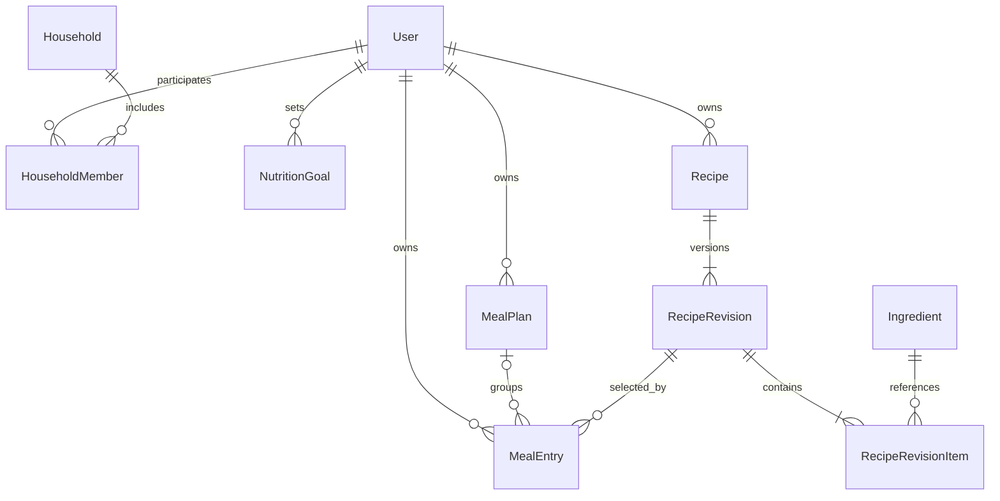

# Backend трекера питания

Создан: 1 ноября 2026 года. Обновлён: 4 ноября 2026 года.

Документ описывает целевую архитектуру, сущности, расчёты и API. Приложение, зависимости и миграции пока не созданы. Деплой в документ не входит.

Основа — исходное ТЗ «Дневник питания — продуктовая архитектура и ТЗ», последующие решения пользователя и [архитектура frontend](../frontend/README.md). Актуальная модель: личные планы, объединение в семейное расписание, закреплённые версии рецептов и автоматический учёт питания по времени.

## 1. Задачи и этапы

Backend обслуживает React-приложение и будущий мобильный клиент через один REST API. Он хранит данные, проверяет доступ и рассчитывает питание.

### Первая версия

- Аккаунт и собственное расписание независимо от наличия семьи.
- Справочник продуктов с КБЖУ.
- Рецепты со всеми сохраняемыми версиями состава.
- Личный недельный план, даты, время, порции и порядок блюд.
- Автоматический учёт еды после запланированного времени.
- Перенос, пропуск, корректировка съеденного количества и незапланированная еда.
- Плановые и фактические итоги, цели КБЖУ с редактируемой историей.
- OpenAPI-контракты для frontend и его моков MSW.

Семью и членство проектируем сразу. Приглашения, объединённый семейный экран и права совместного редактирования реализуем отдельным этапом. Для одиночного режима создавать семью из одного человека не требуется.

### Следующие этапы

1. Семейное расписание как объединение личных планов.
2. Шаблоны недель, потребность в ингредиентах и офлайн-закупка.
3. Кладовая, товары магазинов, цены и стратегии покупки.
4. Объединение записей питания в одну готовку.
5. Подтверждаемый ввод по фото, прогнозирование и интеграции магазинов.

Будущие сущности описаны для понимания расширений. Они не требуют создания всех таблиц в первой реализации.

## 2. Согласованный стек

| Задача | Технология | Назначение |
|---|---|---|
| Язык | Python | Бизнес-логика и интеграции |
| API | FastAPI | HTTP-маршруты, зависимости и OpenAPI |
| База | PostgreSQL | Связанные данные, ограничения и транзакции |
| Схемы API | Pydantic | Входные и выходные DTO, типы и проверки |
| ORM и SQL | SQLAlchemy | Таблицы, связи, запросы и транзакции |
| Драйвер базы | psycopg с async-поддержкой | Соединения с PostgreSQL через SQLAlchemy |
| Миграции | Alembic | Версионирование структуры базы |
| Запуск приложения | Uvicorn | ASGI-сервер для FastAPI |
| Настройки | pydantic-settings | Типизированная конфигурация окружения |
| Окружение и зависимости | uv | Python-окружение и lock-файл |
| Форматирование и lint | Ruff | Стиль и статические проверки |
| Модульные тесты | pytest | Проверка Python-кода и расчётов |
| Тестирование HTTP API | HTTPX + pytest/AnyIO | Интеграционные тесты в процессе приложения |

Для ввода-вывода используем `async def`, SQLAlchemy `AsyncSession` и асинхронный драйвер. Одна сессия относится к одному запросу/сценарию; не разделяем её между параллельными задачами. Расчёты остаются чистыми Python-функциями. Блокирующие вызовы и тяжёлые вычисления не выполняются непосредственно в event loop.

Vitest используется во frontend. Сквозные тесты с браузером не пишем. Совместимые версии инструментов фиксируем при инициализации в lock-файле.

## 3. Ключевые продуктовые решения

1. **Расписание принадлежит человеку.** Выход и вступление в семью сохраняют все его планы, рецепты, цели и дневник.
2. **Семья объединяет личные расписания.** Не создаём вторую копию записей при присоединении. Пользователь может не состоять в семье; активная семья — не более одной.
3. **Версия рецепта закрепляется при добавлении блюда.** По умолчанию выбирается последняя; можно выбрать любую доступную старую. Создание новой версии ничего в существующих планах не обновляет.
4. **Состав версии хранится один раз.** Единая MealEntry ссылается на выбранную версию. Полные копии блюда в каждую запись не сохраняются.
5. **Записи питания объединены в MealEntry.** Тип `scheduled` описывает запланированную еду, `manual` — вручную добавленную незапланированную. Это одна сущность и таблица с разными правилами полей.
6. **В расписании используются порции.** Для корректировки съеденного поддерживаются также граммы готового блюда при известном готовом весе выбранной версии.
7. **После наступления времени еда считается съеденной автоматически.** Подтверждение каждого приёма не требуется. Можно пропустить, перенести или скорректировать количество.
8. **Перенос влияет на автоматический факт.** Если в 14:00 перенести автоматически учтённый приём с 13:00 на 18:00, его вклад в съеденное исчезает до 18:00.
9. **Цели имеют даты действия и редактируемую историю.** Можно изменить прошлые значения и границы периодов. Съеденное при этом не меняется; сравнение с целью пересчитывается.
10. **Копирование и готовка — разные действия.** Сначала копируем записи на даты. Позже объединяем несколько записей в одну большую готовку и считаем число приготовлений.
11. **Закупка сохраняет снимок списка.** Изменения источников вызывают уведомление; обновление начатой закупки выполняется явно.

## 4. Архитектура приложения

Модульный монолит: одно FastAPI-приложение и одна PostgreSQL.

```text
React / будущий мобильный клиент
             ↓ HTTP / JSON
        FastAPI routes
             ↓
      Прикладные сервисы
        ↙           ↘
Чистые расчёты     SQLAlchemy → psycopg → PostgreSQL
```

FSD применяется во frontend. Backend организуется по предметным модулям.

| Модуль | Ответственность |
|---|---|
| `auth` | Идентификация, вход, выход и текущий пользователь |
| `users` | Профиль, часовой пояс и настройки расписания |
| `households` | Семья, членство, доступ и объединённое представление |
| `ingredients` | Продукты и исходные пищевые данные |
| `recipes` | Рецепты, неизменяемые версии и состав |
| `meal_planning` | Личные недели, группировка и операции над планами |
| `meal_entries` | Единая MealEntry: оба типа, количества, перенос, копирование и пропуск |
| `food_diary` | Производное представление MealEntry и суточные итоги, без отдельной таблицы ручного дневника |
| `nutrition` | Цели, расчёты и суточные итоги |
| `dashboard` | Сбор данных экрана за ограниченный период |
| `pantry` — позже | Остатки и движения запасов |
| `shopping` — позже | Потребность и сессии покупки |
| `cooking` — позже | Объединение записей в готовку и партии |
| `store_integrations` — позже | Магазины, предложения и адаптеры |
| `photo_recognition` — позже | Черновики распознавания |

```text
backend/
  src/
    food_tracker/
      main.py
      core/
        config.py
        errors.py
        security.py
        clock.py              # Источник времени для расчётов и тестов
      db/
        base.py
        session.py
      modules/
        auth/
        users/
        households/
        ingredients/
        recipes/
          router.py           # HTTP и зависимости
          schemas.py          # Pydantic DTO
          models.py           # SQLAlchemy-модели
          service.py          # Сценарии и транзакции
          queries.py          # Сложные запросы при необходимости
        meal_planning/
        meal_entries/
        food_diary/
        nutrition/
          calculators.py
        dashboard/
  migrations/
  tests/
    unit/
    integration/
  pyproject.toml
  uv.lock
  README.md
```

Это целевая структура: пустые файлы и будущие модули заранее не создаём.

- Router разбирает запрос и вызывает сервис.
- Pydantic проверяет форму данных; сервис — доступ и бизнес-правила.
- Сервис задаёт границу транзакции. Вспомогательные функции не делают скрытый `commit`.
- ORM-модели не являются публичными DTO.
- Калькуляторы получают значения, включая `now`, и возвращают результат без HTTP и БД.
- Межмодульный сценарий собирается сервисом; router другого модуля не импортируется.
- Внешние запросы не держат открытой транзакцию базы.

## 5. Соглашения данных и времени

- Первичные ключи — UUID. Знание ID не заменяет проверку доступа.
- Python и таблицы используют `snake_case`, JSON — `camelCase`; преобразование задаётся в DTO.
- Моменты времени — PostgreSQL `timestamptz`, JSON ISO 8601 с часовым смещением.
- Календарные даты — `date`, JSON `YYYY-MM-DD`. Часовой пояс — IANA-идентификатор, например `Europe/Moscow`.
- MealPlan сохраняет часовой пояс календаря недели. Изменение профиля не сдвигает уже запланированные моменты автоматически.
- `scheduled_at` — конкретный момент. При вводе местного времени сервер учитывает часовой пояс и проверяет неоднозначные/несуществующие значения.
- Типы приёмов могут иметь настройки времени по умолчанию. При создании записи это время превращается в сохранённый `scheduled_at`; изменение настройки не переносит существующие записи.
- Одно серверное значение `now` используется для всего ответа, чтобы статусы и итоги были согласованы.

Количества и пищевые показатели: Python `Decimal`, PostgreSQL `numeric`. Количества положительные, КБЖУ неотрицательные; `NaN` и бесконечности запрещены. Округление — при выводе, а не на каждом шаге расчёта.

Для JSON пока предлагается передавать Decimal строками, например `"1.5"`. Формат нужно закрепить до генерации клиента и моков. Примеры ниже используют строки. Это оставшееся техническое соглашение, а не изменение выбранных библиотек.

Ингредиенты первой версии измеряются в граммах съедобной части. Деньги будущих покупок — целое количество минимальных денежных единиц и код валюты.

## 6. Основные связи



MealEntry принадлежит User и ссылается на RecipeRevision. Запись `scheduled` входит в личный MealPlan; запись `manual` в первой версии не требует недельного контейнера. Семейное расписание объединяет доступные записи `scheduled` текущих участников. MealParticipant в первой версии не нужен: человек и количество определяются его личной записью.

## 7. Пользователь и семья

### User

Аккаунт и владелец личных данных.

Поля: `id`, `email`, `display_name`, `timezone`, настройки времени приёмов пищи, `password_hash` при парольном входе, даты создания и изменения.

Связи: личные планы, все MealEntry, цели, собственные рецепты и исторические членства. Email нормализуется по принятому правилу и уникален. Секретные поля не входят в DTO.

### Household

Группа для совместного просмотра и закупок.

Поля: `id`, `name`, `timezone`, `created_by_user_id`, `revision`, даты создания и изменения. Бюджет появляется вместе с покупками.

Семья не владеет личными планами. Её revision отражает изменения состава/настроек, важные для объединённого представления и снимков закупки.

### HouseholdMember

Поля: `id`, `household_id`, `user_id`, `role`, `status`, `joined_at`, `left_at`.

Пара `(household_id, user_id)` уникальна; возвращение реактивирует членство. Не более одного активного членства на пользователя — частичный уникальный индекс по `user_id`. Отсутствие семьи является нормальным состоянием.

Выход закрывает членство, не переносит и не удаляет планы. Вступление даёт семейному представлению доступ к личным записям в рамках правил совместного просмотра. Изменять чужое расписание можно только при предусмотренных правах, а не вследствие одного членства.

Предлагаемые роли — `owner`, `editor`, `viewer`. Перед запуском семейного режима уточняются приглашения, передача роли владельца и объём истории, видимый другим участникам. Собственная история доступна пользователю независимо от членств.

### Объединение расписаний

Сервер получает активных участников, выбирает доступные личные записи за период и возвращает их с владельцем каждой позиции. Личные планы не копируются при вступлении и не пересоздаются при выходе.

Действие «Добавить нам обоим» создаёт отдельные записи с индивидуальными порциями в личных планах. Одинаковые дата и рецепт не означают одну готовку. Связанные изменения общих приёмов и объединение в партии — отдельные операции будущего семейного режима.

## 8. Цели NutritionGoal

Целевая норма КБЖУ пользователя на интервал дат.

Поля: `id`, `user_id`, `effective_from`, `effective_to` — исключительная верхняя граница либо `null`, `calories`, `protein_grams`, `fat_grams`, `carbs_grams`, `revision`, даты изменения.

- Пользователь создаёт, исправляет и удаляет ошибочно созданные периоды, в том числе в прошлом.
- Можно менять значения цели и границы дат. Периоды одного пользователя не пересекаются.
- Изменение общей границы соседних периодов выполняется одной транзакцией; интерфейс явно показывает изменяемые интервалы.
- При конфликтующем изменении API сообщает о пересечении, а не молча меняет произвольные периоды.
- Если для даты нет цели, возвращаем отсутствие цели, а не нулевую норму.
- Редактирование прошлой цели пересчитывает сравнение за затронутые даты, но не меняет съеденное количество и КБЖУ.

```text
Соответствие норме = учтённое питание относительно цели на эту дату
Следование расписанию = учтённое питание относительно запланированного
```

Редактирование расписания не создаёт новую цель автоматически. «Период» — интервал действия значения, а не отдельная обязательная программа питания.

## 9. Продукты, рецепты и версии

### Ingredient

Продукт справочника с КБЖУ на 100 г.

Поля: `id`, `name`, `category`, `state`, `calories_per_100g`, `protein_per_100g`, `fat_per_100g`, `carbs_per_100g`, источник данных и его внешний ID, время обновления, `status`.

Сырой и приготовленный продукт различаются. Справочник может обновляться, поэтому историческая версия рецепта не должна рассчитываться по его изменившимся значениям. Источник и условия использования каталога ещё нужно определить.

### Recipe

Постоянная идентичность рецепта и правила доступа.

Поля: `id`, `owner_user_id`, `visibility`, `shared_household_id` при семейной видимости, `current_revision_id`, `archived_at`, даты создания и изменения.

В первой версии используются собственные рецепты. Семейный доступ и публичный каталог добавляются отдельно. Архивирование скрывает рецепт из обычного выбора, но сохраняет версии и существующие ссылки.

### RecipeRevision

Неизменяемая версия блюда.

Поля: `id`, `recipe_id`, `number`, `title`, `instructions`, `yield_servings`, необязательный `cooked_weight_grams`, `source_type`, `created_by_user_id`, `created_at`.

Пара `(recipe_id, number)` уникальна. Указатель текущей версии относится к тому же рецепту. При редактировании создаём новую версию; все старые сохраняются. Изменять содержимое существующей версии нельзя.

`yield_servings` больше нуля. `cooked_weight_grams`, если задан, тоже положителен. Вес готового блюда может отличаться от суммы входных граммовок. Он нужен для учёта съеденного в граммах; без него используется ввод порциями.

### RecipeRevisionItem

Одна строка состава определённой версии.

Поля: `id`, `recipe_revision_id`, `ingredient_id`, `quantity_grams`, `position`, зафиксированные название/состояние продукта, КБЖУ на 100 г и происхождение использованных данных.

Пример: версия овсянки имеет строки «хлопья, 70 г» и «банан, 100 г». Они используются при расчёте версии, порций и покупок. Один ингредиент может встречаться в нескольких строках; в закупке его количество агрегируется.

Пищевые значения фиксирует сервер из справочника. Они хранятся один раз в составе версии, а не в каждом приёме пищи. Итог версии можно сохранить как вычисленный результат; независимо редактировать его нельзя.

### Выбор версии и история

- При добавлении блюда UI предлагает последнюю версию и возможность выбрать доступную старую.
- Клиент передаёт конкретный `recipeRevisionId`; сервер проверяет доступ и сохраняет именно его.
- Чтение существующего расписания никогда не подменяет выбранную версию последней.
- Создание новой версии не обновляет планы, дневник и снимки закупок.
- Заменить версию в конкретной записи можно явно. Коррекция прошлой записи тогда намеренно пересчитает её показатели; это не побочный эффект редактирования рецепта.
- Версии, уже использованные человеком, остаются доступны ему через его записи после архивирования рецепта или выхода автора из семьи. Это не даёт доступа к другим приватным версиям автора.

Исторический состав сохраняется у съеденного и у старой плановой записи. Массового обхода планов при редактировании рецепта нет.

## 10. Личный план и единая запись питания

### MealPlan

Контейнер личного расписания на неделю.

Поля: `id`, `user_id`, `starts_on`, `timezone`, необязательное `title`, `revision`, даты создания и изменения.

Пара `(user_id, starts_on)` уникальна. Неделя начинается в понедельник и содержит семь календарных дат в сохранённом часовом поясе. План нужен для операций над неделей и защиты от параллельных правок. Его владелец — User.

### MealEntry

Единая сущность для запланированной и вручную добавленной незапланированной еды. Одна строка представляет один приём конкретного блюда конкретным человеком.

Общие поля:

- `id`, `user_id` — владелец;
- `kind`: `scheduled` или `manual`;
- `recipe_revision_id` — закреплённая версия;
- `meal_type`: `breakfast`, `lunch`, `dinner`, `snack`;
- `position` — порядок внутри группы;
- `revision`, `deleted_at`, даты создания и изменения.

Поля, зависящие от типа:

| Поле | `scheduled` | `manual` |
|---|---|---|
| `meal_plan_id` | Обязательный личный недельный план | `null`, недельный контейнер не требуется |
| `scheduled_at` | Обязательное запланированное время | `null` |
| `consumed_at` | `null`; автоматический учёт идёт по scheduled_at | Обязательное время употребления, не позже серверного now |
| `timezone` | Часовой пояс календаря MealPlan | Сохранённый часовой пояс ручной записи |
| `servings` | Положительное плановое количество порций | `null`; используется amount |
| `amount_unit`, `amount_quantity` | Необязательная корректировка съеденного количества | Обязательное съеденное количество |
| `skipped_at` | Отметка пропуска либо `null` | `null` |

`amount_unit` принимает `servings` или `g`. Единица и количество всегда задаются вместе. Для граммов нужен готовый вес закреплённой версии. Количество положительно; полный отказ от запланированного блюда отмечается пропуском.

User хранится непосредственно на MealEntry, поэтому личный дневник выбирается одним условием владельца. Для записи с MealPlan проверяем совпадение владельца; составной внешний ключ `(meal_plan_id, user_id)` может закрепить это правило в БД. Часовой пояс записи `scheduled` согласован с планом, а её локальная дата принадлежит неделе.

Pydantic использует схемы по дискриминатору `kind`, PostgreSQL — CHECK-ограничения комбинаций полей и внешние ключи. Случайные сочетания вроде ручной записи с scheduled_at или запланированной без плана не допускаются. Тип записи не меняется неявно при редактировании времени.

### Примеры

```text
MealPlan: план пользователя на неделю с 9 ноября
  MealEntry scheduled: вторник, 13:00, суп версии 3, 1.5 порции
  MealEntry scheduled: вторник, 19:00, салат версии 2, 1 порция

MealEntry manual: вторник, 16:00, йогурт версии 1, amount = 200 г
```

В одном дне и типе приёма пищи может быть несколько записей. Дата и время берутся из соответствующего поля по kind и сохранённого часового пояса. DTO группирует их в дни, включая пустые, без обязательной таблицы MealPlanDay.

### Количество и корректировка

У `scheduled` поле servings сохраняет намерение. Когда amount не задан, после времени учитывается это количество. Amount меняет съеденное, сохраняя плановые порции для сравнения.

У `manual` amount является исходным количеством съеденного; плановых порций нет. Прямой ввод отдельного продукта и оценка по фото добавляются позже. В первой версии оба типа используют доступную RecipeRevision.

Корректировка выполняется в существующей MealEntry. Дополнительную строку для того же автоматического приёма не создаём, состав рецепта не копируем. Действительно дополнительная еда создаётся отдельной записью `manual`.

### Копирование и перенос

Копирование в расписание создаёт отдельные MealEntry `scheduled` с выбранной версией, порциями и новыми датами. Пропуск и корректировка количества не копируются. При копировании ручной записи пользователь задаёт плановые порции явно.

Перенос `scheduled` меняет scheduled_at. При другой неделе запись перемещается в целевой личный MealPlan одной транзакцией. ID, kind и выбранная версия сохраняются; проверяются revision записи и обоих планов. Перенос в будущее убирает автоматически учтённый вклад до нового времени.

Пропуск и корректировка остаются явными полями записи; при необходимости их можно сбросить. Перенос не создаёт вторую MealEntry. У `manual` исправление времени выполняется через consumed_at и остаётся исправлением ручного факта. Для будущей еды используется `scheduled`.

## 11. Автоматический дневник питания

Дневник — вычисляемое представление одной таблицы MealEntry. Расписание выбирает `scheduled`, дневник учитывает оба типа по их правилам.

### Правило расчёта

```text
Для каждой MealEntry:
  если deleted_at задан:
    вклад = 0
  иначе если kind == scheduled:
    если skipped_at задан или scheduled_at > now:
      вклад = 0
    иначе:
      количество = amount, если задан, иначе servings
      вклад = КБЖУ выбранной версии для этого количества
  иначе если kind == manual:
    вклад = КБЖУ выбранной версии для amount на дату consumed_at

Итого съедено = сумма вкладов MealEntry за нужный период
```

Ручное consumed_at проверяется при записи и не может находиться в будущем. Для каждого источника день учёта определяется его временем и сохранённым часовым поясом. Плановый итог включает только исходные servings записей `scheduled`; `manual` в плановый итог не входит.

| Сценарий | Вклад в съеденное |
|---|---|
| В 14:00 запись scheduled на 13:00 не пропущена | Учитывается |
| В 14:00 она перенесена на 18:00 | Не учитывается до 18:00 |
| Отмечен пропуск | Не учитывается |
| Наступило 18:00, пропуска нет | Учитывается в новом времени |
| Добавлена запись manual с consumed_at в прошлом | Учитывается по введённому времени и количеству |

Наступление времени не создаёт и не меняет строки. Сервер вычисляет состояние при чтении; это работает, даже если приложение было закрыто. Автоматически учтённое питание предполагается выполненным по расписанию, а manual введено пользователем явно.

### Время и отображение

- Ответ содержит serverTime и ближайшее nextStatusChangeAt.
- У scheduled статус вычисляется как `scheduled`, `accounted` или `skipped`; у действительной manual — `accounted`.
- Автоматический учёт использует scheduled_at; ручной — consumed_at.
- Frontend обновляет запрос при наступлении следующего времени, возврате на экран и восстановлении соединения.
- Изменение, перенос, пропуск или удаление прошлой записи намеренно пересчитывает её вклад. Закреплённая версия защищает от изменений состава, но не запрещает исправление собственной истории.

### Получение недели

Сервер выбирает MealEntry владельца за период: scheduled — по scheduled_at, manual — по consumed_at. Пакетно загружает закреплённые версии и состав, вычисляет статусы с одним now и группирует записи по дням и типам приёмов. Порядок задают дата, время и position.

Семейное расписание объединяет доступные записи scheduled участников; частные manual не попадают туда автоматически. Ингредиенты на каждый день не копируются, отдельный запрос к базе на каждую карточку не выполняется.

## 12. Расчёты КБЖУ

```text
Показатель строки = quantity_grams / 100 × показатель продукта на 100 г
Показатель версии = сумма показателей строк
Показатель порции = показатель версии / yield_servings
Плановый показатель записи = показатель порции × servings
```

Для корректировки готовыми граммами:

```text
Учтённые порции = consumed_grams / cooked_weight_grams × yield_servings
Учтённое КБЖУ = КБЖУ версии × consumed_grams / cooked_weight_grams
```

Калории берём из зафиксированного значения, не заменяя автоматически формулой по БЖУ. Итоги считаются отдельно для человека; семейная сумма не выдаётся за индивидуальный результат.

Пример: версия на две порции содержит 400 г курицы и 200 г риса. Личные записи на 1 и 1.5 порции дают потребность 500 г курицы и 250 г риса. Для закупки агрегируем количество по ID ингредиента с учётом выбранных версий.

Плановый итог использует исходные порции расписания. Итог дневника — наступившее время, пропуски, корректировки и незапланированную еду. Исправление NutritionGoal меняет сравнение с нормой, а не эти количества.

## 13. Проект REST API

Бизнес-маршруты имеют префикс `/api/v1`. Это проект контракта; сервер ещё не реализован.

### Профиль, семья и цели

| Метод | Маршрут | Назначение |
|---|---|---|
| GET / PATCH | `/users/me` | Профиль, часовой пояс, настройки времени |
| GET | `/households/current` | Текущая семья или её отсутствие |
| POST | `/households` | Создать семью |
| POST | `/households/{householdId}/leave` | Выйти с сохранением личных данных |
| GET | `/users/me/nutrition-goals` | История целей |
| POST | `/users/me/nutrition-goals` | Создать период |
| PATCH | `/users/me/nutrition-goals/{goalId}` | Изменить значения/даты, включая прошлые |
| DELETE | `/users/me/nutrition-goals/{goalId}` | Удалить ошибочный период |
| POST | `/users/me/nutrition-goals/change-boundary` | Изменить общую границу соседних периодов |

Маршруты входа и приглашений определяются вместе с механизмами авторизации и семейных приглашений.

### Справочник и рецепты

| Метод | Маршрут | Назначение |
|---|---|---|
| GET | `/ingredients?query=...&cursor=...&limit=...` | Поиск продуктов |
| GET | `/ingredients/{ingredientId}` | Продукт и источник данных |
| GET / POST | `/recipes` | Поиск / создание рецептов |
| GET | `/recipes/{recipeId}` | Карточка и текущая версия |
| GET | `/recipes/{recipeId}/revisions` | Список доступных версий |
| GET | `/recipes/{recipeId}/revisions/{revisionId}` | Конкретная версия |
| PATCH | `/recipes/{recipeId}` | Создать новую версию без изменения расписания |
| DELETE | `/recipes/{recipeId}` | Архивировать карточку, сохранив версии |

В PATCH отсутствующие поля сохраняются; переданный `items` заменяет состав целиком. Пустой состав запрещён. Передаётся ожидаемый номер текущей версии для защиты от параллельных правок.

```json
{
  "title": "Курица с рисом",
  "yieldServings": "2",
  "items": [
    { "ingredientId": "11111111-1111-4111-8111-111111111111", "quantityGrams": "400" },
    { "ingredientId": "22222222-2222-4222-8222-222222222222", "quantityGrams": "200" }
  ]
}
```

Пищевые значения и расчётные итоги формирует сервер.

### Личный план и записи питания

| Метод | Маршрут | Назначение |
|---|---|---|
| GET | `/users/me/meal-plans?startsOn=...` | Личная неделя с запланированными MealEntry |
| POST | `/users/me/meal-plans` | Создать недельный контейнер |
| GET / POST | `/meal-entries` | Список личных записей / создание scheduled или manual |
| GET / PATCH / DELETE | `/meal-entries/{entryId}` | Чтение, исправление или удаление записи |
| POST | `/meal-entries/{entryId}/copy` | Копировать в расписание на выбранные даты |
| POST | `/meal-entries/{entryId}/move` | Перенести scheduled между неделями |
| PUT / DELETE | `/meal-entries/{entryId}/skip` | Поставить / снять пропуск scheduled |
| PUT / DELETE | `/meal-entries/{entryId}/consumption` | Задать / сбросить корректировку количества scheduled |
| GET | `/users/me/diary?from=...&to=...` | Вычисляемый дневник по MealEntry обоих типов |

Список принимает from/to, необязательные kind и mealPlanId. Владелец определяется по авторизации, а не доверенному userId из тела. Создание проверяется схемой по kind: scheduled требует план, время и servings; manual — consumedAt и amount. Количество manual меняется через PATCH; корректировка scheduled — через consumption.

Amount: `{ "unit": "servings", "value": "0.5" }` либо `{ "unit": "g", "value": "250" }`. Граммы требуют готового веса выбранной версии.

Дневник и расписание используют один entryId. DTO содержит kind, выбранную версию, время, исходное и учтённое количество, вычисленный статус и КБЖУ. Отдельной сущности или API для ручных записей дневника нет.

### Данные экранов

```text
GET /api/v1/users/me/dashboard?from=...&to=...
GET /api/v1/households/{householdId}/schedule?from=...&to=...
```

Личный dashboard содержит планы, MealEntry, вычисленные статусы, дневник и цели. Семейный schedule объединяет доступные записи с владельцами; доступ к чужому частному дневнику из этого не следует.

Диапазоны ограничены, например 31 днём; `from` включительно, `to` исключительно. Семейный часовой пояс задаёт представление общего календаря, не переписывая сохранённые моменты и личные планы.

## 14. Контракты и кеширование

- Pydantic/OpenAPI описывает запросы, ответы и ошибки; схема — `/openapi.json`, интерфейс разработки — `/docs`.
- TypeScript-контракты и RTK Query endpoint генерируются из OpenAPI; ORM-модели во frontend не импортируются.
- Zod проверяет ввод; backend независимо проверяет данные и права.
- Формат дат, Decimal, ошибок и названий полей согласован для API.
- У списков есть ограничение размера, стабильная сортировка и пагинация.
- MSW имитирует контракт для development frontend.

Изменение рецепта инвалидирует карточку и список версий, но не переписывает расписание. Все сохранённые записи читают закреплённую версию. Только явная замена версии в записи меняет её расчёт.

Изменение времени, порций, пропуска или корректировки инвалидирует личный план, дневник и итоги затронутых дат; на семейном этапе — общее представление. Перенос между датами обновляет оба дня.

Даже без мутации время меняет автоматический учёт. Кеш дневника нельзя считать свежим бессрочно: используем `serverTime`, `nextStatusChangeAt` и обновление при возвращении. Если дневник кешируется на сервере, учитываем revision всех затронутых MealEntry и целей. Manual может не иметь MealPlan, поэтому одной revision недельного контейнера недостаточно.

```json
{
  "code": "PLAN_REVISION_CONFLICT",
  "message": "План изменён другим запросом",
  "details": { "currentRevision": 13 },
  "requestId": "request-identifier"
}
```

Ошибки полей Pydantic преобразуются в общий формат для React Hook Form. Статусы: `401` — нет авторизации, `403/404` — нет доступа/ресурса по принятой политике, `409` — конфликт состояния, `412` — несовпадение версии, `422` — неверные значения, `428` — отсутствует обязательное предусловие версии.

## 15. Транзакции и защита от повторов

- Recipe, первая RecipeRevision и её строки создаются одной транзакцией.
- Редактирование создаёт версию и переключает `current_revision_id` условным обновлением или блокировкой Recipe. Номер не назначается незащищённым `max(number) + 1`.
- Редактирование рецепта не блокирует и не обходит планы.
- Изменение MealEntry проверяет и увеличивает её revision. У scheduled в той же транзакции проверяется и увеличивается revision MealPlan; manual защищается своей revision. При ошибке операция откатывается.
- Перенос между неделями проверяет обе revision и обновляет оба плана; блокировки берутся в стабильном порядке.
- Изменение целей выполняется с проверкой пересечений и защитой от одновременных правок.
- Вступление/выход не переносит личные данные; изменение членства и revision семьи атомарно.

Для MealEntry предлагаем `If-Match: "entry-12"`. Для операций scheduled передаётся также ожидаемая revision исходного плана, а при переносе — целевого. Создание scheduled использует revision контейнера, поскольку у новой строки её ещё нет. Устаревшая версия возвращает `412`, отсутствие обязательной — `428`. Изменения строки и контейнеров атомарны.

Для создания объектов предлагаем `Idempotency-Key`: владелец, операция, hash тела и результат сохраняются вместе с изменением. Повтор возвращает тот же результат; тот же ключ с другим телом даёт конфликт. От наступления времени idempotency-записи не создаются: автоматический факт вычисляется при чтении.

## 16. Ограничения и работа с базой

- Внешние ключи на владельцев, планы, версии и ингредиенты. У MealEntry с планом владелец совпадает с владельцем контейнера.
- Уникальность `(user_id, starts_on)`, `(recipe_id, number)`, `(household_id, user_id)` и одного активного членства.
- Текущая версия относится к своему Recipe; это закрепляют связь/ограничение и сервис.
- CHECK по kind: у scheduled есть MealPlan, scheduled_at и servings, а consumed_at отсутствует; у manual есть consumed_at и amount, отсутствуют план, scheduled_at, servings и skipped_at.
- Положительные порции, граммы и выход; amount задаётся согласованной парой unit/value. Для scheduled он необязателен, для manual обязателен.
- Непересекающиеся цели обеспечиваются диапазонным ограничением PostgreSQL либо сериализованной проверкой по пользователю.
- Исторические версии не удаляются каскадно вместе с карточкой.
- У scheduled локальная дата принадлежит неделе её плана; manual не требует контейнера. Межтабличные правила проверяет сервис, а не CHECK с обращением к другим таблицам.

Индексы: планы по пользователю/неделе; MealEntry по пользователю/kind и соответствующему времени, scheduled по плану/времени/позиции; версии по рецепту/номеру, состав по версии, членство по пользователю/семье. Для scheduled_at и consumed_at можно использовать отдельные частичные индексы по kind.

Связанные версии загружаются пакетно без N+1 и неожиданной lazy-загрузки. Поиск продуктов сначала выполняется средствами PostgreSQL; отдельный поисковый сервис заранее не выбирается.

Alembic-миграции просматриваются перед применением. Схема не изменяется автоматически при запуске из ORM-моделей. Seed справочника и тестовых данных выполняется отдельной повторяемой командой.

## 17. Авторизация и доступ

Механизм входа ещё не выбран. Рабочий вариант веб-клиента — серверная сессия, хранение в PostgreSQL и cookie с подходящими атрибутами и CSRF-защитой. Для мобильного клиента передача учётных данных согласуется отдельно; бизнес-проверки от неё не зависят.

- Собственные планы, цели и MealEntry обоих типов доступны владельцу независимо от семьи.
- Семейный просмотр требует активного членства и разрешённого объёма доступа.
- Членство само по себе не даёт права менять чужие цели и ручной дневник.
- Доступ к рецепту/версии проверяется при выборе. Чтение закреплённой в собственной записи версии сохраняет работоспособность истории.
- Вход и публичные технические маршруты имеют отдельные правила; остальные операции выполняются от определённого пользователя.
- Тестовый пользователь не зашивается в бизнес-код; в тестах подменяется зависимость авторизации.

## 18. Потребность и закупки — следующие этапы

```text
Выбранные личные записи участников на даты
  → закреплённые версии × плановые порции
  → агрегированная потребность в ингредиентах
  → учёт доступных запасов
  → количество к покупке
  → товары, упаковки и цена
```

Закупка использует только MealEntry с kind=scheduled. Manual в потребность не входит. Прошлое питание не превращается автоматически в будущую потребность. Запрос явно выбирает период и участников; пропущенные и удалённые записи исключаются из актуальной закупки. Корректировки съеденного относятся к дневнику, плановые порции — к потребности.

### PantryItem и PantryMovement

PantryItem хранит остаток ингредиента в контексте пользователя или семьи. PantryMovement фиксирует приход, расход, корректировку или списание. При введении движений остаток меняется вместе с движением одной транзакцией.

Начальный вариант — ручные остатки. Наступление времени еды не списывает автоматически сырые ингредиенты: продукт мог быть приготовлен общей партией раньше. Точный расход появится с процессом готовки.

Формула `max(0, required - available)` требует согласованного состояния запасов. Параллельные закупки учитывают резервы; первый вариант можно ограничить одной активной сессией на контекст.

### ShoppingSession

Снимок списка и состояние процесса покупки.

Поля: ID, создатель, контекст пользователя/семьи, период и участники, режим, стратегия, статус, время начала/завершения. Сессия может опираться на несколько личных MealPlan.

ShoppingSessionSourcePlan связывает сессию с ID и revision каждого исходного плана. Для семейного списка сохраняется также revision состава семьи. Это заменяет единственную ссылку на семейный MealPlan.

ShoppingSessionItem содержит собственный ID, ingredient ID, название, потребность, количество к покупке, фактически купленное количество и отметку. При наличии магазина — товар, упаковки и цену. Состав рецепта целиком сюда не копируется.

ShoppingStoreLeg связывает часть сессии с магазином, статусом и внешним переходом/заказом. Позиция обновляется по item ID, а не ingredient ID: один ингредиент может покупаться разными товарами.

Изменение исходного плана, версии в конкретной записи или состава участников делает снимок потенциально устаревшим. Новая версия рецепта сама по себе этого не делает: выбранные ссылки не меняются.

Показываем уведомление «План изменился — обновить список?». Без подтверждения сессия сохраняет позиции и количества. Явное обновление показывает разницу и сохраняет уже купленное. Наступление времени еды само по себе не меняет снимок начатой закупки.

Режимы: `offline`, затем `deeplink` и `mcp` при наличии реальных адаптеров. Завершение идемпотентно: приход в кладовую фиксируется по фактически купленному один раз. Недокупленное остаётся в результате и может перейти в новую сессию.

## 19. Магазины, готовка и ИИ — следующие этапы

### Магазины

- Store — провайдер, региональные условия и доставка.
- StoreProduct — конкретный SKU, состав и масса упаковки; связь с Ingredient появляется после сопоставления.
- StoreOffer — цена, наличие, валюта, регион и время актуальности.

Ингредиент и товар не отождествляются по названию. Подбор упаковок учитывает массу, кратность, весовые товары и замены. `single_store` и `smart_split` учитывают доставку, минимальный заказ, наличие и число магазинов. Ответ сообщает полноту и актуальность оценки.

Источники скрыты за адаптерами. Недоступность магазина не блокирует план и дневник. Deeplink не является доказательством оплаты; webhooks проверяются и обрабатываются идемпотентно.

### Объединение в готовку

CookingBatch связывает несколько личных MealEntry scheduled с одной готовкой: выбранная версия, время приготовления, общий выход и распределение порций между людьми и датами.

Пользователь сможет объединить четыре порции супа на два дня в одну кастрюлю. Экран покажет общий объём и число приготовлений. Разные версии не объединяются молча: пользователь выбирает общий состав.

Сумма порций распределений определяет потребность партии. Для ингредиентов используем либо партию, либо её записи-назначения, без двойного учёта. Остатки готовой еды и расход вводятся вместе с этой моделью.

### Шаблоны и ИИ

MealPlanTemplate хранит именованную неделю без дат. Применение создаёт личные записи с выбранными версиями. Изменение шаблона или рецепта не меняет созданные записи автоматически.

Распознавание фото создаёт черновик, который пользователь подтверждает перед созданием версии рецепта или ручного факта. Прогнозирование использует расписание, корректировки, пропуски, ручное питание и запасы. Автоматический учёт по времени сам по себе не доказывает выполнение без отклонений.

Очередь тяжёлых задач выбирается при появлении соответствующей нагрузки. Для обычного автоматического учёта еды она не требуется.

## 20. Проверки и порядок реализации

### Модульные тесты

- КБЖУ состава, порций и готовых граммов.
- До времени вклад автоматической записи нулевой; в момент времени и после — учтённый.
- Перенос с 13:00 на 18:00 в 14:00 убирает вклад; в 18:00 возвращает его.
- Пропуск, снятие пропуска и корректировка количества.
- Разница планового и учтённого питания.
- Часовые пояса, границы дней и недель.
- Сравнение с целью после исправления прошлого периода.

### Интеграционные тесты

На отдельной PostgreSQL с миграциями:

- Атомарное создание рецепта/состава и защита номера версии.
- Выбор старой версии и неизменность записей после новой версии/обновления справочника.
- Сохранение личных планов после выхода и вступления в семью.
- Семейное чтение без копирования и доступа к запрещённым данным.
- Перенос между неделями, пересчёт обеих дат и конфликты revision.
- Создание scheduled и manual через единый API, корректность ограничений kind и отсутствие лишней строки при наступлении времени.
- Корректировка в той же MealEntry без двойного учёта, общий entryId в расписании и дневнике.
- Исключение manual из плановых итогов, семейного расписания и закупочной потребности.
- Исправление прошлых целей/границ без пересечений и без изменения съеденных количеств.
- Повторы запросов, ограничения базы, JSON и OpenAPI.
- Позже — снимок закупки, явное обновление и однократное пополнение запасов.

Время задаём контролируемым источником, без ожидания реальных часов. Внешние сервисы подменяются. Браузерные E2E-тесты не добавляются.

### Этапы реализации

1. Уточнить авторизацию, источник продуктов и формат Decimal; зафиксировать версии согласованных библиотек.
2. Инициализировать FastAPI, PostgreSQL, настройки и миграции.
3. Реализовать пользователя и справочник продуктов.
4. Реализовать Recipe, все версии и расчёты.
5. Реализовать личные недели, выбор версии, время, порции, копирование и перенос.
6. Реализовать производный дневник по MealEntry обоих типов, пропуски и корректировки.
7. Реализовать редактируемые периоды целей и итоги экранов.
8. Подключить реальный API к frontend после разработки с MSW.
9. Добавлять семейный интерфейс, закупки, готовку и ИИ отдельными этапами.

Первая версия готова, когда личное расписание работает без семьи, выбранный состав не меняется от редактирования рецепта, питание учитывается по времени, перенос/пропуск корректирует итог, а прошлые цели доступны для исправления. Релевантные тесты и миграции проходят.

## 21. Документация технологий

- [FastAPI: структура приложения](https://fastapi.tiangolo.com/tutorial/bigger-applications/)
- [FastAPI: OpenAPI](https://fastapi.tiangolo.com/features/)
- [FastAPI: async](https://fastapi.tiangolo.com/async/)
- [Pydantic](https://docs.pydantic.dev/latest/)
- [Pydantic Settings](https://docs.pydantic.dev/latest/concepts/pydantic_settings/)
- [SQLAlchemy: AsyncSession](https://docs.sqlalchemy.org/en/20/orm/extensions/asyncio.html)
- [SQLAlchemy: psycopg](https://docs.sqlalchemy.org/en/20/dialects/postgresql.html#module-sqlalchemy.dialects.postgresql.psycopg)
- [Alembic](https://alembic.sqlalchemy.org/en/latest/)
- [Uvicorn](https://uvicorn.dev/)
- [PostgreSQL: ограничения](https://www.postgresql.org/docs/current/ddl-constraints.html)
- [PostgreSQL: изоляция транзакций](https://www.postgresql.org/docs/current/transaction-iso.html)
- [uv](https://docs.astral.sh/uv/)
- [Ruff](https://docs.astral.sh/ruff/)
- [pytest](https://docs.pytest.org/en/stable/)
- [FastAPI: HTTPX и async-тесты](https://fastapi.tiangolo.com/advanced/async-tests/)
