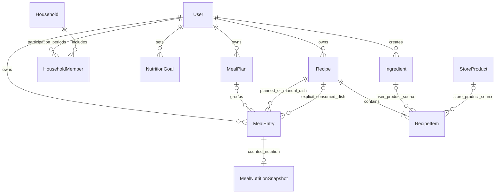

# Backend трекера питания

Создан: 1 ноября 2026 года. Обновлён: 7 ноября 2026 года.

Документ описывает целевую архитектуру, сущности, расчёты и API. Приложение, зависимости и миграции пока не созданы. Деплой в документ не входит.

Этот файл — единый источник истины для скоупа, сущностей, бизнес-правил, расчётов, доступа и REST API. Корневой README описывает репозиторий и общий процесс работы; frontend/README.md описывает клиент и ссылается на соответствующие разделы этого документа. Изменение правила сначала фиксируем здесь.

Актуальная модель: личные планы, рецепты без пользовательских версий, актуальные КБЖУ продуктов и рецептов для плана, явное подтверждение каждого съеденного блюда и собственные снимки подтверждённого питания. Авторизация — отдельный блок разработки. Семейный режим развивается отдельно.

## 1. Задачи и этапы

Backend обслуживает React-приложение и будущий мобильный клиент через один REST API. Он хранит данные, проверяет доступ и рассчитывает питание.

### Первая версия

- Аккаунт: email + пароль, подтверждение почты кодом до первого входа, восстановление пароля и JWT access/refresh-токены.
- Собственное расписание и роли `USER` / `ADMIN`. Регистрация создаёт только `USER`; `ADMIN` дополнительно может публиковать собственные продукты. Семьи и семейные роли в MVP не создаются.
- Создание и исправление собственных продуктов с КБЖУ пользователем или администратором через один сценарий с отдельной меткой происхождения. Исправление сохраняет ID продукта.
- Личные продукты при создании. Каталог `USER` остаётся личным; публикация и снятие с публикации собственных карточек доступны только `ADMIN`.
- Раздельные сущности пользовательского продукта и конкретного товара магазина.
- Создание блюда и создание на основе дают новый ID; «Изменить» у автора обновляет текущий Recipe с тем же ID, без пользовательских версий. Будущая еда использует актуальный рецепт и связанные продукты.
- Собственные снимки пищевых данных съеденного на момент подтверждения: правка продукта не меняет историю; КБЖУ съеденной записи можно исправить отдельно.
- Быстрое добавление продукта через блюдо из одного ингредиента.
- Личный недельный план, даты, время, порции и порядок блюд.
- Явное подтверждение каждого съеденного блюда и ручной ввод/корректировка факта. Прошедшее время плана само по себе не учитывает еду.
- Сохранение явно записанного факта при переносе или изменении расписания.
- Перенос, пропуск, корректировка съеденного количества и незапланированная еда.
- Плановые и фактические итоги, цели КБЖУ с редактируемой историей.
- OpenAPI-контракты для frontend и его моков MSW.

Семью, периоды членства и семейную историю питания описываем как задел. Таблицы, API и логику семейного режима, включая приглашения, объединённый экран и права совместного редактирования, реализуем отдельным этапом. Для одиночного режима создавать семью из одного человека не требуется.

### Следующие этапы

1. Семейное расписание как объединение личных планов.
2. Шаблоны недель, потребность в ингредиентах и офлайн-закупка.
3. Кладовая, товары магазинов, цены и стратегии покупки.
4. Объединение записей питания в одну готовку.
5. Подтверждаемый ввод по фото, прогнозирование и интеграции магазинов.

Будущие сущности описаны для понимания расширений. Они не требуют создания всех таблиц в первой реализации. В MVP доступны личные продукты пользователей и общий каталог карточек, опубликованных `ADMIN`. Для администратора используем те же формы и API с проверкой роли; полный административный кабинет, загрузка полных каталогов магазинов, сопоставление и цены относятся к следующим этапам.

Стартовое наполнение каталога, источники данных и удобство первых сценариев уточняем по ходу разработки. Отдельный предварительный этап для этого не требуется.

Упрощённую модель приготовления сохраняем: состав и готовый выход задаются явно, коэффициенты потерь и преобразований не вводятся. Сложные сценарии смены часовых поясов откладываются; базовые моменты времени и сохранённый часовой пояс остаются.

## 2. Согласованный стек

| Задача | Технология | Назначение |
|---|---|---|
| Язык | Python | Бизнес-логика и интеграции |
| API | FastAPI | HTTP-маршруты, зависимости и OpenAPI |
| База | PostgreSQL | Связанные данные, ограничения и транзакции |
| Схемы API | Pydantic | Входные и выходные DTO, типы и проверки |
| ORM и SQL | SQLAlchemy | Таблицы, связи, запросы и транзакции |
| Драйвер базы | psycopg с async-поддержкой | Соединения с PostgreSQL через SQLAlchemy |
| Миграции | Alembic | Версионирование структуры базы |
| Запуск приложения | Uvicorn | ASGI-сервер для FastAPI |
| Настройки | pydantic-settings | Типизированная конфигурация окружения |
| Окружение и зависимости | uv | Python-окружение и lock-файл |
| Форматирование и lint | Ruff | Стиль и статические проверки |
| Модульные тесты | pytest | Проверка Python-кода и расчётов |
| Тестирование HTTP API | HTTPX + pytest/AnyIO | Интеграционные тесты в процессе приложения |

Для ввода-вывода используем `async def`, SQLAlchemy `AsyncSession` и асинхронный драйвер. Одна сессия относится к одному запросу/сценарию; не разделяем её между параллельными задачами. Расчёты остаются чистыми Python-функциями. Блокирующие вызовы и тяжёлые вычисления не выполняются непосредственно в event loop.

Backend проверяем модульными и интеграционными тестами. Браузерные E2E-тесты в проекте не добавляем. Совместимые версии backend-инструментов фиксируем при инициализации в lock-файле.

## 3. Ключевые продуктовые решения

1. **Расписание принадлежит человеку.** Выход и вступление в семью сохраняют его планы, блюда, цели и дневник.
2. **Семья объединяет личные расписания.** Записи не копируются при присоединении; активная семья — не более одной. Каждый возврат создаёт новый период членства с сохранением предыдущих.
3. **Копирование и изменение рецепта — разные действия.** «Создать на основе» сохраняет самостоятельный Recipe с новым ID. «Изменить» доступно только автору и обновляет его Recipe с тем же ID, включая название, инструкцию, состав, количества и выход. Будущие приёмы следуют за актуальным рецептом и продуктами по ссылкам RecipeItem; съеденное использует собственные снимки. Версий рецептов и переключения между ними нет.
4. **КБЖУ съеденного фиксируется отдельно.** MealEntry ссылается на Recipe, но дневник читает собственный MealNutritionSnapshot, а не актуальные КБЖУ рецепта. Изменение продукта сохраняет историю; пользователь может явно исправить КБЖУ только выбранной съеденной записи. Начальный снимок использует текущие данные на момент подтверждения или ручного сохранения съеденного, даже при вводе задним числом.
5. **Одна MealEntry объединяет два происхождения записи.** `scheduled` имеет план, `manual` добавляется как незапланированная еда. Подтверждение и корректировки хранятся отдельно от kind. В MVP сохраняем одну сущность; разделение рассмотрим в будущем, если реальные сценарии потребуют этого.
6. **Каждое блюдо подтверждает пользователь.** Запланированное блюдо входит в дневник только после явного сохранения съеденного. При ручном добавлении действие «Сохранить съеденное» одновременно подтверждает еду, без второго клика. Корректировки подтверждённого факта сохраняются отдельно.
7. **Время плана не создаёт факт.** Без подтверждения вклад в съеденное равен нулю до и после scheduled_at. Закрытый клиент и позднее открытие приложения ничего не начисляют.
8. **Явный факт отделён от плана.** Подтверждение/ввод сохраняет фактическое время, количество и блюдо. Перенос, смена плановых порций или блюда и пропуск в расписании сами по себе не изменяют этот факт.
9. **Количество — порции или готовые граммы.** План использует порции. Граммы съеденного допустимы при известном готовом весе; для быстрого добавления одного продукта готовый вес определяется автоматически.
10. **Личный и общий каталоги разделены правами.** `USER` создаёт и исправляет собственные личные продукты, `ADMIN` использует тот же сценарий и может публиковать собственные карточки для всех. Метка создателя, видимость и связь с магазинным товаром — разные свойства. Исправление продукта сохраняет его ID, обновляет карточку и расчёты связанных рецептов; снимки съеденного остаются прежними.
11. **Цели имеют редактируемые периоды.** Исправление нормы или границ прошлого периода меняет сравнение с целью, а не съеденное.
12. **Копирование и готовка различаются.** Копирование создаёт записи на даты; объединение в общую готовку появляется позже.
13. **Закупка сохраняет снимок списка.** Изменения источников вызывают уведомление; обновление начатой закупки выполняется явно.

## 4. Архитектура приложения

Модульный монолит: одно FastAPI-приложение и одна PostgreSQL.

```text
React / будущий мобильный клиент
             ↓ HTTP / JSON
        FastAPI routes
             ↓
      Прикладные сервисы
        ↙           ↘
Чистые расчёты     SQLAlchemy → psycopg → PostgreSQL
```

Backend организуется по предметным модулям. Авторизация реализуется и принимается отдельным блоком `auth`; выбранные требования к ней сохраняются в разделе 17.

| Модуль | Ответственность |
|---|---|
| `auth` | Регистрация, коды почты, восстановление пароля, JWT access/refresh, вход, выход и текущий пользователь |
| `users` | Профиль, часовой пояс и настройки расписания |
| `households` — позже | Семья, членство, доступ и объединённое представление |
| `ingredients` | Продукты пользователей/администраторов, публикация, исходные пищевые данные и отдельные товары магазинов |
| `recipes` | Определения блюд, ссылки состава на продукты, актуальный расчёт и создание на основе |
| `meal_planning` | Личные недели, группировка и операции над планами |
| `meal_entries` | Единая MealEntry: оба типа, снимки съеденного, подтверждение, исправление КБЖУ факта, перенос, копирование и пропуск |
| `food_diary` | Производное представление MealEntry и суточные итоги, без отдельной таблицы ручного дневника |
| `nutrition` | Цели, расчёты и суточные итоги |
| `dashboard` | Сбор данных экрана за ограниченный период |
| `pantry` — позже | Остатки и движения запасов |
| `shopping` — позже | Потребность и сессии покупки |
| `cooking` — позже | Объединение записей в готовку и партии |
| `store_integrations` — позже | Магазины, предложения и адаптеры |
| `photo_recognition` — позже | Черновики распознавания |

```text
backend/
  src/
    food_tracker/
      main.py
      core/
        config.py
        errors.py
        security.py
        clock.py              # Источник времени для расчётов и тестов
      db/
        base.py
        session.py
      modules/
        auth/
        users/
        households/
        ingredients/
        recipes/
          router.py           # HTTP и зависимости
          schemas.py          # Pydantic DTO
          models.py           # SQLAlchemy-модели
          service.py          # Сценарии и транзакции
          queries.py          # Сложные запросы при необходимости
        meal_planning/
        meal_entries/
        food_diary/
        nutrition/
          calculators.py
        dashboard/
  migrations/
  tests/
    unit/
    integration/
  pyproject.toml
  uv.lock
  README.md
```

Это целевая структура: пустые файлы и будущие модули заранее не создаём.

- Router разбирает запрос и вызывает сервис.
- Pydantic проверяет форму данных; сервис — доступ и бизнес-правила.
- Сервис задаёт границу транзакции. Вспомогательные функции не делают скрытый `commit`.
- ORM-модели не являются публичными DTO.
- Калькуляторы получают значения и возвращают результат без HTTP и БД. Серверное время передаём явно там, где оно нужно для проверки фактической даты.
- Межмодульный сценарий собирается сервисом; router другого модуля не импортируется.
- Внешние запросы не держат открытой транзакцию базы.

## 5. Соглашения данных и времени

- Первичные ключи — UUID. Знание ID не заменяет проверку доступа.
- Python и таблицы используют `snake_case`, JSON — `camelCase`; преобразование задаётся в DTO.
- Моменты времени — PostgreSQL `timestamptz`, JSON ISO 8601 с часовым смещением.
- Календарные даты — `date`, JSON `YYYY-MM-DD`. Часовой пояс — IANA-идентификатор, например `Europe/Moscow`.
- MealPlan сохраняет часовой пояс календаря недели. Изменение профиля не сдвигает уже запланированные моменты автоматически.
- `scheduled_at` — конкретный запланированный момент. `consumed_at` — явно записанное фактическое время. Сложные сценарии смены поясов и календарные неоднозначности не расширяем в отдельный скоуп MVP; сохраняем базовое представление времени и часового пояса.
- Типы приёмов могут иметь настройки времени по умолчанию. При создании записи это время превращается в сохранённый `scheduled_at`; изменение настройки не переносит существующие записи.
- Серверное время используется для проверки consumed_at и фиксации момента действия. Само течение времени не меняет факт и пищевые итоги. Для снимка при подтверждении рецепт и его продукты читаются из согласованного текущего состояния базы.

Количества и пищевые показатели: Python `Decimal`, PostgreSQL `numeric`. Количества положительные, КБЖУ неотрицательные; `NaN` и бесконечности запрещены. Правила округления и суммирования КБЖУ определены в [разделе расчётов](#округление-и-суммирование-кбжу).

Decimal — тип для десятичных чисел: например, 0.1, 1.5 порции или 12.35 г. Он позволяет выполнять десятичные операции без двоичной погрешности обычного float; точность деления и округление всё равно задаются явно. Это внутренний способ расчёта, он не требует отдельного действия пользователя.

Для JSON пока предлагается передавать такие значения строками, например `"1.5"`. Варианты `"1.5"` и `1.5` — разные типы в API: без общего соглашения форма может отправить число, а схема ожидать строку. Формат передачи и точность хранения закрепляем в первом соответствующем контракте; frontend и моки следуют ему. Правило округления КБЖУ уже согласовано в разделе 12. Примеры ниже используют строки. Дополнительные библиотеки для клиентской арифметики заранее не выбираем; итоговый расчёт остаётся серверным.

Ингредиенты первой версии измеряются в граммах съедобной части. Деньги будущих покупок — целое количество минимальных денежных единиц и код валюты.

## 6. Основные связи



Recipe — определение блюда; RecipeItem — строка с ID продукта и количеством. Строка имеет ровно один источник: Ingredient или StoreProduct. Текущие КБЖУ рецепта рассчитываются по этим ссылкам; RecipeItem не замораживает пищевые данные. Это две сущности продуктов, а не две обязательные копии одного товара.

MealEntry принадлежит User. Запись `scheduled` входит в личный MealPlan; `manual` недельного контейнера не требует. План ссылается на Recipe, а при явном вводе факта отдельно сохраняется ссылка на съеденное блюдо. Эти ссылки могут совпадать. Учтённое питание имеет отдельный MealNutritionSnapshot с использованными данными состава и КБЖУ; история не зависит от текущего расчёта связанного Recipe.

Семейное расписание объединяет доступные `scheduled` текущих участников. Семейная история использует все периоды участия и правила видимости. MealParticipant не нужен: человек и количество определяются личной записью.

## 7. Пользователь и семья

### User

Аккаунт и владелец личных данных.

Поля MVP: `id`, `email`, `password_hash`, `email_verified_at` (до подтверждения — `null`), `role` (`USER` или `ADMIN`), `display_name`, `timezone`, настройки времени приёмов пищи, даты создания и изменения. Регистрация всегда создаёт `USER`; роль `ADMIN` назначается доверенным способом вне публичных API регистрации и профиля. Пароль хранится как хеш Argon2id. До подтверждения почты access/refresh-токены и доступ к личному кабинету не выдаются.

Связи: личные планы, все MealEntry, цели, собственные рецепты и исторические членства. Email нормализуется по принятому правилу и уникален. Секретные поля не входят в DTO.

### Household

Группа для совместного просмотра и закупок.

Поля: `id`, `name`, `timezone`, `created_by_user_id`, `revision`, даты создания и изменения. Бюджет появляется вместе с покупками.

Семья не владеет личными планами. Её revision отражает изменения состава/настроек, важные для объединённого представления и снимков закупки.

### HouseholdMember

Одна запись — один непрерывный период участия человека в семье. Сущность относится к будущему семейному этапу.

Поля: `id`, `household_id`, `user_id`, `role`, `joined_at`, необязательное `left_at`, даты создания и изменения.

- Период задаётся как `[joined_at, left_at)`: момент вступления включён, выхода исключён; `left_at = null` означает продолжающееся участие.
- Отдельный `status` не храним: активность определяется по `left_at`. Приглашение ещё не является членством и позже получит отдельную сущность.
- Пара `(household_id, user_id)` не уникальна. Выход заполняет `left_at`; возвращение создаёт новую запись с новым ID и `joined_at`, не открывая старую повторно.
- `left_at`, если задан, строго позже `joined_at`. Периоды одного пользователя не пересекаются, в том числе между разными семьями; соседние периоды могут иметь общую границу.
- Не более одного незакрытого периода на пользователя — частичный уникальный индекс по `user_id` при `left_at IS NULL`. Отсутствие семьи является нормальным состоянием.

Например, вступление 1 ноября, выход 3 ноября и возвращение 7 ноября сохраняются двумя строками: `[1 ноября, 3 ноября)` и `[7 ноября, null)`. Даты создания/изменения строки не заменяют даты участия.

Выход закрывает членство, не переносит и не удаляет планы. Вступление даёт семейному представлению доступ к личным записям в рамках правил совместного просмотра. Изменять чужое расписание можно только при предусмотренных правах, а не вследствие одного членства.

В MVP роли аккаунта `USER` / `ADMIN` определяют возможности личного каталога и публикации; семейные роли и проверки по ним не реализуются. Роли будущего членства определим при запуске семейного режима вместе с приглашениями и объёмом доступной истории. Собственная история доступна пользователю независимо от членств. Периоды сохраняют вступления и выходы, но не являются полным аудитом: историю смены ролей, инициаторов действий и исправлений при необходимости добавляем отдельным журналом событий.

### Семейная история питания — будущий этап

Семейный дневник должен показывать, кто, когда, какое блюдо и сколько съел во время участия в семье, включая уже вышедших участников. Выход сам по себе не удаляет из семейной истории ранее совместно доступное питание; повторное вступление не открывает питание за перерыв между периодами.

Источником остаётся личная MealEntry: `user_id` определяет человека, MealNutritionSnapshot — использованный состав и КБЖУ, время и количество — питание. Ссылка на Recipe сохраняет происхождение, но его актуальный расчёт не заменяет исторические значения. Для отнесения к семье используем попадание фактического consumed_at подтверждённого питания в период HouseholdMember. Дата создания записи и текущая семья пользователя для этого не подходят. Учитываются только записи с вкладом в дневник по правилам раздела 11.

Для MVP новые семейные поля на MealEntry и копии записей не нужны. На семейном этапе история выбирается по всем периодам участия в нужной семье, а не только по её текущему составу. Исправления фактической еды пересчитывают семейную историю, как и личную. Неподтверждённый план не входит в семейный дневник; перенос плана с подтверждённым фактом не меняет его consumed_at и семейную принадлежность. Это редактируемый дневник, а не неизменяемый снимок или аудит.

Отнесение еды к периоду не даёт права на чтение. До запуска семейного режима закрепляем, кому доступна история бывших участников и прошлые периоды до вступления самого читателя. Частные `manual` не становятся общими автоматически: для их включения потребуется явное правило совместного доступа. При этом сохраняется требование семейной истории ранее доступного питания; доработка схемы доступа относится к семейному этапу.

### Объединение расписаний

Сервер получает активных участников, выбирает доступные личные записи за период и возвращает их с владельцем каждой позиции. Личные планы не копируются при вступлении и не пересоздаются при выходе.

Действие «Добавить нам обоим» создаёт отдельные записи с индивидуальными порциями в личных планах. Одинаковые дата и рецепт не означают одну готовку. Связанные изменения общих приёмов и объединение в партии — отдельные операции будущего семейного режима.

## 8. Цели NutritionGoal

Целевая норма КБЖУ пользователя на интервал дат.

Поля: `id`, `user_id`, `effective_from`, `effective_to` — исключительная верхняя граница либо `null`, `calories`, `protein_grams`, `fat_grams`, `carbs_grams`, `revision`, даты изменения.

- Пользователь создаёт, исправляет и удаляет ошибочно созданные периоды, в том числе в прошлом.
- Можно менять значения цели и границы дат. Периоды одного пользователя не пересекаются.
- Изменение общей границы соседних периодов выполняется одной транзакцией; интерфейс явно показывает изменяемые интервалы.
- При конфликтующем изменении API сообщает о пересечении, а не молча меняет произвольные периоды.
- Если для даты нет цели, возвращаем отсутствие цели, а не нулевую норму.
- Редактирование прошлой цели пересчитывает сравнение за затронутые даты, но не меняет съеденное количество и КБЖУ.

```text
Соответствие норме = учтённое питание относительно цели на эту дату
Следование расписанию = учтённое питание относительно запланированного
```

Редактирование расписания не создаёт новую цель автоматически. «Период» — интервал действия значения, а не отдельная обязательная программа питания.

## 9. Продукты, актуальные рецепты и снимки съеденного

### Две сущности продуктов

| Сущность | Назначение | Происхождение |
|---|---|---|
| Ingredient | Продукт, созданный человеком: общий ингредиент или описанный брендовый продукт | Пользователь; администратор использует тот же сценарий |
| StoreProduct | Конкретная позиция каталога магазина с его идентификатором | Данные реального магазина, введённые или загруженные с указанием источника |

Метка «создан администратором» описывает автора карточки Ingredient. Она сама по себе не превращает карточку в StoreProduct, не подтверждает наличие товара в магазине и не означает отдельную проверку качества.

### Ingredient: продукт пользователя или администратора

Поля: `id`, `created_by_user_id`, `created_by_type` (`user` или `administrator` на момент создания), `name`, необязательные бренд и штрихкод, `category`, `state`, КБЖУ на 100 г, сведения об источнике, `visibility` (`private` или `public`), `status`, `revision`, даты создания и изменения.

- Пользователь и администратор создают одну сущность одним прикладным сценарием; метку происхождения сервер определяет по роли создателя. Клиент не назначает себе метку администратора.
- Новый продукт виден только автору (`private`), в том числе у `ADMIN`. Каталог обычного пользователя остаётся личным: `USER` не может публиковать продукты. Только `ADMIN` может открыть собственную карточку всем (`public`) и снять её с публикации.
- Публикация не создаёт второй продукт и не меняет его ID, автора или метку происхождения. Проверяются текущая роль `ADMIN` и владение карточкой. Метка происхождения сама по себе не даёт права публикации; смена роли не переписывает метку. Публикация чужих личных продуктов не предусмотрена.
- Поиск объединяет собственные личные карточки и публичные карточки с различимой меткой «создан пользователем» / «создан администратором». Чужие личные продукты в поиск не попадают.
- Автор может исправлять свои данные на месте с сохранением ID. Обновляются доступная карточка, расчёты всех ссылающихся на неё Recipe и будущая еда. Снимки уже съеденного не пересчитываются. Изменение видимости доступно только `ADMIN` для собственных карточек. После снятия с публикации или архивирования карточка исчезает из нового выбора других пользователей; существующие рецепты сохраняют рабочие ссылки, съеденное — свои снимки. Имеющаяся ссылка разрешает серверный расчёт использованного продукта в доступном рецепте, но не открывает личную карточку для прямого чтения и нового поиска.
- Сырой и приготовленный продукт различаются. Бренд, разновидность и штрихкод заполняются, если известны; слово «макароны» не считается доказательством выбора конкретного бренда.
- Изменение КБЖУ влияет и на уже существующие рецепты, и на будущие приёмы. История съеденного использует отдельные снимки. Правка меняет текущую карточку; ранее подтверждённые приёмы продолжают читать собственные снимки.

В MVP `ADMIN` использует те же формы создания и исправления собственных продуктов, дополненные публикацией и снятием с публикации. Роль не открывает чужие личные карточки. Полный административный кабинет, поиск дублей, расширенные полномочия управления общим каталогом и массовый импорт определяются позже.

### StoreProduct: конкретный продукт магазина

Поля: `id`, магазин/источник и его внешний ID товара, название, бренд, разновидность, штрихкод/GTIN при наличии, масса или объём упаковки и единица, КБЖУ и источник значений, время обновления, статус. Пара «магазин + внешний ID» идентифицирует позицию источника. Цена и наличие относятся к будущему StoreOffer.

Ingredient и StoreProduct не отождествляются по одному названию. Пользовательская карточка может описывать обобщённый продукт или тот же брендовый товар, но связь с магазинной позицией требует сопоставления. Подтверждённые связи сохраняются; неопределённые совпадения не используются как точная идентичность. Таблицы сопоставления и автоматические адаптеры добавляются на магазинном этапе.

Для будущего подбора различаем «только этот товар», «предпочитаю бренд» и «подойдёт аналог». Сам факт использования общего ингредиента не задаёт бренд. ИИ может предложить соответствие по названию и характеристикам, но не восстанавливает отсутствующее предпочтение и не выдаёт аналог за идентичный товар. Эти стратегии не входят в MVP.

### Recipe: сохранённое определение и актуальное КБЖУ, без версий

Поля: `id`, `owner_user_id`, `title`, `instructions`, `yield_servings`, необязательный `cooked_weight_grams`, `kind` (`regular` или `single_product`), необязательный `source_recipe_id`, `visibility`, `shared_household_id` при семейном доступе, `archived_at`, `revision`, `created_at`, `updated_at`.

Только автор может через «Изменить» исправлять название, инструкцию, состав, количества, выход и готовый вес текущего Recipe. ID, автор и происхождение копии сохраняются; revision защищает от одновременных правок. **Будущие приёмы следуют за обновлённым Recipe. Расчётное КБЖУ также меняется вслед за текущими данными продуктов. Съеденное сохраняет собственные состав, выход и КБЖУ в снимке, независимо от изменений Recipe или продуктов.** Пользовательских RecipeRevision, выбора или переключения версий нет; техническая история определений для учёта питания в MVP не требуется: снимок создаётся при подтверждении.

«Создать на основе» заполняет черновик данными доступного Recipe: названием, инструкцией, выходом, готовым весом и строками состава с ID продуктов и граммовками. После правок черновик сохраняется как новый Recipe с новым ID, даже если пользователь ничего не изменил. КБЖУ обоих рецептов рассчитывается по актуальным данным связанных продуктов; исторические снимки съеденного в черновик не переносятся. Исходный рецепт и существующие ссылки не меняются.

`source_recipe_id`, если используется, показывает происхождение копии, не задавая наследование, цепочку версий или автоматическую синхронизацию. Новое блюдо по умолчанию личное, даже если создано на основе доступного семейного. Создание копии никому не заменяет исходное блюдо.

В первой версии используются собственные блюда. Семейный доступ и публичный каталог блюд добавляются отдельно; публикация продукта Ingredient не публикует блюда его автора. Архивирование убирает блюдо из обычного выбора и сохраняет существующие ссылки. Уже использованное блюдо доступно через собственную запись питания, не открывая другие личные блюда автора.

`yield_servings` и заданный `cooked_weight_grams` положительны. Вес готового блюда может отличаться от суммы входных граммовок. В MVP используем явно заданные значения без коэффициентов потерь приготовления.

При PATCH сохраняются проверки kind: технический single_product должен соответствовать правилу одной строки на 100 г, одной порции и готового веса 100 г. Изменение обычного рецепта не исправляет исходные карточки его продуктов.

### RecipeItem: ссылка на продукт и количество

Поля: `id`, `recipe_id`, ровно один из `ingredient_id` / `store_product_id`, `quantity_grams`, `position`. Пищевые показатели не замораживаются в RecipeItem: текущий расчёт читает их из связанного продукта.

При новом выборе продукта сервер проверяет доступность источника и сохраняет его ID и количество. При создании на основе или редактировании собственных ранее сохранённых строк сервер проверяет перенесённые ссылки по доступному рецепту; это позволяет сохранить уже использованный скрытый источник без открытия его карточки. Новый выбор скрытого чужого продукта запрещён. Каждая строка положительна, пустой состав запрещён. Один продукт может встречаться в нескольких строках. Правка состава и выхода атомарна с Recipe; текущие итоги вычисляются из ссылок.

Исторический дневник читает MealNutritionSnapshot конкретного съеденного приёма. Исправление источника меняет КБЖУ Recipe, но не этот снимок. Архивирование источника или рецепта не удаляет ссылки и снимки съеденного.

Пример: продукт был 100 ккал/100 г, рецепт содержит 150 г и даёт 150 ккал. После исправления продукта на 120 ккал/100 г тот же Recipe с тем же ID даёт 180 ккал; будущие приёмы пересчитываются. Съеденный до исправления приём сохраняет 150 ккал в своём снимке. Ручное исправление его КБЖУ может изменить только эту съеденную запись.

Пример: «Овсянка с бананом» содержит хлопья 70 г и банан 100 г. Замена банана яблоком создаёт отдельное блюдо «Овсянка с яблоком»; старые планы и съеденное продолжают ссылаться на первое. Замена блюда в конкретной записи выполняется явно; изменение плановой ссылки не меняет отдельно сохранённую фактическую.

### MealNutritionSnapshot: пищевые данные съеденного

Связанный с MealEntry снимок — источник КБЖУ дневника. Он содержит `id`, уникальный `meal_entry_id`, `recipe_id`, `basis_at` (момент чтения текущей пищевой базы при подтверждении), `recorded_at` (момент сохранения), название блюда, `yield_servings`, готовый вес при наличии, строки состава с ID и типами источников, их названиями, количеством и использованным КБЖУ на 100 г. Итоговая база блюда рассчитывается по этим строкам. Количество съеденного берётся из MealEntry; его изменение масштабирует сохранённую базу.

- Неподтверждённая scheduled не имеет снимка съеденного, в том числе после scheduled_at. Плановый расчёт использует актуальные продукты и Recipe.
- Первое подтверждение, сохранение полного факта и ручное добавление создают снимок по текущим данным на момент действия. consumed_at может быть раньше: КБЖУ не восстанавливается на фактическое или плановое прошлое время.
- Подтверждение уже подтверждённой еды сохраняет её снимок. Повтор действия не обновляет пищевую базу по текущему каталогу и не добавляет калории второй раз.
- Изменения количества или фактического времени сохраняют базу снимка. Явная замена фактически съеденного блюда создаёт новый снимок по текущим данным нового блюда. Изменение планового блюда не меняет снимок факта.
- Пользователь может исправить КБЖУ подтверждённой записи через `nutrition_override`. UI принимает значения за текущее съеденное количество; сервер нормализует их к базе снимка. Исходная база хранится отдельно от исправления. При смене количества исправленная база масштабируется; снятие override возвращает исходную базу без чтения каталога.
- Отмена подтверждения scheduled полностью очищает факт, снимок и override. Повторное подтверждение создаёт новый снимок по текущим данным. Manual исправляют или удаляют; неподтверждённый manual не сохраняется.

Факт, подтверждение и снимок сохраняются одной транзакцией с проверкой revision MealEntry. Рецепт и продукты для снимка читаются согласованно. У записи не более одного активного снимка и одного вклада в дневник. Клиент не передаёт произвольный исходный снимок; override проверяется отдельно. Чтение дневника не создаёт снимки и не записывает факт.

### Момент фиксации пищевых данных

Для MVP достаточно текущих Recipe/RecipeItem, текущих продуктов и снимков подтверждённого питания. Хранение прошлых состояний рецепта и пищевых данных продукта для восстановления на scheduled_at не требуется. Revision остаётся защитой от конкурентной правки текущего объекта.

Пример: на 13:00 запланированы 150 г продукта с 100 ккал/100 г. В 14:00 продукт исправлен на 120 ккал/100 г. Пока пользователь не подтвердил еду, в дневнике 0 ккал. Подтверждение в 15:00, даже с consumed_at на 13:00, сохраняет 180 ккал по текущим данным. Если еда была подтверждена до исправления продукта, её снимок сохраняет 150 ккал. Изменить его КБЖУ можно отдельной корректировкой этой записи.

### Быстрое добавление продукта — MVP

Сценарий: выбрать доступный продукт → ввести количество в граммах и время → сохранить еду. Редактор многокомпонентного блюда, ручное название и настройка выхода пользователю не требуются.

Сервер создаёт или переиспользует Recipe с `kind=single_product`: одна строка на 100 г выбранного продукта, выход 1 техническая порция, готовый вес 100 г. Например, 150 г йогурта дают 1.5 технической порции; пользователь продолжает видеть граммы. Это пересчёт без преобразования продукта при приготовлении.

Переиспользование допустимо в доступном контексте при совпадении ID и типа источника продукта и технических параметров single_product. Исправление КБЖУ продукта не требует нового Recipe: актуальный расчёт следует за ссылкой. Каждая съеденная MealEntry получает собственный снимок. Создание простого блюда, MealEntry и её снимка для ручного ввода атомарно.

Для незапланированной еды действие «Сохранить съеденное» создаёт manual с подтверждённым фактом; дополнительное подтверждение не нужно. Для будущей еды можно добавить то же простое блюдо в scheduled. Одиночные продукты отделяем фильтром от обычных рецептов, чтобы они не засоряли каталог блюд. Продукт пользователя допускается и без связи с магазином; точное сравнение цен для него появится после сопоставления.

## 10. Личный план и единая запись питания

### MealPlan

Контейнер личного расписания на неделю. Поля: `id`, `user_id`, `starts_on`, `timezone`, необязательное `title`, даты создания и изменения. Revision недели не используется.

Пара `(user_id, starts_on)` уникальна. Неделя начинается в понедельник и содержит семь календарных дат в сохранённом часовом поясе. План группирует записи для чтения и операций над неделей. Его владелец — User. Защита от параллельных правок относится к отдельному блюду в расписании — MealEntry; независимые записи одной недели не конфликтуют между собой.

### MealEntry: происхождение записи и независимый факт

Одна строка представляет одно блюдо одного человека. `kind=scheduled` означает наличие расписания, `kind=manual` — незапланированную запись. Scheduled может ожидать подтверждения или содержать подтверждённый факт; manual создаётся сразу с подтверждённым фактом. Обе формы остаются одной сущностью MealEntry.

Общие поля: `id`, `user_id`, `kind`, `recipe_id`, `meal_type` (`breakfast`, `lunch`, `dinner`, `snack`), `position`, `revision`, `deleted_at`, даты создания и изменения. Recipe хранит определение, его расчёт следует за продуктами; съеденное имеет отдельный MealNutritionSnapshot. Revision строки защищает конкретную MealEntry от конкурентных правок и не является версией рецепта.

| Поле | scheduled | manual |
|---|---|---|
| `meal_plan_id` | Обязательный личный недельный план | Отсутствует |
| `scheduled_at`, `timezone` | Время плана и пояс MealPlan | Времени плана нет |
| `servings` | Положительные плановые порции | Отсутствуют |
| `recipe_id` | Блюдо по плану | Выбранное съеденное блюдо |
| `skipped_at` | Пропуск в расписании либо null | Отсутствует |
| `consumed_at`, `consumed_timezone` | Только при явном подтверждении или вводе факта | Обязательное фактическое время и его пояс |
| `consumed_recipe_id` | Ссылка на съеденное блюдо при явном факте | То же блюдо, что recipe_id |
| `amount_unit`, `amount_quantity` | Зафиксированное фактическое количество при явном факте | Обязательное фактическое количество |
| `confirmed_at` | Обязательно при наличии факта; время явного сохранения съеденного | Обязательно; заполняется при сохранении съеденного |
| `consumption_recorded_at` | Время первого явного сохранения факта | Обязательно |
| `consumption_edited_at` | Время последнего явного ввода/исправления факта, если выполнялось | Заполняется при вводе и последующих исправлениях |
| Связанный MealNutritionSnapshot | Только при подтверждённом факте, независимо от времени плана | Обязательная сохранённая пищевая база |
| `nutrition_override` в снимке | Необязательное явное исправление КБЖУ съеденного | Необязательное явное исправление КБЖУ съеденного |

Это описание данных и инвариантов предметной модели. `confirmed_at` и служебные даты — моменты действий; они не заменяют фактическое `consumed_at`. Фактический пояс сохраняется отдельно, чтобы перенос плана не менял дату уже съеденного.

### Количество и подтверждение

- Без подтверждённого факта scheduled не входит в съеденное ни до, ни после планового времени. Подтверждается каждое блюдо, то есть каждая MealEntry отдельно.
- Действие «Подтвердить» сохраняет consumed_at, consumed_timezone, consumed_recipe_id, amount, confirmed_at и снимок одной транзакцией. По умолчанию предлагаются блюдо и порции плана; после сохранения они независимы от плана.
- Если scheduled_at уже наступило, по умолчанию предлагается это время. При действии «Уже съел» до плана предлагается текущий момент. consumed_at не может быть будущим. По умолчанию manual использует текущее время; пользователь может указать прошлое.
- Сохранение полного факта через consumption или ручное добавление еды также является явным подтверждением. Дополнительное нажатие «Подтвердить» не требуется.
- `amount_unit` — servings или g. Количество положительно; единица и значение задаются вместе. Граммы требуют готового веса сохранённого снимка. Изменение количества масштабирует базу снимка или её override.
- Правка только плана не создаёт факт. При наличии факта изменение времени, порций или блюда плана не меняет съеденное.
- Исправление факта сохраняет подтверждение и отмечается consumption_edited_at. При смене фактического блюда формируется новый снимок по текущим данным; при изменении количества/времени прежняя база сохраняется.
- Nutrition override допустим только для уже подтверждённой еды. Для записи без факта сервер возвращает конфликт состояния: сначала нужно явно сохранить съеденное.
- Пропуск помечает план. Если факт ошибочен, пользователь отменяет подтверждение scheduled или удаляет запись; нулевое количество не вводится.

### Копирование, перенос, пропуск и отмена подтверждения

Копирование создаёт новую scheduled с выбранным плановым блюдом, порциями и датами. Факт, снимок, override, подтверждение, корректировки и пропуск не копируются. При копировании manual в расписание пользователь задаёт плановые порции.

Перенос меняет только план. Между неделями запись перемещается в целевой личный MealPlan одной транзакцией с сохранением ID и kind и проверкой revision этой MealEntry. Revision недель не требуется. Подтверждённая еда остаётся на consumed_at, даже если план перенесли в другую неделю; неподтверждённая не входит в дневник.

Пропуск и его снятие не создают и не удаляют факт. Если факт уже записан, он остаётся в дневнике независимо от пропуска плана.

Отмена подтверждения scheduled полностью сбрасывает факт: consumed_at, consumed_timezone, consumed_recipe_id, amount, confirmed_at, consumption_recorded_at, consumption_edited_at, снимок и override. План и пропуск сохраняются. Съеденное перестаёт учитываться и не появляется снова с течением времени. Повторное подтверждение использует актуальные пищевые данные. Отдельного состояния «факт без подтверждения» нет. Для manual отмена через confirmation/consumption не предусмотрена: ошибочную запись исправляют или удаляют.

Удаление всей MealEntry исключает и план, и её факт. Это отдельное действие, не побочный эффект переноса или архивирования блюда.

### Целостность и группировка

User хранится непосредственно на MealEntry. Для scheduled владелец совпадает с владельцем MealPlan; составной внешний ключ `(meal_plan_id, user_id)` может закрепить это правило. Плановый пояс согласован с планом, а плановая локальная дата входит в его неделю. Дата явного факта может отличаться и от планового дня, и от недели контейнера.

Scheduled без подтверждения не имеет блока факта и снимка съеденного. Подтверждённый факт содержит согласованный набор: consumed_at, consumed_timezone, consumed_recipe_id, положительный amount, confirmed_at, consumption_recorded_at и снимок. Корректировки не снимают confirmed_at. Manual всегда содержит подтверждённый факт, снимок и отметку ручного ввода; поля плана отсутствуют.

Pydantic и ограничения PostgreSQL проверяют обязательные комбинации. Тип записи не меняется из-за подтверждения или переноса. В одном дне и типе приёма пищи может быть несколько блюд; пустые дни формируются при чтении, без обязательной MealPlanDay.

Пример: суп запланирован во вторник на 13:00, 1.5 порции. Пользователь подтверждает 1.5 порции в 12:30. Дневник учитывает это блюдо в 12:30. Перенос плана на 18:00 и смена плановых порций не переписывают уже съеденные 1.5 порции.

## 11. Дневник и подтверждение питания

Дневник — представление подтверждённых фактов MealEntry обоих kind и их MealNutritionSnapshot. Отдельной записи для подтверждения или корректировки не создаём. Одно блюдо даёт не более одного вклада.

### Подтверждение и состояние плана

В дневник входят только записи с полным подтверждённым фактом. Для scheduled можно показывать отметку «Подтверждено пользователем», для manual — «Добавлено пользователем», для исправленного факта — дополнительную отметку «Скорректировано». Все они означают явное сохранение съеденного. Kind и отметка корректировки не отменяют обязательность confirmed_at.

«Запланировано», «время прошло» и «пропущено» описывают план. Неподтверждённое блюдо остаётся в расписании и не увеличивает съеденное после наступления времени.

### Правило расчёта

```text
Для каждой MealEntry:
  если deleted_at задан или нет полного подтверждённого факта:
    вклад = 0
  иначе:
    вклад = КБЖУ по базе снимка с учётом nutrition_override и фактического количества
            (пересчёт порций или граммов по формулам раздела 12)
    дата учёта = consumed_at в consumed_timezone

Итого съедено = сумма вкладов за выбранные фактические даты
```

Вклад не зависит от наступления scheduled_at и не складывается с планом. Факт сохраняется при переносе или пропуске плана. Плановый итог отдельно включает servings неудалённых scheduled и актуальное КБЖУ Recipe; manual в план не входит. Плановый и исторический итоги могут различаться после правки каталога.

| Сценарий | Результат |
|---|---|
| В 14:00 план на 13:00 без подтверждения | Вклад в съеденное нулевой |
| Приложение закрыто несколько дней | Без действий еда не учитывается, снимки не создаются |
| В 12:30 подтверждён обед по плану на 13:00 | Факт учитывается на 12:30 |
| Неподтверждённый план перенесён на 18:00 | Вклад остаётся нулевым и после 18:00 |
| Подтверждённый обед перенесён или пропущен | Факт остаётся на своём consumed_at |
| Исправлены количество, время или КБЖУ факта | Меняется та же запись без повторного учёта |
| Повторно подтверждена уже съеденная еда | Снимок и вклад не дублируются |
| Сохранена незапланированная еда | Создаётся manual с подтверждением и снимком |
| Продукт исправлен до первого подтверждения | Снимок получает новые значения на момент подтверждения |
| Продукт исправлен после подтверждения | Сохранённый снимок не меняется |
| Отменено подтверждение scheduled | Факт и снимок очищены, вклад нулевой до нового подтверждения |

### Время и выборка

Расписание выбирается по scheduled_at. Дневник — по consumed_at подтверждённого факта обоих kind. Нельзя ограничивать дневник ID плана или его неделей: факт остаётся на своей дате после переноса расписания.

Чтение дневника не сохраняет факт и не требует фоновых задач. Для итогов не нужен таймер наступления еды. Актуальность полученных данных определяется сроком свежести кеша из раздела 14.

Сервер загружает блюда, состав и снимки пакетно, без запроса на каждую карточку. На семейном этапе история использует consumed_at и периоды членства с отдельной проверкой доступа; частные manual не становятся общими автоматически.

## 12. Расчёты КБЖУ

```text
Показатель строки Recipe = quantity_grams / 100 × актуальный показатель продукта на 100 г
Показатель блюда = сумма показателей строк
Показатель порции = показатель блюда / yield_servings
Плановый показатель записи = показатель порции × servings
```

Для корректировки готовыми граммами:

```text
Учтённые порции = consumed_grams / cooked_weight_grams снимка × yield_servings снимка
Учтённое КБЖУ = пищевая база снимка с учётом override × consumed_grams / cooked_weight_grams снимка
```

Для текущего Recipe калории берём из актуального значения продукта, для дневника — из снимка или его явного override, не заменяя автоматически формулой по БЖУ. Итоги считаются отдельно для человека; семейная сумма не выдаётся за индивидуальный результат.

Пример: блюдо на две порции содержит 400 г курицы и 200 г риса. Личные записи на 1 и 1.5 порции дают потребность 500 г курицы и 250 г риса. Для закупки агрегируем количество по источнику продукта и сохранённому составу блюда. Не объединяем пользовательские и магазинные позиции как один точный товар без подтверждённого сопоставления; разные ограничения по бренду/заменам сохраняются.

Плановый итог использует исходные порции расписания и актуальные данные связанных продуктов. Итог дневника включает только подтверждённые факты scheduled и manual; все учтённые пищевые значения берутся из снимков съеденного. Исправление NutritionGoal меняет сравнение с нормой, а не эти количества.

### Округление и суммирование КБЖУ

- Для отображения используем `ROUND_HALF_UP`: округляем к ближайшему значению, а точную половину — от нуля. Все показатели КБЖУ неотрицательны, поэтому половина округляется вверх.
- Калории показываем целыми, без дробной части; белки, жиры и углеводы — с одним знаком после запятой. Например, 100.5 ккал → 101 ккал, 12.25 г белка → 12.3 г.
- Сначала рассчитываем и суммируем значения с вычислительной точностью `Decimal`, затем округляем результат для отображения. Промежуточные строки, порции и итоги не округляем до экранной точности перед дальнейшими расчётами.
- Итоги блюда, приёма, дня и выбранного периода каждый раз считаем по значениям до экранного округления. Сумма отображённых строк может отличаться от отображённого итога.
- Исходные пищевые данные и база снимка сохраняют расчётную точность и не заменяются округлёнными значениями для экрана. Серверные итоги и предварительные клиентские расчёты используют одно согласованное правило; на неявные режимы округления Python, PostgreSQL или JavaScript не полагаемся.

Пример: три блюда по 100.4 ккал отображаются как 100 ккал каждое. Дневной итог рассчитывается как 100.4 + 100.4 + 100.4 = 301.2 и отображается как 301 ккал. Складывать округлённые 100 + 100 + 100 для расчёта дневного итога нельзя.

## 13. Проект REST API

Бизнес-маршруты имеют префикс `/api/v1`. Это проект контракта; сервер ещё не реализован.

### Профиль, семья и цели

| Метод | Маршрут | Назначение |
|---|---|---|
| GET / PATCH | `/users/me` | Профиль, часовой пояс, настройки времени |
| GET | `/households/current` | Текущая семья или её отсутствие |
| POST | `/households` | Создать семью |
| POST | `/households/{householdId}/leave` | Выйти с сохранением личных данных |
| GET | `/users/me/nutrition-goals` | История целей |
| POST | `/users/me/nutrition-goals` | Создать период |
| PATCH | `/users/me/nutrition-goals/{goalId}` | Изменить значения/даты, включая прошлые |
| DELETE | `/users/me/nutrition-goals/{goalId}` | Удалить ошибочный период |
| POST | `/users/me/nutrition-goals/change-boundary` | Изменить общую границу соседних периодов |

Семейные маршруты в этом разделе относятся к будущему этапу и в MVP не реализуются. Маршруты регистрации, входа и восстановления пароля определены в разделе 17; приглашения проектируются на семейном этапе.

### Справочник и рецепты

| Метод | Маршрут | Назначение |
|---|---|---|
| GET | `/ingredients?query=...&cursor=...&limit=...` | Поиск продуктов |
| GET | `/ingredients/{ingredientId}` | Продукт и источник данных |
| POST | `/ingredients` | Создать собственный личный продукт; `USER` и `ADMIN` |
| PATCH | `/ingredients/{ingredientId}` | Исправить собственный продукт на месте, сохранив ID |
| PUT / DELETE | `/ingredients/{ingredientId}/publication` | Опубликовать / снять с публикации собственный продукт; только `ADMIN` |
| DELETE | `/ingredients/{ingredientId}` | Архивировать собственный продукт без удаления сохранённых снимков |
| GET / POST | `/recipes` | Поиск / создание рецептов |
| GET | `/recipes/{recipeId}` | Определение блюда и его актуальное расчётное КБЖУ |
| PATCH | `/recipes/{recipeId}` | Автор изменяет существующее блюдо с сохранением ID |
| DELETE | `/recipes/{recipeId}` | Архивировать блюдо, сохранив состав и существующие ссылки |

POST продукта принимает название, состояние, КБЖУ на 100 г, необязательные бренд/штрихкод, категорию и источник данных. Владелец, метка происхождения и начальная видимость `private` назначаются сервером. PATCH изменяет переданные поля текущей карточки с проверкой её revision; отсутствующие поля сохраняются. ID, владелец и происхождение не меняются. Видимость не изменяется через POST/PATCH: для неё используется отдельный маршрут publication с проверкой текущей роли `ADMIN` и владения. `USER` получает `403` при попытке публикации; `ADMIN` не получает доступ к чужой личной карточке. Исправление КБЖУ меняет расчёты существующих рецептов и будущих приёмов, сохраняя снимки уже съеденного.

Создание обычного блюда и «Создать на основе» используют POST `/recipes`; во втором случае `sourceRecipeId` показывает происхождение и позволяет проверить перенесённые ссылки. Черновик сохраняется новым ID. «Изменить» использует PATCH `/recipes/{recipeId}` с проверкой автора и `If-Match: "recipe-12"`: отсутствующие поля сохраняются, переданный items целиком заменяет состав, пустой состав запрещён. Правка сохраняет ID, атомарно обновляет состав/выход и увеличивает revision. Сервер рассчитывает актуальное КБЖУ по продуктам. Будущие приёмы со ссылкой на этот Recipe обновляются, съеденные снимки остаются прежними. Маршрутов revisions и пользовательских версий нет; ADMIN не получает право редактировать чужой Recipe только по роли.

```json
{
  "title": "Курица с рисом",
  "yieldServings": "2",
  "items": [
    { "ingredientId": "11111111-1111-4111-8111-111111111111", "quantityGrams": "400" },
    { "ingredientId": "22222222-2222-4222-8222-222222222222", "quantityGrams": "200" }
  ]
}
```

Пищевые значения и расчётные итоги формирует сервер.

### Личный план и записи питания

| Метод | Маршрут | Назначение |
|---|---|---|
| GET | `/users/me/meal-plans?startsOn=...` | Личная неделя с запланированными MealEntry |
| POST | `/users/me/meal-plans` | Создать недельный контейнер |
| GET / POST | `/meal-entries` | Список личных записей / создание scheduled или manual |
| GET / PATCH / DELETE | `/meal-entries/{entryId}` | Чтение, исправление или удаление записи |
| POST | `/meal-entries/{entryId}/copy` | Копировать в расписание на выбранные даты |
| POST | `/meal-entries/{entryId}/move` | Перенести scheduled между неделями |
| PUT / DELETE | `/meal-entries/{entryId}/skip` | Поставить / снять пропуск scheduled |
| PUT / DELETE | `/meal-entries/{entryId}/consumption` | Задать полный явный факт scheduled / полностью сбросить его вместе со снимком |
| PUT / DELETE | `/meal-entries/{entryId}/confirmation` | Подтвердить съеденное / полностью отменить факт scheduled вместе со снимком |
| PUT / DELETE | `/meal-entries/{entryId}/nutrition-override` | Явно исправить КБЖУ съеденного / вернуть исходную пищевую базу его снимка |
| GET | `/users/me/diary?from=...&to=...` | Вычисляемый дневник по MealEntry обоих типов |

Список принимает from/to, необязательные kind и mealPlanId. Владелец определяется по авторизации. Создание scheduled требует план, время и servings и само по себе не подтверждает еду. Создание manual требует consumedAt и amount; явное сохранение одновременно подтверждает еду и создаёт снимок. Факт manual меняется через PATCH, полный факт scheduled — через consumption. PUT confirmation может использовать значения плана по умолчанию; PUT consumption передаёт полный факт и тоже подтверждает его. Для повторного подтверждения существующая база сохраняется. Первое подтверждение читает текущие пищевые данные; правка количества/времени сохраняет базу, замена фактического блюда получает текущие данные нового блюда. DELETE confirmation и DELETE consumption у scheduled одинаково полностью отменяют факт со снимком и override; для manual эти операции возвращают конфликт состояния. Nutrition override доступен только при существующем подтверждённом факте. Все изменения проверяют revision этой MealEntry.

Amount: `{ "unit": "servings", "value": "0.5" }` либо `{ "unit": "g", "value": "250" }`. Граммы требуют готового веса фактического снимка. Nutrition override принимает четыре неотрицательных конечных показателя за текущее съеденное количество; формат Decimal и нормализация фиксируются в DTO. Клиентские снимки исходных продуктов не принимаются.

Дневник и расписание используют один entryId. DTO разделяет актуальное `plannedNutrition` и историческое `consumedNutrition`, содержит kind, плановую и фактическую ссылки на Recipe, время, исходное и учтённое количество, вычисленный статус, `nutritionBasisAt`, признак override и revision записи. Карточка Recipe возвращает актуальный расчёт; его нельзя подставлять вместо consumedNutrition в историю. Отдельной MealEntry или API-каталога для ручных записей дневника нет.

### Данные экранов

```text
GET /api/v1/users/me/dashboard?from=...&to=...
GET /api/v1/households/{householdId}/schedule?from=...&to=...
```

Личный dashboard содержит планы, MealEntry, вычисленные статусы, дневник и цели. Семейный schedule объединяет доступные записи с владельцами; доступ к чужому частному дневнику из этого не следует.

Диапазоны ограничены, например 31 днём; `from` включительно, `to` исключительно. Семейный часовой пояс задаёт представление общего календаря, не переписывая сохранённые моменты и личные планы.

## 14. Контракты и кеширование

Для каждой ручки соблюдаем [общий порядок разработки](../README.md#порядок-разработки). До бизнес-логики фиксируем метод, маршрут, параметры, Pydantic-схемы запросов/ответов и ошибки. Описания маршрута и схем достаточно для формирования OpenAPI. Остальные ручки уточняем по мере разработки.

- Pydantic/OpenAPI — источник API-контрактов; спецификация доступна через `/openapi.json`, интерфейс разработки — `/docs`.
- ORM-модели не являются публичными DTO. Форматы чисел и времени определяются разделом 5.
- Списки имеют ограничение размера, стабильную сортировку и пагинацию.
- Backend независимо проверяет значения, права и бизнес-инварианты, даже если форма проверяет ввод на клиенте.

### Простое кеширование MVP

Используем срок свежести `N` секунд с момента успешного получения ответа. `N` задаётся конфигурацией; значение выберем при реализации. По истечении срока при следующем обращении к данным нужен новый запрос. До истечения срока допустимо видеть прежние данные, в том числе после чужой правки общего продукта. Конкретная реализация клиентского кеша описана во frontend/README.md.

После собственной успешной мутации клиент использует ответ сервера и при необходимости повторно получает данные текущего экрана. Для MVP не строим граф зависимостей кеша между продуктами, рецептами, планами и итогами. Отпечатки всех связанных revision, таймер наступления еды, постоянный polling и WebSocket для актуализации не требуются. Revision сохраняется для защиты записи, а не как механизм кеширования.

Отдельный серверный кеш расчётов пока не вводим: API читает PostgreSQL и вычисляет ответ. При необходимости он появится отдельно. Снимок съеденного — постоянные данные истории, а не кеш: срок `N` не удаляет и не пересоздаёт его. Исправление каталога не меняет снимки независимо от времени повторного запроса.

### Ошибки API

```json
{
  "code": "ENTRY_REVISION_CONFLICT",
  "message": "Запись питания изменена другим запросом",
  "details": { "currentRevision": 13 },
  "requestId": "request-identifier"
}
```

Ошибки полей Pydantic приводятся к общему формату API с путями полей. Статусы: `401` — нет авторизации, `403/404` — нет доступа/ресурса по принятой политике, `409` — конфликт состояния, `412` — несовпадение revision, `422` — неверные значения, `428` — отсутствует обязательное предусловие revision. Клиентское отображение ошибок определяется frontend.

## 15. Транзакции и защита от повторов

- Recipe и ссылки всех строк RecipeItem создаются одной транзакцией; пищевые значения в них не замораживаются.
- Авторское изменение Recipe проверяет его revision и владение, атомарно обновляет текущий рецепт и строки состава. Рецепт сохраняет ID; копии и снимки съеденного не изменяются.
- Создание на основе сохраняет новое определение блюда с новым ID без обновления оригинала и обхода планов.
- Создание простого блюда и записи при быстром добавлении атомарно; повтор не создаёт дополнительного съеденного.
- Подтверждение/ввод факта атомарно фиксирует время, блюдо, количество, снимок и отметки. Исправление КБЖУ конкретной съеденной записи атомарно обновляет override и отметку корректировки; исходная база сохраняется. Изменение плана не переписывает этот блок.
- Продукты пользователей и администраторов создаются одним сценарием с серверной меткой происхождения. Исправление проверяет revision и обновляет ту же карточку с увеличением revision, сохраняя ID. Пищевые изменения не переписывают снимки подтверждённой еды. Публикация и снятие с публикации также проверяют revision и меняют видимость той же карточки; доступны только текущему `ADMIN` для собственных продуктов.
- Изменение scheduled или manual проверяет и увеличивает revision только соответствующей MealEntry. Revision недели не передаётся и не проверяется. Одновременные правки разных блюд одной недели не вызывают конфликт друг друга. При ошибке операция откатывается.
- Перенос между неделями проверяет revision перемещаемой MealEntry и атомарно меняет её план и время. Целевой контейнер при необходимости создаётся с защитой уникальности `(user_id, starts_on)`; блокировки берутся в стабильном порядке.
- Изменение целей выполняется с проверкой пересечений и защитой от одновременных правок.
- Вступление/выход не переносит личные данные; изменение членства и revision семьи атомарно.

Для изменения MealEntry используем `If-Match: "entry-12"` с revision этой записи. Устаревшая revision возвращает `412`, отсутствие обязательной — `428`. Создание новой записи не требует revision недели: проверяются доступ к контейнеру, ограничения данных и Idempotency-Key. Массовое изменение существующих записей передаёт ожидаемую revision каждой затронутой MealEntry; состав операции и атомарность фиксируются в её контракте. Recipe — определение блюда, а MealEntry — конкретное блюдо в расписании или дневнике; здесь revision относится к MealEntry, без введения версий рецептов.

Изменения Ingredient, включая публикацию и архивирование, используют `If-Match: "ingredient-12"` с теми же статусами `412` / `428`. Это номер состояния изменяемой карточки для защиты от параллельных правок, а не отдельная сущность версии продукта или рецепта.

Изменения Recipe используют `If-Match: "recipe-12"`; конфликт относится к одновременной правке одного рецепта его автором. Это revision текущего объекта, без публичного каталога версий. Изменение Recipe не увеличивает revision всех связанных MealEntry: новый запрос получает актуальный плановый расчёт, исторические снимки сохраняются.

Для создания объектов предлагаем `Idempotency-Key`: владелец, операция, hash тела и результат сохраняются вместе с изменением. Повтор возвращает тот же результат; тот же ключ с другим телом даёт конфликт. Чтение и наступление планового времени не создают факт. Повторное подтверждение не создаёт новую еду и не обновляет уже сохранённую базу снимка.

## 16. Ограничения и работа с базой

- Внешние ключи на владельцев, планы, определения блюд и источники продуктов. У MealEntry с планом владелец совпадает с владельцем контейнера. MealNutritionSnapshot связан с MealEntry уникальным внешним ключом.
- Уникальность `(user_id, starts_on)`; для магазинных позиций — источника/магазина и его внешнего ID товара.
- На семейном этапе: один незакрытый период членства на пользователя (`left_at IS NULL`), проверка `left_at > joined_at` и отсутствие пересечений периодов пользователя. Пара `(household_id, user_id)` может повторяться; проверка пересечений защищается ограничением базы либо сериализацией изменений по пользователю.
- У RecipeItem ровно один источник: Ingredient или StoreProduct; сохранены граммовка и позиция, без снимка КБЖУ. Состав текущего определения изменяется только автором, атомарно с выходом Recipe.
- CHECK по kind: scheduled имеет план, scheduled_at и servings; manual не имеет плановых полей и skipped_at, но всегда имеет полный явный факт.
- Блок подтверждённого факта заполнен согласованно: фактические время, пояс, блюдо, amount, confirmed_at, дата сохранения и снимок. Scheduled без факта не имеет снимка. Проверяется соответствие снимка фактическому блюду; исправления сохраняют подтверждение.
- Положительные порции, граммы и выход; amount задаётся согласованной парой unit/value. Граммы проверяются относительно фактически выбранного блюда.
- Ingredient имеет автора, метку типа создателя на момент создания, revision и видимость private/public. При создании видимость private; исправление сохраняет ID и происхождение. Изменение публикации проверяет текущую роль `ADMIN` и владение в сервисе; `USER` не может сделать личный продукт публичным через поля запроса.
- Название, бренд или непроверенный штрихкод пользовательской карточки не объявляются уникальным ключом реального магазинного товара.
- Непересекающиеся цели обеспечиваются диапазонным ограничением PostgreSQL либо сериализованной проверкой по пользователю.
- Использованные рецепты и снимки съеденного не удаляются каскадно при архивировании или скрытии исходного продукта. Override отделён от исходных пищевых данных снимка и изменяется только явным действием владельца MealEntry.
- У scheduled локальная дата принадлежит неделе её плана; manual не требует контейнера. Межтабличные правила проверяет сервис, а не CHECK с обращением к другим таблицам.

Индексы: планы по пользователю/неделе; MealEntry по пользователю и scheduled_at / consumed_at, scheduled по плану/времени/позиции; блюда по владельцу, состав по блюду; продукты по автору/видимости и поисковым полям; магазинные позиции по источнику/внешнему ID; членство по пользователю/семье. Индекс consumed_at учитывает явный факт обоих kind, а не только manual.

Связанные рецепты, их продукты и снимки съеденного загружаются пакетно без N+1 и неожиданной lazy-загрузки. Поиск продуктов сначала выполняется средствами PostgreSQL; отдельный поисковый сервис заранее не выбирается.

Alembic-миграции просматриваются перед применением. Схема не изменяется автоматически при запуске из ORM-моделей. Seed справочника и тестовых данных выполняется отдельной повторяемой командой.

## 17. Авторизация и доступ

Авторизация — отдельный блок реализации и приёмки со своим модулем `auth`, контрактами и тестами. Упрощение учёта питания и кеша не меняет выбранную схему авторизации. В этом разделе находятся серверные правила; клиентское поведение описывается отдельно со ссылкой сюда.

### Согласованная схема MVP

- Вход по email и паролю. Почта обязательно подтверждается одноразовым кодом при регистрации, до выдачи токенов и входа в личный кабинет.
- При последующих обычных входах код не требуется. Для восстановления пароля отправляется отдельный код на подтверждённый email.
- Используем подписанные JWT двух назначений: короткоживущий access-токен и обновляемый refresh-токен.
- Роли аккаунта — `USER` и `ADMIN`. Обе роли используют личное расписание и дневник; только `ADMIN` может публиковать собственные продукты и снимать их с публикации. Регистрация всегда создаёт `USER`, назначение `ADMIN` выполняется доверенным способом вне публичных маршрутов. Семьи, членство, семейные роли и полный административный кабинет в MVP не реализуются.

### Регистрация, вход и восстановление

Регистрация: email + пароль → неподтверждённый аккаунт и отправка кода → ввод кода → установка `email_verified_at` → выдача токенов и вход в личный кабинет. Подтверждение привязано к конкретной попытке регистрации через случайный `challengeId`; одного знания email недостаточно. Повторная регистрация не заменяет пароль существующего аккаунта.

Обычный вход: email + пароль → проверка пароля и подтверждения почты → выдача новой пары токенов. Неподтверждённому пользователю после правильного пароля предлагается завершить подтверждение; токены до этого не выдаются.

Восстановление: email → отправка нового кода, если есть подтверждённый аккаунт → ввод кода и нового пароля → атомарная смена хеша и отзыв всех сеансов пользователя → обычный вход с новым паролем. Код регистрации не подходит для восстановления и наоборот. После сброса автоматический вход не выполняется; на почту отправляется уведомление об изменении.

Пароли хешируются Argon2id через готовую библиотеку; параметры и политика длины фиксируются при реализации. Пароли, коды и токены не записываются в логи и не возвращаются в профиле.

### Коды из почты

Стартовые технические настройки, изменяемые конфигурацией: код из 6 цифр, срок действия 10 минут, не более 5 неверных попыток на challenge, повторная отправка не чаще раза в 60 секунд. Генератор — криптографически стойкий; проверка, учёт попыток и погашение защищены от конкурентных запросов.

`EmailChallenge` хранит `id`, `user_id`, назначение (`verify_email` или `reset_password`), проверочный отпечаток кода, срок действия, число попыток, время отправки и погашения. Для короткого кода используем HMAC с отдельным серверным секретом и привязкой к challenge/пользователю/назначению: обычный быстрый хеш шестизначного кода легко перебрать при утечке базы.

Успешный код одноразовый. Повторная отправка делает предыдущий код недействительным. Дополнительно ограничиваем запросы и суммарные попытки по аккаунту и IP, чтобы переотправка не обходила защиту от перебора. Неподтверждённые аккаунты и истёкшие challenges имеют политику очистки. Публичные ответы на запрос восстановления и отправку кодов не раскрывают наличие аккаунта; учитываем различия времени ответа.

Письма отправляются через заменяемый адаптер почтового сервиса. Провайдер выбирается при реализации; в тестах используется подмена. Не держим транзакцию PostgreSQL открытой во время отправки; предусмотрены повторная отправка и обработка временной недоступности почты.

### JWT и жизненный цикл токенов

Стартовые сроки, изменяемые конфигурацией: access — 15 минут, refresh-сеанс — 30 дней с момента входа. Ротация refresh не продлевает абсолютный срок сеанса.

- Access передаётся в `Authorization: Bearer <token>`. В браузере хранится только в памяти, без `localStorage`, `sessionStorage` и сохранения Redux в постоянное хранилище.
- Refresh в вебе передаётся cookie `HttpOnly; Secure; SameSite=Lax`, без `Domain`, с `Path=/api/v1/auth` и сроком не больше оставшегося срока refresh. В JSON для браузера refresh не возвращается.
- JWT содержат минимальные claims: `sub` (ID пользователя), `sid` (ID сеанса), `jti`, `iat`, `exp`, `iss`, `aud` и `token_type` (`access`/`refresh`). Access также содержит роль `USER` или `ADMIN`. При проверке права публикации используется текущая роль пользователя из базы, а не только сохранённый claim. Пароль, код и дневник в payload не входят; подпись не скрывает содержимое JWT.
- Используем готовую JWT-библиотеку. Сервер явно задаёт разрешённый алгоритм и проверяет подпись, issuer, audience, срок и назначение токена. Refresh не принимается вместо access. Ключи и правила проверки access/refresh разделены; секреты хранятся в конфигурации окружения.
- `AuthSession` хранит пользователя, время создания/истечения и `revoked_at`. `RefreshToken` хранит `jti`, связь с сеансом, хеш токена, срок, время использования и ссылку на замену. Исходные refresh-токены в базе не сохраняются.
- Каждый refresh атомарно погашает старый токен и выдаёт новую пару. История использованных refresh сохраняется до истечения сеанса: повторное предъявление использованного токена отзывает весь его сеанс. Конкурентные обновления не могут оба успешно использовать один токен.
- Защищённый запрос проверяет access JWT, подтверждённого пользователя и активность `sid` в базе. Поэтому выход, отзыв сеанса и сброс пароля сразу закрывают доступ и по ранее выданным access. JWT не отменяет серверный учёт отзыва.
- Выход отзывает текущий сеанс и удаляет refresh-cookie с теми же Path/атрибутами. Сброс пароля отзывает все сеансы и погашает остальные challenges восстановления.

Веб и API предпочтительно доступны через один origin с маршрутизацией `/api`. Cookie-запросы auth, включая login, refresh и logout, защищаются от CSRF: проверка разрешённого Origin и CSRF-токен. `SameSite` дополняет эту защиту. При отдельном origin разрешаются только явно заданные адреса и credentials; `*` не используется.

Мобильный клиент в будущем использует тот же JWT access и серверные проверки. Хранение refresh в защищённом хранилище ОС и его транспорт определяются на мобильном этапе; браузерная HttpOnly-cookie в JavaScript не раскрывается.

### Маршруты auth

Префикс — `/api/v1`. Методы ниже — POST с JSON, кроме refresh-cookie и CSRF-заголовка. DTO фиксируются в OpenAPI при реализации. Получение CSRF-токена — отдельный публичный GET `/auth/csrf`; клиент хранит его в памяти.

| Маршрут | Назначение |
|---|---|
| `/auth/register` | Принять email/пароль, начать регистрацию и отправить код; вернуть `challengeId` без access/refresh |
| `/auth/verify-email` | Проверить challenge/код, подтвердить почту и выдать токены |
| `/auth/verification/resend` | Переотправить код регистрации с учётом ограничений |
| `/auth/login` | Войти по email/паролю; при неподтверждённой почте после проверки пароля вернуть `email_verification_required` и challenge |
| `/auth/refresh` | Принять refresh-cookie, выполнить ротацию и вернуть новый access |
| `/auth/logout` | Отозвать текущий сеанс и удалить cookie; истёкший access не мешает выходу по refresh |
| `/auth/password/forgot` | Запросить код восстановления; вернуть одинаковый публичный ответ с `challengeId` независимо от существования аккаунта |
| `/auth/password/reset` | Принять challenge/код/новый пароль, сбросить пароль и отозвать все сеансы |

Ответ с токенами содержит access, `tokenType=Bearer` и срок действия; refresh устанавливается только через Set-Cookie. Используется `Cache-Control: no-store`. Текущий пользователь читается через GET `/api/v1/users/me`.

### Доступ к данным

- Роли `USER` и `ADMIN` не дают доступа к чужим личным данным. Планы, цели, MealEntry, приватные блюда и продукты доступны владельцу; фильтрация выполняется на сервере. Общий поиск объединяет собственные продукты и карточки, опубликованные `ADMIN`.
- Пользователь определяется по проверенному access и сеансу. Переданный в теле/URL `userId` не считается доказательством доступа.
- `USER` создаёт и исправляет собственные продукты без публикации. `ADMIN` дополнительно публикует и снимает с публикации только собственные карточки. Чужой личный каталог недоступен администратору. Публичные регистрация и профиль не принимают назначение роли или метки происхождения.
- Семейные права и расширенные административные возможности добавляются отдельными этапами. В MVP нет публичного назначения ролей и доступа к чужому дневнику.
- Регистрация, подтверждение, восстановление и публичные технические маршруты имеют отдельные правила; бизнес-операции требуют подтверждённого пользователя с ролью `USER` или `ADMIN` и проверки прав на конкретное действие.
- Тестовый пользователь не зашивается в бизнес-код; в тестах подменяется зависимость авторизации.

## 18. Потребность и закупки — следующие этапы

```text
Выбранные личные записи участников на даты
  → сохранённый состав рецептов × плановые порции
  → агрегированная потребность в ингредиентах
  → учёт доступных запасов
  → количество к покупке
  → товары, упаковки и цена
```

Закупка использует только MealEntry с kind=scheduled. Manual в потребность не входит. Прошлое питание не превращается автоматически в будущую потребность. Запрос явно выбирает период и участников; пропущенные и удалённые записи исключаются из актуальной закупки. Корректировки съеденного относятся к дневнику, плановые порции — к потребности.

### PantryItem и PantryMovement

PantryItem хранит остаток ингредиента в контексте пользователя или семьи. PantryMovement фиксирует приход, расход, корректировку или списание. При введении движений остаток меняется вместе с движением одной транзакцией.

Начальный вариант — ручные остатки. Наступление времени еды не списывает автоматически сырые ингредиенты: продукт мог быть приготовлен общей партией раньше. Точный расход появится с процессом готовки.

Формула `max(0, required - available)` требует согласованного состояния запасов. Параллельные закупки учитывают резервы; первый вариант можно ограничить одной активной сессией на контекст.

### ShoppingSession

Снимок списка и состояние процесса покупки.

Поля: ID, создатель, контекст пользователя/семьи, период и участники, режим, стратегия, статус, время начала/завершения. Сессия может опираться на несколько личных MealPlan.

ShoppingSessionSourcePlan связывает сессию с ID каждого исходного плана. ShoppingSessionSourceEntry сохраняет ID и revision каждой выбранной MealEntry. Состав записей выбранного периода также сравнивается при проверке актуальности, чтобы обнаружить добавление, удаление и перенос еды; revision недели не используется. Для семейного списка сохраняется также revision состава семьи. Это заменяет единственную ссылку на семейный MealPlan.

ShoppingSessionItem содержит собственный ID, тип и ID источника продукта (Ingredient или StoreProduct), название, потребность, количество к покупке, фактически купленное количество и отметку. При наличии магазина — товар, упаковки и цену. Состав рецепта целиком сюда не копируется.

ShoppingStoreLeg связывает часть сессии с магазином, статусом и внешним переходом/заказом. Позиция обновляется по item ID, а не ingredient ID: один ингредиент может покупаться разными товарами.

Изменение набора записей, плановых порций, выбранного блюда, его состава/выхода или состава участников делает снимок потенциально устаревшим. Сессия сохраняет также ID и revision использованных Recipe. Создание нового блюда на основе старого не заменяет выбранный Recipe. Исправление только КБЖУ продукта меняет пищевой расчёт, но не потребность в граммах. Изменение других данных продукта, отображаемых в списке, учитывается отдельным отпечатком источников. Проверка актуальности сравнивает релевантные поля, чтобы правка только съеденного не требовала обновления закупки. Начатый список обновляется явно с сохранением купленного. Пользовательские и магазинные продукты объединяются только с учётом подтверждённых соответствий и допустимых замен.

Показываем уведомление «План изменился — обновить список?». Без подтверждения сессия сохраняет позиции и количества. Явное обновление показывает разницу и сохраняет уже купленное. Наступление времени еды само по себе не меняет снимок начатой закупки.

Режимы: `offline`, затем `deeplink` и `mcp` при наличии реальных адаптеров. Завершение идемпотентно: приход в кладовую фиксируется по фактически купленному один раз. Недокупленное остаётся в результате и может перейти в новую сессию.

## 19. Магазины, готовка и ИИ — следующие этапы

### Магазины

- Store — провайдер, региональные условия и доставка.
- StoreProduct — отдельная от Ingredient позиция каталога магазина, описанная в разделе 9; сопоставление пользовательских продуктов с магазинными добавляется на этом этапе.
- StoreOffer — цена, наличие, валюта, регион и время актуальности.

Ingredient и StoreProduct не отождествляются по названию. Различаем точный товар в той же упаковке, тот же продукт в другой фасовке и аналог. Предпочтения «только этот товар», «предпочитаю бренд», «подойдёт аналог» задаются явно и не выводятся из одного названия. Подбор упаковок учитывает массу, кратность, весовые товары и замены. `single_store` и `smart_split` учитывают доставку, минимальный заказ, наличие и число магазинов. Ответ сообщает полноту и актуальность оценки.

Источники скрыты за адаптерами. Недоступность магазина не блокирует план и дневник. Deeplink не является доказательством оплаты; webhooks проверяются и обрабатываются идемпотентно.

### Объединение в готовку

CookingBatch связывает несколько личных MealEntry scheduled с одной готовкой: выбранный Recipe с сохранённым составом, время приготовления, общий выход и распределение порций между людьми и датами. КБЖУ уже съеденного по-прежнему читается из снимков приёмов, без подстановки актуального расчёта Recipe.

Пользователь сможет объединить четыре порции супа на два дня в одну кастрюлю. Экран покажет общий объём и число приготовлений. Разные блюда не объединяются молча: пользователь выбирает общий состав.

Сумма порций распределений определяет потребность партии. Для ингредиентов используем либо партию, либо её записи-назначения, без двойного учёта. Остатки готовой еды и расход вводятся вместе с этой моделью.

### Шаблоны и ИИ

MealPlanTemplate хранит именованную неделю без дат. Применение создаёт личные записи со ссылками на выбранные Recipe, без переноса снимков съеденного. Будущие записи рассчитываются по актуальным продуктам. Изменение шаблона или создание нового блюда на основе старого не подменяет Recipe в созданных записях автоматически.

Распознавание фото создаёт черновик, который пользователь подтверждает перед созданием нового блюда или ручного факта. Прогнозирование использует расписание, подтверждённое питание, корректировки, пропуски, ручное питание и запасы. Прошедший неподтверждённый план не считается съеденным.

Очередь тяжёлых задач выбирается при появлении соответствующей нагрузки. Для подтверждения еды отдельная очередь не требуется.

## 20. Проверки и порядок реализации

### Модульные тесты питания

- Расчёт состава, порций, готовых граммов, масштабирование исходной базы и override.
- Нулевой вклад неподтверждённого плана до и после scheduled_at, включая закрытый клиент и позднее открытие.
- Подтверждение до времени плана с фактическим временем не позже now.
- Первое подтверждение после изменения продукта или рецепта использует текущие состав, выход и КБЖУ.
- Ранее подтверждённая еда сохраняет снимок после правок каталога и рецепта.
- Ввод задним числом использует текущие данные на момент сохранения.
- Повторное подтверждение сохраняет исходный снимок и не удваивает вклад.
- Изменение количества/времени сохраняет базу; явная смена фактического блюда получает новую базу.
- Снятие override возвращает исходную базу без чтения текущего каталога.
- Перенос, смена плановых порций/блюда и пропуск сохраняют подтверждённый факт.
- Отмена подтверждения scheduled полностью очищает факт и снимок; вклад остаётся нулевым с течением времени. Новое подтверждение использует текущий каталог.
- Сохранение manual одновременно подтверждает еду; неподтверждённый manual недопустим.
- Базовые границы дней/недель в сохранённом поясе и сравнение с целью после исправления прошлого периода.

### Интеграционные тесты питания и доступа

На отдельной PostgreSQL с миграциями проверяем:

- Изоляцию личных данных, серверное определение владельца и запрет чужих изменений.
- Создание на основе новым Recipe ID; авторский PATCH сохраняет ID, атомарно обновляет состав/выход и проверяет revision. Правка исходника не меняет состав копии.
- Создание продукта пользователем/администратором с серверной меткой происхождения и личной видимостью. USER не может публиковать, ADMIN публикует только собственную карточку. Роль не открывает чужие личные данные.
- Исправление продукта сохраняет ID и меняет актуальные расчёты рецептов/планов; снимки подтверждённого питания сохраняются.
- Скрытие/архивирование продукта не разрушает рабочие ссылки; перенос ранее использованных скрытых ссылок проверяется по доступному исходному рецепту.
- Быстрое добавление: single_product, MealEntry, confirmed_at и снимок сохраняются атомарно; повтор не создаёт двойное питание.
- Неподтверждённый план на 13:00 не входит в дневник при первом открытии в 15:00. После правки продукта в 14:00 подтверждение в 15:00 сохраняет текущие значения, даже если consumed_at = 13:00.
- Согласованное чтение рецепта и продуктов при создании снимка; конкурирующие изменения и подтверждения не создают смешанную базу или дубликат.
- Полноту факта, обязательность confirmed_at, единственность снимка и один entryId в календаре/дневнике.
- Перенос между неделями с сохранением consumed_at; дневник выбирается по фактической дате независимо от контейнера плана.
- Независимые правки разных MealEntry одной недели и конфликт устаревшей revision одной записи; revision недели не используется.
- Отмену подтверждения со всеми корректировками/override; повторное чтение не возвращает питание без действия пользователя.
- Запрет override без подтверждённого факта; снятие override не читает актуальный каталог.
- Исключение manual из плана и закупочной потребности, ровно один источник RecipeItem, ограничения количеств и непересечение целей.
- Идемпотентность, откат транзакций, JSON и соответствие OpenAPI.

На семейном этапе отдельно проверяем членства, права на историю и сохранение личных данных после выхода; на закупочном — снимок списка и однократное пополнение запасов. Эти проверки не входят в MVP.

### Отдельная приёмка авторизации

Проверяем требования раздела 17: регистрацию без доступа до кода; подтверждение и дальнейший вход без кода; сроки, одноразовость, назначения и конкурентное погашение кодов; лимиты; JWT claims и подпись; ротацию/replay refresh; CSRF; выход; восстановление пароля с отзывом сеансов; запрет назначения ADMIN через публичный API и проверку текущей роли для публикации.

Время задаём управляемым источником, внешние сервисы подменяем. Браузерные E2E-тесты не добавляем.

### Этапы реализации

Для каждого сценария проходим согласованное прото → реализация и проверка backend → подключение frontend к готовой ручке. Все API заранее не проектируем. Общие соглашения раздела 5 закрепляем на первом использующем их контракте.

1. Инициализировать FastAPI, PostgreSQL, настройки, миграции и lock-файл.
2. Реализовать отдельный блок auth по разделу 17; выбрать почтовый адаптер и библиотеки JWT/Argon2id при реализации.
3. Реализовать продукты, роли/публикацию, Recipe/RecipeItem, создание на основе и авторское изменение. Для расчёта используем текущие данные без технических историй определений.
4. Реализовать личные недели, выбор блюда, время, порции, копирование и перенос.
5. Реализовать дневник на одной MealEntry: подтверждение каждого блюда, снимки на момент подтверждения, исправление факта/КБЖУ, отмену подтверждения, пропуски и быстрый ввод. Сохранить revision отдельных записей.
6. Реализовать периоды целей и итоги экранов. Проверить простую политику свежести N секунд без графа зависимостей кеша.
7. Развивать семью, административный кабинет, закупки, готовку и ИИ отдельными этапами. Наполнение каталога уточнять по ходу работы.

### Готовность первой версии

Авторизация проходит отдельную приёмку. Личное расписание работает без семьи; продукты и рецепты создаются/исправляются по правилам доступа. Дневник учитывает только явно подтверждённую еду. Прошедшее время и открытие приложения не создают факт. Подтверждение фиксирует текущую пищевую базу; правки каталога не меняют сохранённое съеденное. Отмена подтверждения scheduled убирает факт полностью. Работают ручное питание, быстрый ввод, корректировки, цели и независимые revision. Тесты и миграции проходят.

## 21. Документация технологий

- [OWASP: восстановление пароля](https://cheatsheetseries.owasp.org/cheatsheets/Forgot_Password_Cheat_Sheet.html)
- [OWASP: хранение паролей](https://cheatsheetseries.owasp.org/cheatsheets/Password_Storage_Cheat_Sheet.html)
- [OWASP: сессии и хранение секретов в браузере](https://cheatsheetseries.owasp.org/cheatsheets/Session_Management_Cheat_Sheet.html)
- [RFC 8725: проверка JWT](https://www.rfc-editor.org/rfc/rfc8725.html)
- [RFC 9700: ротация refresh-токенов](https://www.rfc-editor.org/rfc/rfc9700.html#section-4.14)
- [FastAPI: структура приложения](https://fastapi.tiangolo.com/tutorial/bigger-applications/)
- [FastAPI: OpenAPI](https://fastapi.tiangolo.com/features/)
- [FastAPI: async](https://fastapi.tiangolo.com/async/)
- [Pydantic](https://docs.pydantic.dev/latest/)
- [Pydantic Settings](https://docs.pydantic.dev/latest/concepts/pydantic_settings/)
- [SQLAlchemy: AsyncSession](https://docs.sqlalchemy.org/en/20/orm/extensions/asyncio.html)
- [SQLAlchemy: psycopg](https://docs.sqlalchemy.org/en/20/dialects/postgresql.html#module-sqlalchemy.dialects.postgresql.psycopg)
- [Alembic](https://alembic.sqlalchemy.org/en/latest/)
- [Uvicorn](https://uvicorn.dev/)
- [PostgreSQL: ограничения](https://www.postgresql.org/docs/current/ddl-constraints.html)
- [PostgreSQL: изоляция транзакций](https://www.postgresql.org/docs/current/transaction-iso.html)
- [uv](https://docs.astral.sh/uv/)
- [Ruff](https://docs.astral.sh/ruff/)
- [pytest](https://docs.pytest.org/en/stable/)
- [FastAPI: HTTPX и async-тесты](https://fastapi.tiangolo.com/advanced/async-tests/)
